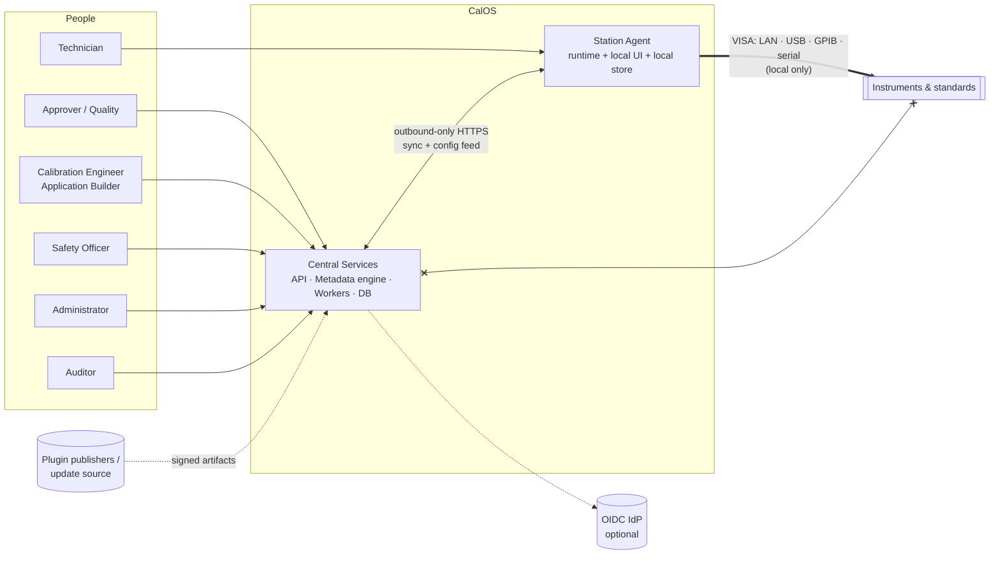
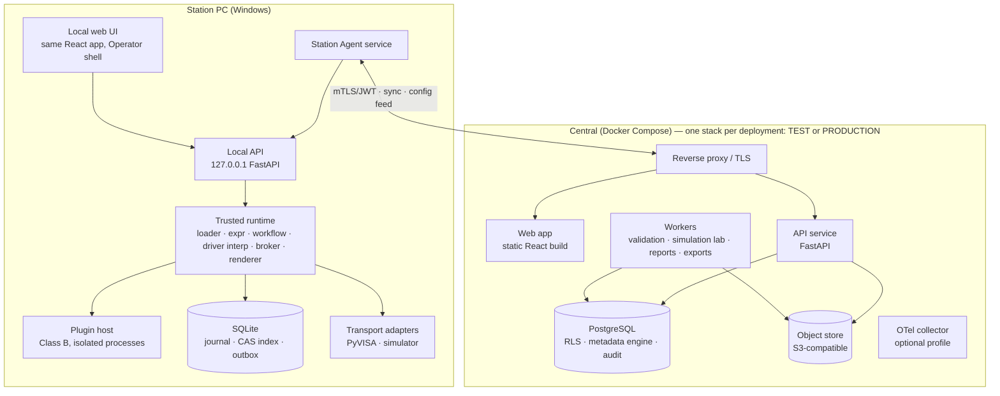
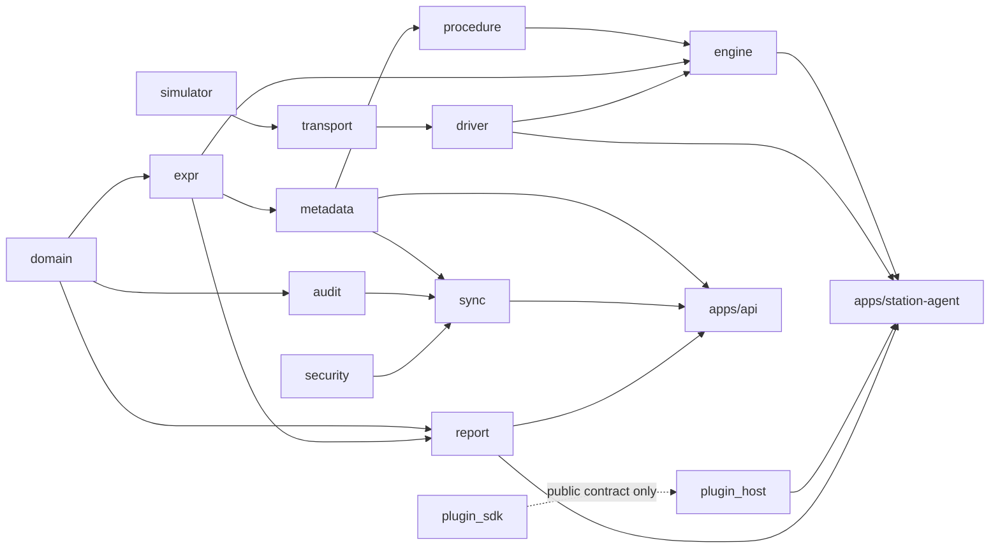
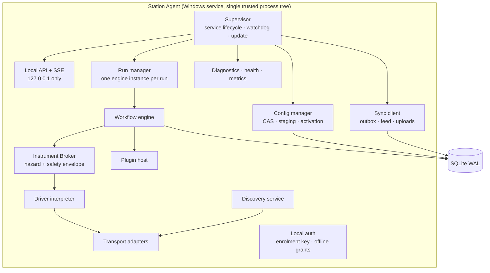
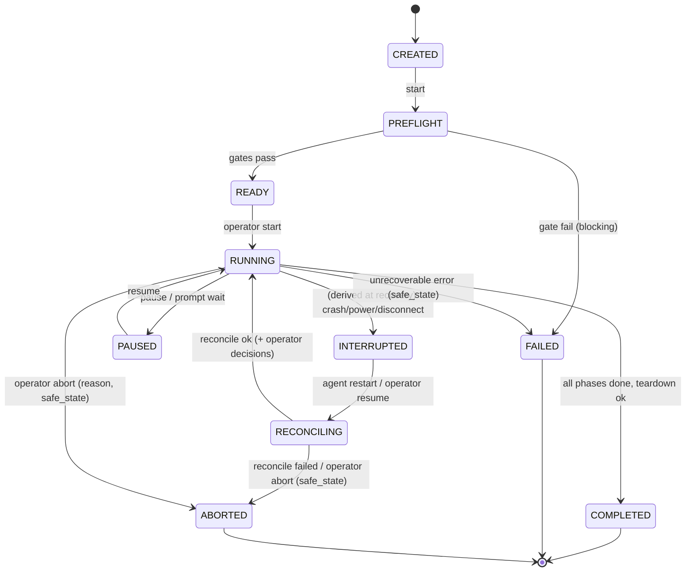
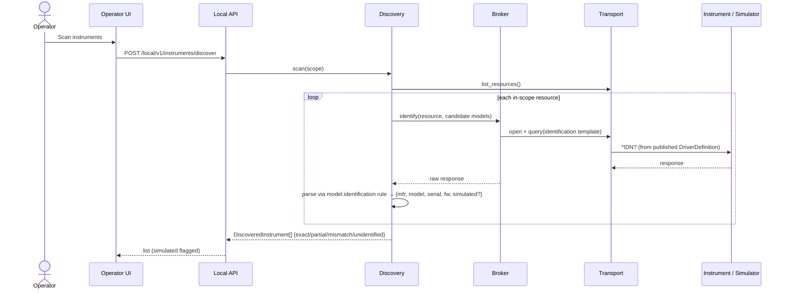
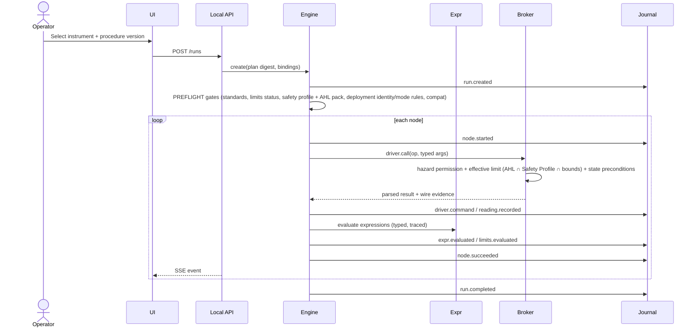
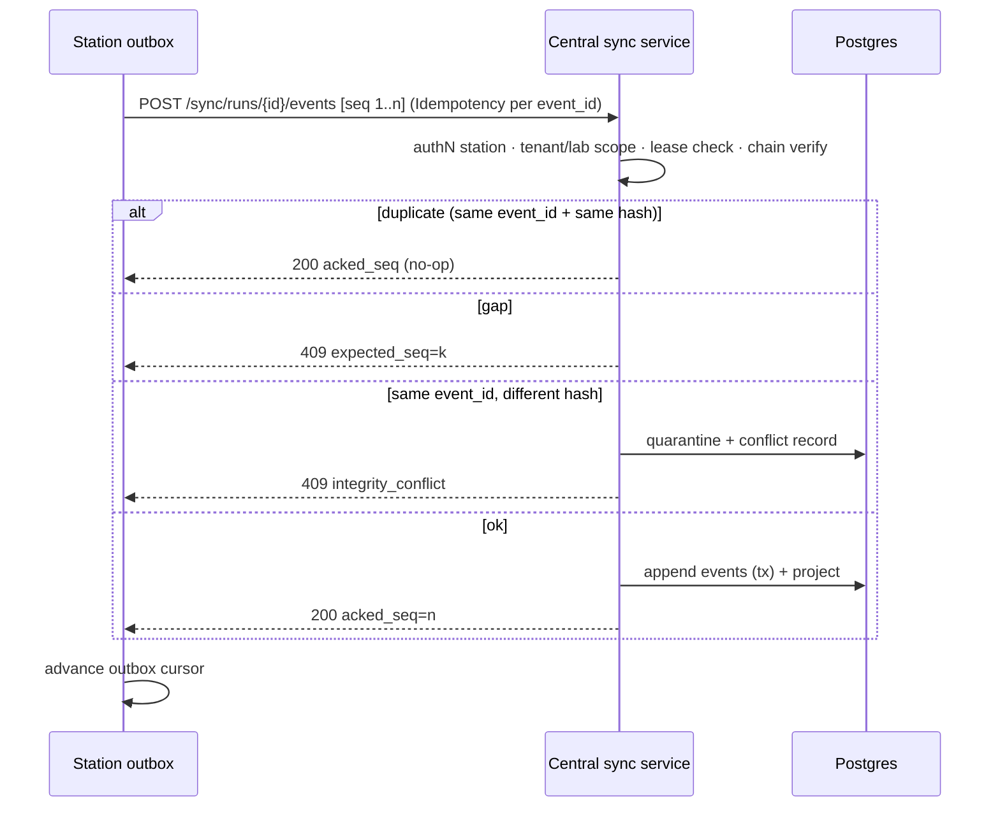
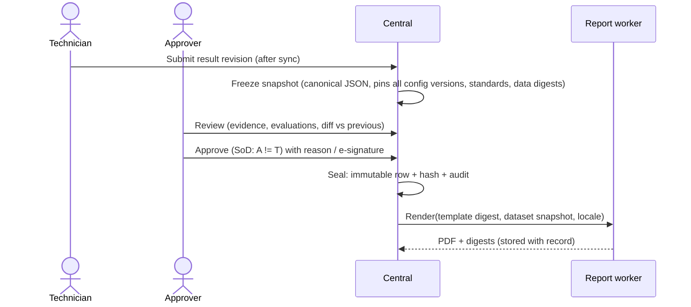
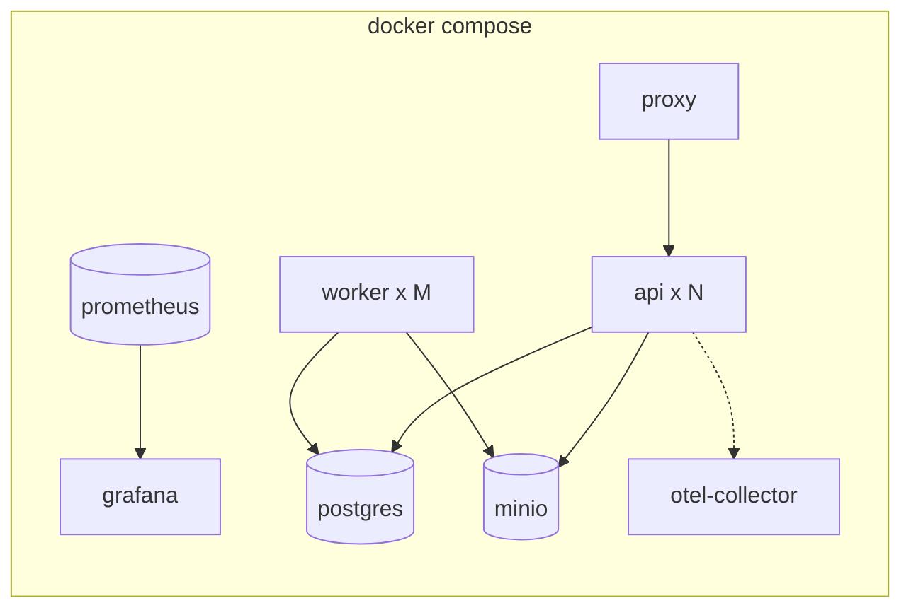

# ARCHITECTURE.md — Calibration OS

| | |
|---|---|
| Status | Draft 0.2 — rebased on the **No-Code-First** mandate |
| Read first | [NO_CODE_ARCHITECTURE](NO_CODE_ARCHITECTURE.md) (the metadata/runtime split this document builds on) |
| Related | [DOMAIN_MODEL](DOMAIN_MODEL.md) · [PROCEDURE_SCHEMA](PROCEDURE_SCHEMA.md) · [API_CONTRACT](API_CONTRACT.md) · [PLUGIN_SDK_SPEC](PLUGIN_SDK_SPEC.md) · [SECURITY_MODEL](SECURITY_MODEL.md) · [ADR index](adr/README.md) |

---

## 1. Scope and reading guide

This document defines the system structure: context, containers, modules, runtime behavior, data flows, deployment, versioning, observability and failure handling. It does not restate the metadata engine, expression language, driver runtime or designers in depth — those live in the No-Code documents and are referenced by section.

## 2. Architectural drivers (ranked)

| Rank | Driver | Consequence |
|---|---|---|
| 1 | **Integrity of metrological records** | Hash-chained journal/audit, immutable published config and approved results, pinned versions everywhere |
| 2 | **Safety of instruments and operators** | Hazard classes, Safety Profiles enforced in the broker, fail-closed, safe-state on fault |
| 3 | **No-Code First** | Metadata engine + trusted generic runtime; code only for new building blocks |
| 4 | **Bench autonomy** | Local-first station: journal, compiled config cache, local UI, offline-capable |
| 5 | **Security & tenancy** | Out-of-process plugins, signed artifacts, RLS, no cloud→instrument path |
| 6 | **Determinism & reproducibility** | Terminating languages, decimal arithmetic, pinned versions, golden tests |
| 7 | **Maintainability** | Strict module boundaries, schema-driven editors, small trusted core |
| 8 | **Scalability** | Stateless API, linear sync, Postgres-backed queue |

## 3. Baseline conformance and proposed extensions

The baseline stack is **unchanged**. Rows marked *Extension* add components that the baseline did not name; **E1–E6 were accepted by the product owner on 2026-11-01** (ADR-0022, Q-01 closed). Specific libraries are chosen in Phase 0.

| Baseline element | Status | Notes |
|---|---|---|
| React + TypeScript frontend | **Conforms** | One web app with three shells: Operator (station), Admin/Operations, Builder |
| Python + FastAPI backend | **Conforms** | Central API; station-local API is also FastAPI |
| PostgreSQL | **Conforms** | Central system of record incl. metadata engine (JSONB) and RLS |
| Windows Station Agent (Python + PyVISA) | **Conforms** | Windows service; VISA via PyVISA; `pyvisa-py` fallback |
| Independently versioned plugins | **Conforms, refined** | Two classes: A (no-code packages) and B (technical plugins) — see NO_CODE_ARCHITECTURE §3 |
| Docker for central services | **Conforms** | Compose first; **one independent stack per deployment** (Test and Production are separate deployments — ADR-0024) |
| Local offline-capable station | **Conforms** | Local store required → *Extension E1* |
| **E1** Embedded SQLite at station | *Extension* | Local journal + config CAS index. ADR-0003 |
| **E2** Postgres-backed job queue (e.g., `procrastinate`-class) | *Extension* | Report rendering, validation/simulation workers; avoids adding Redis/Broker. ADR-0022 |
| **E3** S3-compatible object store (MinIO or filesystem driver) | *Extension* | Packages, assets, evidence, rendered PDFs. ADR-0022 |
| **E4** OpenTelemetry + Prometheus-format metrics | *Extension* | Observability. ADR-0022 |
| **E5** Tooling: `uv` workspace, `pnpm` workspace, Vite, `import-linter`, `eslint-plugin-boundaries`, Alembic, SQLAlchemy 2, Pydantic v2, Playwright, Hypothesis | *Extension (tooling)* | Implementation choices within baseline languages |
| **E6** Ed25519 signing, TUF-style metadata for distribution | *Extension (security)* | ADR-0004, ADR-0021 |

## 4. System context


`CEN x--x INST` = **no path**: central never talks to instruments (SEC-P1).

**Deployments (ADR-0024).** The diagram shows *one* deployment. CalOS is installed twice: a **Test** deployment (authoring, simulation, validation) and a **Production** deployment (real calibrations). They share no infrastructure; stations are pinned to exactly one; the only cross-deployment flow is a signed **Release Package** moved by file transfer (DF-8).

## 5. Container view



## 6. Monorepo and module boundaries

```
calos/
├─ apps/
│  ├─ api/                    # FastAPI central service (composition root)
│  ├─ station-agent/          # Windows service (composition root)
│  └─ web/                    # React app: shells = operator | admin | builder
├─ packages/py/
│  ├─ calos_domain/           # Pure domain: quantities, units, metrology entities, errors. No I/O.
│  ├─ calos_expr/             # Typed expression engine (parse, typecheck, evaluate, canonical AST)
│  ├─ calos_metadata/         # Kind registry, schemas, lifecycle, deps graph, packaging, diff/merge, validators
│  ├─ calos_procedure/        # Procedure IR, compiler to ExecutionPlan, static analysis
│  ├─ calos_engine/           # Workflow engine, state machine, journal port, resume logic
│  ├─ calos_driver/           # Driver interpreter, formatters/parsers, hazard + safety checks (broker core)
│  ├─ calos_transport/        # Transport port + adapters (visa, simulator); discovery
│  ├─ calos_simulator/        # Declarative simulator engine
│  ├─ calos_report/           # Dataset contract, template model, renderer
│  ├─ calos_audit/            # Hash-chain primitives
│  ├─ calos_sync/             # Sync protocol models, client & server logic
│  ├─ calos_security/         # Signing/verification, TUF-style metadata, crypto helpers, SecretProvider port
│  ├─ calos_plugin_sdk/       # PUBLIC SDK for Class B (stable API)
│  ├─ calos_plugin_host/      # Isolation, IPC, capability enforcement (agent side)
│  └─ calos_observability/    # logging/tracing setup
├─ packages/ts/
│  ├─ api-client/             # Generated from OpenAPI
│  ├─ domain-types/           # Generated from JSON Schemas
│  ├─ editor-core/            # Document model, commands, patch, undo/redo, schema-driven inspector
│  ├─ designers/              # procedure-canvas, driver, metrology, ui-layout, report-page, i18n workspaces
│  ├─ ui-runtime/             # Renderer: component registry, binding, actions, layer resolver
│  ├─ expr-presentation/      # TS presentation-subset evaluator (conformance-tested vs Python)
│  ├─ ui-kit/                 # Design system components, tokens
│  └─ i18n/                   # ICU message handling, RTL utilities
├─ schemas/                   # JSON Schemas per kind & version — SOURCE OF TRUTH for TS types & validators
├─ catalog/                   # Building-block catalog definitions (type_id, schema, editor hints)
├─ content/                   # SHIPPED CONFIGURATION (system UI, shared command libraries, demo app package)
│  └─ apps/keysight-34401a-demo/   # exported .calapp sources — produced by the Builder, not hand-written code
├─ plugins/                   # Class B technical plugins (none required for VS-1)
├─ deploy/                    # Compose, Dockerfiles, installers (MSI), CI templates
├─ tests/                     # cross-cutting: e2e, contract, fault-injection, golden vectors
└─ docs/
```

### 6.1 Dependency rules (enforced in CI)



| Rule | Mechanism |
|---|---|
| `calos_domain` and `calos_expr` import nothing from the repo except each other/stdlib | `import-linter` forbidden-imports contract |
| `engine` depends on ports (`JournalPort`, `BrokerPort`, `ClockPort`) — never on FastAPI, SQLAlchemy, SQLite, PyVISA | import-linter + test with fake adapters |
| Runtime packages contain **no instrument/manufacturer/model strings** | grep-lint test (B-3) |
| `apps/*` are composition roots; **no app imports another app** | import-linter |
| `plugins/*` import only `calos_plugin_sdk` | import-linter |
| TS packages: `ui-runtime`, `editor-core`, `designers` do not import `api-client` directly; they use injected host ports | eslint-plugin-boundaries |
| JSON Schemas in `schemas/` generate both Pydantic models and TS types; hand-edited generated code fails CI | codegen drift check |
| New config kinds require registry entry + schema + validators + editor binding + conformance fixtures | PR checklist enforced by test that enumerates registry |

## 7. Component architecture

### 7.1 Central

| Component | Responsibility |
|---|---|
| API service | AuthN/Z, tenancy context, REST endpoints (API_CONTRACT), draft API, publish pipeline orchestration, assignment/deployment, sync endpoints, audit |
| Metadata engine (`calos_metadata` + persistence adapters) | Kinds, drafts, snapshots, versions, deps, packages, diff/merge, impact analysis |
| Validation service/workers | Publish pipeline stages; type checking; compat computation |
| Simulation Lab workers | Run engine + simulator in isolation for preview/app tests; **no VISA, no instrument network** |
| Report workers | Deterministic rendering (pinned renderer versions) |
| Sync service | Ingest journals idempotently, conflict detection, change feed |
| Signing service | Config/assignment signing via `SecretProvider`/KMS; trust roots; Test: release-signing key; Production: trusted release issuers + re-attestation key |
| Audit service | Hash-chained audit append; verification job |
| Release & change-control service | Release candidates/packages/records, trusted issuers, change requests, privileged role-grant approvals, production authoring lock (`PRODUCTION_CHANGE_CONTROL`) |
| Safety service | Hardware Limits Pack import/verification and distribution (separate signed channel), effective-limit inspection, candidate export |

### 7.2 Station Agent (see §8)

### 7.3 Web app shells

| Shell | Where it runs | Users | Content |
|---|---|---|---|
| **Operator** | Station (served by agent at `127.0.0.1`), also reachable centrally for review | Technicians | Discovery, run console, results, draft report |
| **Admin/Operations** | Central | Managers, admins, approvers, auditors | Fleet, assets, standards, runs, review queue, audit, users, deployments, governance |
| **Builder** | Central | Calibration engineers, safety officers | Designers, simulation lab, publish |

All shells render screens from **UI configuration** wherever practical (FR-UI-07); three shells are *configurations of the same runtime + registry*, not three apps.

## 8. Station Agent internals



- **Single-writer per run**: one engine instance per run, owning that run's journal stream; the supervisor enforces at most one active run per instrument resource (resource lock) and per station policy.
- **Local persistence (SQLite, WAL, `synchronous=FULL` for journal commits):** tables `run`, `journal_event`, `reading`, `evidence_ref`, `outbox_cursor`, `cas_blob`, `config_index`, `assignment_state`, `local_audit`, `offline_grant`, `kv`. Journal is the source of truth; `run`/`reading` are projections that can be rebuilt by replay.
- **Local API** (`/local/v1`): bound to loopback only; `Host`/`Origin` validation; per-session token (anti-DNS-rebinding, anti-CSRF); no listening on other interfaces; no cross-origin allowed.
- **Windows service hosting** (ADR-0012): service under a dedicated low-privilege account; recovery actions on failure; instrument access via the service identity only; installer MSI signed; interactive UI via Edge/Chrome app-mode or kiosk shortcut pointing to the local URL.
- **Deployment pinning & safety store:** the agent persists its pinned `{deployment_id, environment_kind}` and rejects metadata, tokens or configs from any other deployment. A **Hardware Limits store** (read-only ACL, separate from config CAS) holds the verified pack; the loader re-verifies at service start and at every run start; unverifiable ⇒ H2+ refused. Test agents may open only the simulator and the allow-listed test instruments; Production agents refuse `simulation`/`validation` runs.
- **Time**: events carry `wall_utc`, `monotonic_ns` (since agent start), `boot_id`; skew vs central measured at sync.
- **Plugin host**: Class B plugins spawn as child processes (Windows Job Object, restricted token, no network egress via firewall rule scoped to executable), communicating over authenticated local IPC with the broker.

## 9. Transport adapters

```python
# Port (conceptual; defined in calos_transport)
class Transport(Protocol):
    def open(self, resource: ResourceAddress, settings: TransportSettings) -> None: ...
    def write(self, data: bytes) -> None: ...
    def read(self, *, until: Terminator | int, timeout: Duration) -> bytes: ...
    def query(self, data: bytes, *, timeout: Duration) -> bytes: ...
    def clear(self) -> None: ...          # device clear
    def read_stb(self) -> int: ...
    def close(self) -> None: ...
    @property
    def info(self) -> TransportInfo: ...  # kind, simulated flag, backend
```

| Adapter | Resource examples | Notes |
|---|---|---|
| `VisaTransport` | `TCPIP0::host::inst0::INSTR`, `TCPIP0::host::port::SOCKET`, `USB0::…::INSTR`, `GPIB0::n::INSTR`, `ASRL3::INSTR` | PyVISA; backend = installed VISA else `pyvisa-py`; settings from driver connection profile (baud, parity, flow control, EOI, terminators) |
| `SimulatorTransport` | `SIM::<profile-key>::<n>` | In-process; `info.simulated = true` always |
| `SimulatorSocketTransport` | `TCPIP::127.0.0.1::<port>::SOCKET` | Optional; exercises real LAN path in tests |
| Class B transports | declared by plugin | Out-of-process |

**Discovery**: enumerate VISA resources (`list_resources`) + configured inventory + simulator registry; send **only** the identification query defined by candidate model definitions, only to in-scope resources, with short timeouts; unknown devices are listed unidentified and never sent anything else. The Instrument Broker owns the single path to transports; nothing else holds an open handle. **Per-resource mutex** prevents concurrent access from two runs.

## 10. Execution engine: build vs OpenTAP (summary)

Decision: **build a thin, metadata-interpreting engine** (`calos_engine`) behind an `ExecutionEnginePort`; evaluate OpenTAP as an optional adapter later (time-boxed spike, defined revisit triggers). Full evaluation: [ADR-0002](adr/0002-execution-engine-build-vs-opentap.md). The No-Code mandate strengthens this: the engine's value is interpreting *our* typed, bounded, versioned, resumable procedure IR with evidence and calibration semantics — which OpenTAP's plan model would need to be wrapped to provide.

## 11. Run lifecycle and journal

### 11.1 Execution state machine


Review/approval state is **separate** (`ResultRevision.review_state`, DOMAIN_MODEL).

### 11.2 Journal event envelope

```json
{
  "event_id": "uuidv7",
  "run_id": "uuidv7",
  "seq": 128,
  "type": "reading.recorded",
  "event_schema": 1,
  "occurred": { "wall_utc": "2026-11-01T10:15:30.123Z", "monotonic_ns": 123456789, "boot_id": "…" },
  "actor": { "kind": "engine|operator|system", "user_id": "…", "station_id": "…" },
  "pins": { "procedure": "sha256:…", "config_manifest": "sha256:…" },
  "payload": { },
  "prev_hash": "sha256:…",
  "hash": "sha256:…"
}
```
`hash = SHA-256(canonical_json(envelope minus hash))` chaining to `prev_hash`.

Event types (v1): `run.created`, `preflight.gate_evaluated`, `run.started`, `phase.begun`, `node.started`, `driver.command` (name, expanded args, wire text, response, duration, hazard class), `safety.violation`, `reading.recorded`, `evidence.attached`, `expr.evaluated` (for metrological expressions: trace), `limits.evaluated`, `decision.evaluated`, `operator.prompted`, `operator.responded`, `adjustment.applied`, `node.succeeded|failed|skipped|retried`, `run.paused`, `run.interrupted`, `run.reconciled`, `run.resumed`, `run.aborted`, `run.completed`, `run.finalized`, `report.draft_generated`, `sync.acked`.

### 11.3 Resume algorithm (normative summary)
1. Agent start: scan runs with last state ∈ {RUNNING, PAUSED, RECONCILING}; verify hash chain; if broken ⇒ quarantine run (FS-09).
2. Write `run.interrupted` (idempotent) with detected cause.
3. Operator selects **Resume** (or Abort). Engine enters RECONCILING: re-verify instrument identity (serial equal to run's binding), re-assert connection, read error queue, execute declared **safe_state** for sources, re-apply the last configuration of the in-flight node per its resume policy.
4. Locate deepest incomplete node. Policy: `idempotent` ⇒ re-execute; `resumable` ⇒ continue with partial data (previous attempt retained, flagged `superseded`); `non_repeatable` ⇒ require explicit operator decision (`confirm_done | redo | abort`), with evidence, journaled.
5. Emit `run.resumed`; continue.

## 12. Data flows

### DF-1 Authoring → publish → deploy → install
See [NO_CODE_ARCHITECTURE §16](NO_CODE_ARCHITECTURE.md#16-offline-distribution-and-synchronization-of-configuration) and [CONFIGURATION_GOVERNANCE](CONFIGURATION_GOVERNANCE.md).

### DF-2 Discovery and identity verification



### DF-3 Run execution



### DF-4 Interruption and resume — see §11.3. Sequence: kill → restart → `run.interrupted` → UI prompt → reconcile → resume.

### DF-5 Sync (upstream)



### DF-6 Review, approval, report


### DF-7 Class B plugin install/update — see [PLUGIN_SDK_SPEC §9](PLUGIN_SDK_SPEC.md).

### DF-8 Release: Test → Production (separate deployments)

```mermaid
sequenceDiagram
  actor Eng as Calibration Engineer / LSMA (Test)
  participant T as TEST deployment
  actor RM as Release Manager
  participant FS as File transfer (out of band)
  participant P as PRODUCTION deployment
  actor AP as Production approvers (QM · Safety Officer · Metrology)
  Eng->>T: Publish package (draft→review→approve→publish)
  RM->>T: Create Release Candidate + evidence
  T->>T: Test approvals (digest-bound, SoD)
  RM->>T: Export signed Release Package (Test release key)
  T-->>FS: package + checksum
  FS-->>P: package (no standing connection)
  RM->>P: Import → verify issuer ∈ Trusted Release Issuers, signature, digests, schema, compat
  P->>P: Production-mode validation (no synthetic/simulated, AHL coverage, $input resolved)
  AP->>P: Independent approvals (importer ≠ approver; Safety Officer (+QM) for safety content)
  P->>P: Release → versions (origin=release, identical digests) → re-attest
  RM->>P: Assign canary → sign-off → stable
```

## 13. Central deployment topology


Profiles: `core` (proxy, api, worker, postgres, object store), `observability`, `all-in-one` (adds a local station for single-bench customers).

**Two deployments.** Phase 0/MVP runs two isolated Compose projects on development infrastructure — `calos-test` and `calos-prod` (a *rehearsal* Production) — with distinct project names, networks, volumes, secrets, ports/hostnames, signing keys and station enrolments; a CI **isolation test** asserts nothing is shared and that cross-deployment artifacts are rejected. The Production profile sets `deployment_role=production`, which disables the Builder/authoring surface at the API layer. **Operational Production deployment requires separately secured infrastructure** (hardened hosts and network, managed secrets/KMS, backups, monitoring) — a gate defined in the roadmap. Secrets via Docker secrets / `SecretProvider`. Migrations run as a separate one-shot job under a DB role with DDL rights; the app role has no DDL and no UPDATE/DELETE on immutable tables.

## 14. Persistence strategy

| Concern | Store | Notes |
|---|---|---|
| Configuration (drafts, versions, packages) | Postgres JSONB | Immutable versions; digests; RLS |
| Run data (journal, readings, evidence refs) | Postgres (`run_event` append-only partitioned by month) + object store | Mirror of station journal |
| Approved results | Postgres immutable tables + sealed snapshot blob | |
| Audit | Postgres append-only hash-chained | |
| Reports, packages, assets | Object store; metadata in Postgres | |
| Station | SQLite + CAS directory | Disposable caches vs authoritative journal clearly separated |

## 15. Versioning strategy

Independent axes, each with explicit compatibility rules. **Nothing is "latest" at runtime: every run, report and approved result pins the exact versions/digests of every axis it touched.**

| Axis | Scheme | Compatibility rule |
|---|---|---|
| Platform release (central) | SemVer | Release notes list all axis changes |
| Public REST API | URL major `/api/v1`; additive-only within major; `Deprecation`/`Sunset` headers | Breaking ⇒ new major; N and N-1 served ≥ policy window |
| Local agent API | `/local/v1` | Bundled UI and agent ship together; versions checked at UI boot |
| Sync protocol | Integer `sync_protocol` with negotiation | Central supports current + previous |
| Agent | SemVer | Central supports window (proposal: current + 2 previous minors) |
| Config kind schema | Integer `schema_version` per kind | Runtime supports N and N-1; migrations produce new drafts |
| Config item content | SemVer + digest, **change-class rules** | patch=editorial, minor=compatible functional, major=breaking/metrological change |
| Building block (catalog) | `major.minor` per `type_id` | Additive minors; package `requires` minimum minors |
| Expression language & function library | `expr_lang major.minor`; each function has own version/status | Evaluation records language + function versions |
| Application package | SemVer + manifest digest | Closure pinned |
| Class B plugin | SemVer; declares `sdk_api` range and `provides` | Compatibility engine |
| Plugin SDK | `sdk_api major.minor` | Additive minors |
| Report dataset contract | `major.minor` | Templates declare supported majors |
| Report renderer | SemVer, retained | Approved reports pin renderer version |
| Hardware Limits Pack | `pack_version` (monotonic) + schema version; signed on `hardware-limits` role; expiry | Loader rejects older/expired/unsigned; runs pin the digest |
| Release Package / manifest | `release_manifest_version`; package SemVer + digest | Production supports current and previous manifest versions |
| Deployment protocol (identity checks) | `deployment_protocol` integer in `hello`/manifests | Mismatch ⇒ `DEPLOYMENT_MISMATCH` |
| Central DB schema | Alembic revisions; expand→migrate→contract | Rolling-upgrade safe |
| Station DB schema | `PRAGMA user_version`, forward-only, pre-migration backup | Agent refuses unknown newer version |
| Journal event schema | per-type `event_schema` with upcasters | Old events replayable forever |
| Docs/ADRs | Date + status | |

**Change-class enforcement:** the structural diff proposes the minimum SemVer bump; authors may bump higher, never lower. Any change touching test points, limits, formulas, units, decision rules, or hazard-class commands is at least **minor** and requires the metrological/safety approval path.

## 16. Observability

| Pillar | Design |
|---|---|
| Logs | JSON (structlog), fields: `ts, level, msg, service, version, tenant_id, lab_id, station_id, run_id, node_id, trace_id, span_id, user_id (opaque)`; secrets/PII redaction processor; separate from **audit** (which is a record, not a log) |
| Metrics | Prometheus format: run counts/durations, journal commit latency, instrument command latency/error rates by driver, sync lag (events, seconds), outbox depth, config activation status, plugin crashes, validation pipeline times, API RED metrics |
| Traces | OpenTelemetry: API → worker; station: run → node → driver.call spans; trace context propagated in sync batches (`traceparent`) |
| Diagnostics | Station "Diagnostics bundle": versions, active config manifest, redacted logs, journal integrity report, transport inventory, last N wire logs (opt-in), clock skew; produced locally, uploaded on request |
| Health | `/healthz` (liveness), `/readyz` (deps), station `/local/v1/status` |
| Run reconstruction | Given `run_id`, join journal + logs + traces (NFR-13) |

## 17. Failure scenarios

| ID | Scenario | Detection | System behavior | Recovery / evidence | Test |
|---|---|---|---|---|---|
| FS-01 | Instrument disconnect mid-acquisition | Transport error/timeout | Node fails per `on_error`; sources → safe_state; run PAUSED | Reconnect, reconcile, retry per resume policy; attempt retained | Simulator fault injection |
| FS-02 | Agent crash / `kill -9` / power loss | Restart scan finds RUNNING run | `run.interrupted`; no auto-continue | Operator Resume → reconcile | Kill at every journal boundary |
| FS-03 | Wrong instrument connected on resume | Serial/identity ≠ run binding | Block; offer abort | Audit entry | Sim identity swap |
| FS-04 | Reference standard becomes overdue/withdrawn during run | Assignment/standards feed or gate re-check at phase boundary | Per policy: warn/block at next gate | Supervisor decision recorded | Config-feed test |
| FS-05 | SCPI error queue non-empty after command | Driver `error_handling` | Treated per severity map; evidence stored | Retry/escalate/fail | Sim fault |
| FS-06 | Safety envelope violation requested | Broker check | **Fail closed**, `safety.violation`, safe_state | Review config; no override path | Negative tests |
| FS-07 | Plugin (Class B) crash/hang | Heartbeat/timeouts | Kill process; node fails; agent unaffected | Run PAUSED; plugin flagged | Chaos test |
| FS-08 | Config bundle fails verification | Signature/digest mismatch | Reject; keep current active; alert | Re-fetch; security alert | Tamper tests |
| FS-09 | Journal hash-chain break / SQLite corruption | Startup verification, integrity check | Quarantine run/db; copy to `quarantine/`; **never auto-repair** | Restore from backup; re-sync from central for synced portion; unsynced tail loss declared and flagged | Corruption tests |
| FS-10 | Duplicate sync batch / retry storm | event_id+hash idempotency | No-op ack | — | Replay tests |
| FS-11 | Out-of-order / gapped batch | seq check | 409 expected_seq | Station resends | Property tests |
| FS-12 | Two stations resume same run | Lease/epoch check | Second rejected; conflict record | Supervisor resolves, nothing dropped | Multi-agent test |
| FS-13 | Run used a version later withdrawn | Withdrawal feed | Run flagged `needs_review`; not invalidated | Quality workflow | Feed test |
| FS-14 | Clock jump/skew | Monotonic vs wall delta; sync skew | Flag events; do not rewrite times | Review flag | Clock tests |
| FS-15 | Disk full on station | Pre-checks, write errors | Pause run; refuse start; alert | Free space; resume | Disk quota test |
| FS-16 | Central DB outage | Health/timeouts | Stations unaffected; API 503 | Backlog sync later | Chaos |
| FS-17 | Partial evidence upload | Digest mismatch / chunk state | Resume upload; reference not committed until verified | — | Upload fault tests |
| FS-18 | Report render failure | Worker error | Job retried; draft remains available as data | Alert; fix template via new version | Render fault tests |
| FS-19 | Update fails (agent/plugin/config) | Health check after swap | Automatic rollback to previous | Alert | Update tests |
| FS-20 | Builder concurrent edit collision | Revision mismatch | 409 with merge options | No lost edits | Concurrency tests |
| FS-21 | Valid-but-wrong config published | Detected by test vectors/scenarios/review | Prevented earlier; if found later: withdraw version, flag affected runs | Impact analysis lists runs/results | Mutation tests on config validators |
| FS-22 | Expression eval budget exceeded / eval error | Engine | Node failure with typed error | Fix config | Fuzz |
| FS-23 | VISA backend missing on station | Capability report | Station marked incompatible for real-transport apps; simulator still available | IT installs backend | Compat tests |
| FS-24 | Operator abandons run | Idle timeout policy | PAUSED → supervised abort path, safe_state | Audit | UI test |
| FS-25 | Tenant isolation bug | RLS + generated tests | Query returns zero rows / denies | Security incident process | Table-wide RLS tests |
| FS-26 | Release Package tampered or from untrusted issuer | Signature/issuer/digest verification at import | Rejected; no versions created; alert | Re-export from Test; review issuer list | Release tamper tests |
| FS-27 | Test station enrolled/pointed at Production (or reverse) | Deployment identity mismatch at enrolment/hello/manifest | Rejected (`DEPLOYMENT_MISMATCH`); agent keeps current state | Re-enrol correct station; audit | Cross-deployment probes |
| FS-28 | Hardware Limits Pack missing/expired/invalid on a station | Loader verification at start and run start | H2+ refused (fail closed); H0/H1 continue; alert | Import valid pack through safety channel | Pack tamper/expiry tests |
| FS-29 | Pinned Safety Profile withdrawn while run in flight | Withdrawal feed / node-boundary check | Run halts at next boundary → safe_state; cannot resume under profile | Supervisor + Safety Officer decision; new run under replacement | Withdrawal-during-run test |
| FS-30 | Approver unavailable (dual control cannot complete) | Pending approvals aging | Release/safety change waits; emergency withdrawal/rollback still possible | Deputies per MI-34; no bypass | Workflow tests |
| FS-31 | Attempted direct edit of production configuration | Authoring lock, DB grants/triggers | `PRODUCTION_CHANGE_CONTROL`; audited | Use Release / Change Request | Production lock tests |

## 18. Architecture-level acceptance criteria

| ID | Criterion |
|---|---|
| AC-ARCH-01 | Import-linter and eslint-boundaries contracts exist and pass; deliberate violations fail CI. |
| AC-ARCH-02 | Runtime packages contain no instrument/manufacturer/model string (lint test). |
| AC-ARCH-03 | Engine unit tests run with only fake ports (no DB, no VISA, no network). |
| AC-ARCH-04 | No code path from central services to a transport adapter exists (static import check + network policy test). |
| AC-ARCH-05 | Replaying a run's journal into an empty projection reproduces identical projections (byte-equal canonical dump). |
| AC-ARCH-06 | All FS-xx scenarios have automated tests or documented manual drills referenced from the test plan. |
| AC-ARCH-07 | Every versioning axis in §15 has a compatibility test (N/N-1) in CI. |
| AC-ARCH-08 | The Test and Production Compose projects share no network, volume, secret, port or key (isolation test passes); deliberate sharing fails CI. |
| AC-ARCH-09 | The Hardware Limits Pack store is not writable by any application component (static + runtime ACL test), and no code path computes an effective limit larger than the AHL. |
