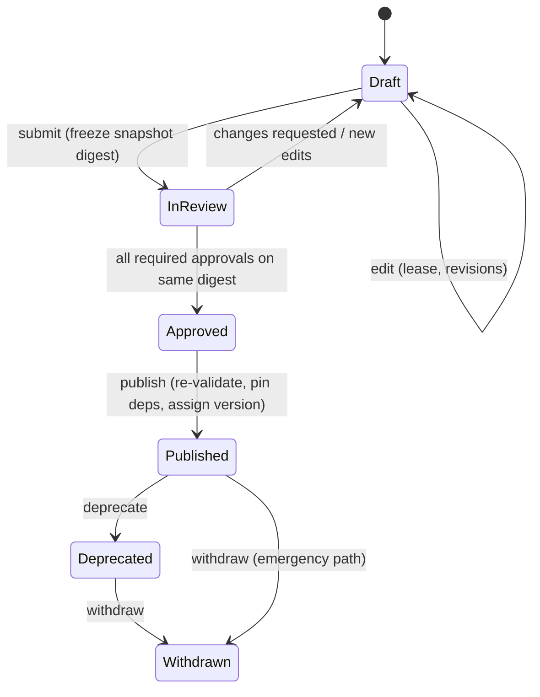

# CONFIGURATION_GOVERNANCE.md

| | |
|---|---|
| Status | Draft 0.2 — Q-13/Q-14 resolved (ADR-0023 safety ownership; ADR-0024 separate Test/Production deployments) |
| Scope | How configuration (instruments, drivers, procedures, metrology, UI, reports, translations, policies, safety profiles) is created, reviewed, approved, published, deployed, rolled back, promoted, backed up and retired |
| Related | [NO_CODE_ARCHITECTURE §4, §14–16](NO_CODE_ARCHITECTURE.md) · [API_CONTRACT §2.3](API_CONTRACT.md) · [SECURITY_MODEL](SECURITY_MODEL.md) |

> Approval matrices and thresholds below are **defaults ("strictest wins")** pending MI-30 (the lab's own approval matrix). They are configurable as `Policy` items — but a policy change is itself governed configuration.

## 1. Principles

1. **Published = immutable.** Content never changes after publication; new versions are created.
2. **Approve what you reviewed.** Approvals bind to a content digest, not to a name.
3. **Separate duties.** Author, approver and deployer are different people for controlled kinds.
4. **Publish ≠ deploy.** Publishing creates a version; deployment assigns it to places. Rollback is re-assignment.
5. **Nothing silent.** Every transition is audited with actor, reason, and diff.
6. **Pin everything.** Runs and results carry exact versions and digests; later changes never alter history.
7. **Safety is governed apart.** Safety Profiles have their own permission, approval chain and signing context.

## 2. Roles and permissions

### 2.1 Permission catalog (configuration domain)

| Permission | Allows |
|---|---|
| `config.view` | View items, versions, diffs, dependencies |
| `config.draft.<group>` | Create/edit drafts in kind group (`instrument`, `driver`, `procedure`, `metrology`, `ui`, `report`, `i18n`, `policy`) |
| `config.submit` | Submit draft for review |
| `config.review` | Comment/review (no decision) |
| `config.approve.<group>` | Approve/reject in group |
| `config.publish` | Publish approved snapshot |
| `config.deprecate` / `config.withdraw` | Lifecycle transitions |
| `config.lease.takeover` | Take over another user's draft lease |
| `driver.author` | Author H0/H1 commands |
| `driver.author.hazardous` | Author H2/H3 commands |
| `driver.author.system` | Author H4 commands (rare) |
| `driver.test` / `driver.test.hazardous` | Communication test H0 / hazardous |
| `safety.manage` | Create/maintain Safety Profiles (LSMA) |
| `safety.approve` | Approve safety-critical changes (Safety Officer / Technical Authority) |
| `safety.approve.compliance` | Additional approval of metrological/compliance-affecting safety changes (Quality Manager) |
| `safety.withdraw` | Withdraw a Safety Profile (fail-safe direction) |
| `hardware_limits.candidate` / `hardware_limits.sign` | Author a Hardware Limits Pack candidate / take part in the offline threshold signature (custody, not a runtime permission) |
| `metrology.edit` / `metrology.approve` | Edit / approve metrology kinds |
| `package.build` / `package.export` / `package.import` | Package operations |
| `deploy.view` / `deploy.assign` / `deploy.rollback` | Deployment operations |
| `release.create` / `release.export` | Create Release Candidates / export signed Release Packages (Test deployment) |
| `release.approve.test` / `release.approve.prod` | Approve a release in Test / in Production (independent) |
| `release.import` | Import a Release Package into Production (importer ≠ approver) |
| `change.request` / `change.approve` | Raise / approve production Change Requests |
| `trust.issuer.propose` / `trust.issuer.approve` | Propose / approve Trusted Release Issuers (dual control) |
| `grant.propose` / `grant.approve` | Propose / approve privileged role grants (dual control) |
| `backup.manage` | Backups/restore |
| `policy.edit` | Policies |

### 2.2 Default role bundles

| Role | Permissions (default) |
|---|---|
| **Calibration Engineer (Builder)** | `config.view`, `config.draft.{instrument,driver,procedure,metrology,ui,report,i18n}`, `config.submit`, `driver.author`, `driver.test`, `package.build`, `package.export` — **Test deployment only**; in a Production deployment the bundle is execution-only (`run.execute`) |
| **Metrology Approver** | `config.view`, `config.review`, `config.approve.{procedure,metrology,instrument}`, `metrology.approve` |
| **Quality Manager** | `config.view`, `config.review`, `config.approve.{report,i18n,policy}`, `config.publish`, `config.deprecate`, `config.withdraw`, `deploy.view`, `policy.edit` |
| **Lab Safety / Metrology Administrator (LSMA)** | `config.view`, `safety.manage`, `hardware_limits.candidate`, `config.submit` — creates and maintains Safety Profiles; **no approval rights** |
| **Safety Officer / Technical Authority** | `config.view`, `safety.approve`, `safety.withdraw`, `config.approve.driver` (hazard review), `release.approve.{test,prod}` (safety-class), `trust.issuer.approve`, `grant.approve` (safety roles), `driver.test.hazardous`, `hardware_limits.sign` — **no authoring of the same change** |
| **Deployment Manager** | `config.view`, `deploy.*` (assign, rollback), `package.import` (Test), `release.import` (Production; may not approve what they import) |
| **Release Manager** | `release.create`, `release.export` (Test); `release.import` (Production); `deploy.assign` to `stable` (with sign-off) |
| **Platform Admin** | tenancy/user/role/station administration, infrastructure, `grant.propose`, `trust.issuer.propose`; **never** `safety.*`, `config.approve.*`, `release.approve.*`, `result.approve` (toxic-combination validator) |
| **Auditor** | read-only config, audit, impact; no drafts |

(Persons may hold several roles; SoD rules in §5 still apply per change.)

## 3. Lifecycle and what each state permits

| State | Editable | Usable by new runs | Deployable | Visible in palette |
|---|---|---|---|---|
| Draft | yes (leased) | no (Simulation Lab only) | no | author only |
| In Review | no (frozen) | no | no | reviewers |
| Approved | no | no | no | — |
| Published | no | yes | yes | yes |
| Deprecated | no | existing assignments yes; new assignments blocked | no new | warning badge |
| Withdrawn | no | **blocked for new runs**; history intact | no | hidden (searchable) |

## 4. Change classes and approval matrix (defaults)

Computed by structural diff against the parent version; authors may raise the class, never lower it.

| Change class | Examples | Min. SemVer bump | Approvals required |
|---|---|---|---|
| **Editorial** | Text, translations, notes, layout `presentation` | patch | 1 reviewer (`config.approve.<group>`) |
| **Functional** | New optional step, UI field, new report section, driver op added (H0/H1) | minor | 1 domain approver + 1 independent reviewer |
| **Metrological** | Test points, limits, formulas, units, corrections, budgets, decision rules, rounding, As Found/As Left logic | minor/major | `metrology.approve` (not the author) + independent review; test vectors must pass |
| **Safety / hazardous** | Any H2+ command, any change in Safety Profile, interlocks, safe_state, adjustment steps | minor/major | LSMA authors → **Safety Officer** approves (`safety.approve`, ≠ author); **+ Quality Manager** (`safety.approve.compliance`) when classified metrological/compliance-affecting; + `metrology.approve` if procedural; lab policy may add a second Safety Officer. Re-approved independently in Production on release |
| **Breaking** | Removing/renaming parameters, outputs, ops, dataset fields; schema migration | major | as above + impact analysis sign-off |

A single change set is classified by its **highest** class.

## 5. Separation of duties (defaults)

| Rule | Enforcement |
|---|---|
| Author cannot approve own snapshot (any group) | `SEPARATION_OF_DUTIES` |
| Safety Profile changes need a Safety Officer approval (≠ author) and, when compliance-affecting, a Quality Manager approval (ADR-0023); lab policy may add approvers | `SEPARATION_OF_DUTIES` |
| Publisher may be the approver only for editorial changes (policy) | |
| Production assignment requires a user without authoring edits in that version | |
| Break-glass is limited to the **fail-safe direction** (withdrawal, rollback by re-assignment) and allowed to the Quality Manager or Safety Officer alone; auto-flags for post-hoc review within policy window. There is **no** break-glass for loosening safety limits or skipping approvals | audit flag `break_glass` |
| Safety Profile author (LSMA) ≠ Safety Officer approver ≠ any contributor to the draft | `SEPARATION_OF_DUTIES` |
| Platform Administrators hold no approval authority; role assignments that combine them are rejected | `ROLE_CONFLICT` |
| Privileged role grants (safety/approval roles) need approval by a Safety Officer (or Quality Manager for compliance roles) who is neither grantor nor grantee | dual control |
| Release importer ≠ Production approver; Production approval is independent of Test approval | `SEPARATION_OF_DUTIES` |

## 6. Validation before publish
Publish re-runs the full pipeline (NO_CODE_ARCHITECTURE §14) against *pinned* dependencies; a failure blocks publish even if review already passed (dependencies may have changed state). Findings are archived with the version (`validation_report_digest`).

## 7. Versioning rules
- SemVer assigned at publish: `max(computed minimum, author choice)`.
- A `major` bump on a shared component (sub-procedure, command library, calculation) does not affect dependents until they upgrade; dependents show an "upgrade available" indicator with impact preview.
- Version identity = `(kind, key, version)` **and** `content_digest`; reusing a version number is impossible.
- Pre-release labels (`1.2.0-rc.1`) allowed in Test deployments only; they cannot be released to Production.

## 8. Impact analysis
For any version (and for any proposed deprecate/withdraw/upgrade) the system shows:

| Section | Content |
|---|---|
| Dependents | Items/versions that pin it (transitive) |
| Packages | Application packages containing it |
| Assignments | Labs/stations/channels where active, staged, or pending |
| Stations | Compatibility and activation state |
| Runs | In-flight runs pinned to it (blocks withdrawal unless break-glass) |
| Approved results | Count and list of snapshots referencing it (informational; never altered) |
| Test impact | Result of re-running dependents' `ApplicationTest`s against the proposed version (before publish) |
| Metrology diff | For metrological changes: what-if comparison of outputs on archived test vectors/representative datasets (explicitly labelled what-if) |

Rules: withdrawal with in-flight runs requires break-glass; deprecation is always allowed; upgrade of a dependency inside a dependent is a normal draft→publish of the dependent.

## 9. Test and Production deployments, release management and change control (ADR-0024)

**Test and Production are separate deployments.** They share no database, credentials, secrets, signing keys, agents, queues, object stores, audit records or trust roots. Each deployment's identity `{deployment_id, environment_kind}` is immutable and checked on every token, manifest and package.

### 9.1 What each deployment permits

| | Test deployment | Production deployment |
|---|---|---|
| Purpose | Simulations, draft applications, Safety Profile and Hardware-Limits-candidate authoring, validation workflows | Real calibrations and regulated records |
| Authoring (drafts, Builder, Safety Console editing) | Yes (per permissions) | **No** — all draft/edit routes disabled (`PRODUCTION_CHANGE_CONTROL`) |
| Content allowed | Drafts, pre-release labels, `synthetic_demo`, `simulated` profiles | Only released versions: approved, signed, validated; no `synthetic_demo`, no `simulated`, no unresolved `$input` |
| Run modes | `simulation`, `validation` (allow-listed test instruments only; never approvable) | `production` |
| Stations | Test only (pinned) | Production only (pinned) |
| Data | Test data only | Production data only; never copied to Test |
| Allowed configuration operations | All authoring + approvals + Release Candidate creation/export | Release import/verification/approval, assignment/canary/rollback, withdrawal, Change Requests, access administration |

### 9.2 Release workflow (explicit approval and promotion)

| Stage | Where | Actions | Approvals / checks |
|---|---|---|---|
| 1. **Candidate** | Test | Select a *published* package version; attach validation evidence (validation report, application-test results, impact analysis, change class, simulation/hardware validation records) | Readiness checklist green (no blocking findings; production-targeted checks run in advance) |
| 2. **Test approval** | Test | Review and approve on digest | Quality Manager; Metrology approver for metrological content; Safety Officer (+QM) if Safety Profiles or hazardous ops are included; SoD |
| 3. **Export** | Test | Build signed **Release Package** (`.calapp` + `release_manifest.json` + evidence) with the Test release-signing key | Release Manager; audited |
| 4. **Transfer** | Out of band | File transfer (no standing link between deployments) | Checksums displayed for operator confirmation |
| 5. **Import & verify** | Production | Verify issuer ∈ Trusted Release Issuers, signature, digests, schema versions, compatibility; state `imported` | Importer recorded |
| 6. **Production validation** | Production | Re-run pipeline in production mode (PR-013/014/016/023 + `intended_modes` contains production + AHL coverage for every H2+ op + no simulated content) | Automatic; blocking |
| 7. **Production approval** | Production | Independent approvals on the imported digest (same rules as stage 2; **Safety Profiles require Safety Officer (+QM) approval again**) | Importer ≠ approver; Test approvals do not carry over |
| 8. **Release** | Production | Versions created with `origin = release(<test deployment id>, digest)`, identical content digests; Production re-attests with its own signing key | Release Manager |
| 9. **Assign** | Production | Canary station → recorded sign-off → `stable` | Deployment Manager + sign-off |

Properties: identical digests prove identical content; **no stage can be skipped**; hot fixes follow the same stages with expedited approvals permitted by policy; rejection at any stage returns the candidate to Test with findings.

### 9.3 Trusted Release Issuers
Production holds the public release-signing keys of the Test deployment(s) it trusts. Adding, rotating or removing an issuer is a trust-root change: **Platform Admin proposes; Quality Manager and Safety Officer approve** (`trust.issuer.propose` / `trust.issuer.approve`); audited; alerts on change.

### 9.4 Production change control
- No direct configuration edits in Production. Non-content settings (lab policies, staleness thresholds, issuer lists, SoD parameters) change through **Change Requests**: raise → impact summary → approvals per the approval matrix (Quality Manager; Safety Officer for safety-relevant) → apply (audited, versioned, rollback-able). Emergency actions are limited to withdrawal and rollback by re-assignment (fail-safe direction).
- Access administration (users, roles, stations) remains with the Platform Administrator but cannot grant approval authority without dual control (§5).

### 9.5 Environment drift and monitoring
Dashboard compares Test vs Production released digests ("what is in Production but not in Test", "what is approved in Test but not released"), flags divergence, shows pending releases and age. Training of Builders uses Test only.

### 9.6 Phase 0 / MVP deployment topology and production gate
Two isolated Docker Compose projects on development infrastructure (`calos-test`, `calos-prod` rehearsal) with an automated isolation test; separately secured infrastructure (hardened hosts and network, managed secrets/KMS, backup, monitoring) is a **gate before operational use**.

## 10. Deployment, canary and rollback

1. **Assign** a package version to a target (lab/group/station) on channel `canary` or `stable` with an activation policy (`when_idle`, `at_window`, `manual`).
2. Stations pull, verify, stage, report; the console shows per-station state (pending/staged/active/failed with reason).
3. **Canary**: assign to one designated station; require recorded sign-off (who, evidence run IDs) before assigning `stable`.
4. **Rollback**: choose an earlier **approved, non-withdrawn** version → creates a new assignment event; stations stage & activate it; in-flight runs finish on their pinned versions; audit records reason. Rollback to a withdrawn version is refused.
5. Station-local rollback: if activation fails health checks, station reverts to previous bundle automatically and reports.

## 11. Dependency tracking
- Edges recorded at publish (DAG enforced).
- Graph views: "what does X need / what needs X"; export (JSON/GraphML).
- Unpublished or withdrawn dependency ⇒ publish blocked (`DEPENDENCY_UNPUBLISHED`).
- Orphan detection report for unused versions (informational; never auto-delete).

## 12. Audit history
Each configuration event: `draft.created|edited(rev)|forked|merged|submitted|reviewed|approved|rejected|published|deprecated|withdrawn|assigned|rolled_back|promoted|imported|exported|backup.created|restored`, with actor, reason, before/after digests, correlation. The UI offers: timeline, per-version diff, "who changed this field and when" (blame), and signed export (hash chain proof).

## 13. Backups and disaster recovery
| Item | Rule |
|---|---|
| Scope | All config items/versions/packages/assignments/approvals/audit (DB), blob assets |
| Cadence | Scheduled (policy) + before every schema migration + on demand; each backup is a **signed, content-addressed snapshot** |
| Verification | Automated periodic **restore test** into an isolated environment; digest comparison |
| Restore | Governed action (`backup.manage` + second approver); restores into a fresh environment by default; in-place restore only by break-glass |
| Retention | Per policy (Q-04) |
| Config as files | Optional export of all published versions as a directory of canonical JSON for external VCS/archive |

## 14. Import/export rules
- `.calapp` export includes full closure + manifest + signature; no secrets, no personal data, no run data.
- Import never overwrites: identical digest ⇒ dedupe; same `(kind,key,version)` with different digest ⇒ `VERSION_IMMUTABLE` rejection.
- Import of unsigned or untrusted-signer packages requires explicit trust decision (CFG·GOV) and lands in a Test deployment only (Production accepts Release Packages from Trusted Release Issuers only).

## 15. Emergency procedures
| Situation | Action |
|---|---|
| Faulty published procedure discovered | Withdraw (break-glass allowed) → assignments blocked for new runs → impact analysis lists affected runs/results → quality workflow → corrected version published through normal path |
| Compromised signing key | Revoke in signed metadata → stations stop activating → re-sign with new key per runbook |
| Unsafe Safety Profile discovered | Withdraw profile → dependents' H2+ ops become unrunnable (fail closed) → re-approve corrected profile |

## 16. Reports and indicators (governance dashboard)
Items awaiting review (age), approvals by role, publish frequency, rollback count, withdrawn versions, stations on non-current versions, drift (stations active ≠ assigned), `synthetic_demo` content in production assignments (must be 0), validation failure trends.

## 17. Acceptance criteria

| ID | Criterion |
|---|---|
| AC-GOV-01 | A published version cannot be modified via any API or direct SQL as the application role; attempts fail and are audited. |
| AC-GOV-02 | Approval on digest X cannot be used to publish digest Y. |
| AC-GOV-03 | Author-self-approval attempts fail for all controlled groups; Safety Profile changes require Safety Officer approval (≠ author) plus Quality Manager approval when classified metrological/compliance-affecting. |
| AC-GOV-04 | Rollback to version N-1 results in all targeted stations activating N-1 while in-flight runs finish on N; result snapshots remain unchanged. |
| AC-GOV-05 | Impact analysis for a shared sub-procedure lists all dependent procedures, packages, assignments, stations, in-flight runs and approved results (verified on a seeded graph). |
| AC-GOV-06 | A Release Package promoted Test→Production (separate deployments) has identical content digests, requires independent Production approvals, and is rejected if it contains `synthetic_demo`, `simulated` safety profiles, unresolved `$input`, or comes from an untrusted issuer. |
| AC-GOV-07 | Restoring a backup into a clean environment reproduces identical digests for all versions and a verifying audit chain. |
| AC-GOV-08 | Break-glass withdrawal works with a single authorized user, is flagged, and appears in the post-review queue. |
| AC-GOV-09 | Concurrent editors: second editor cannot save without lease; stale saves receive 409 with merge options; no edit is lost. |
