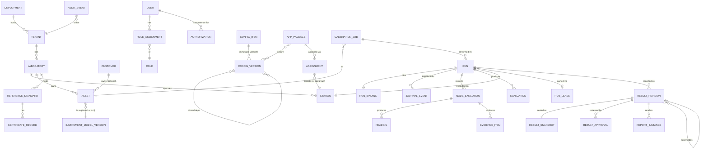
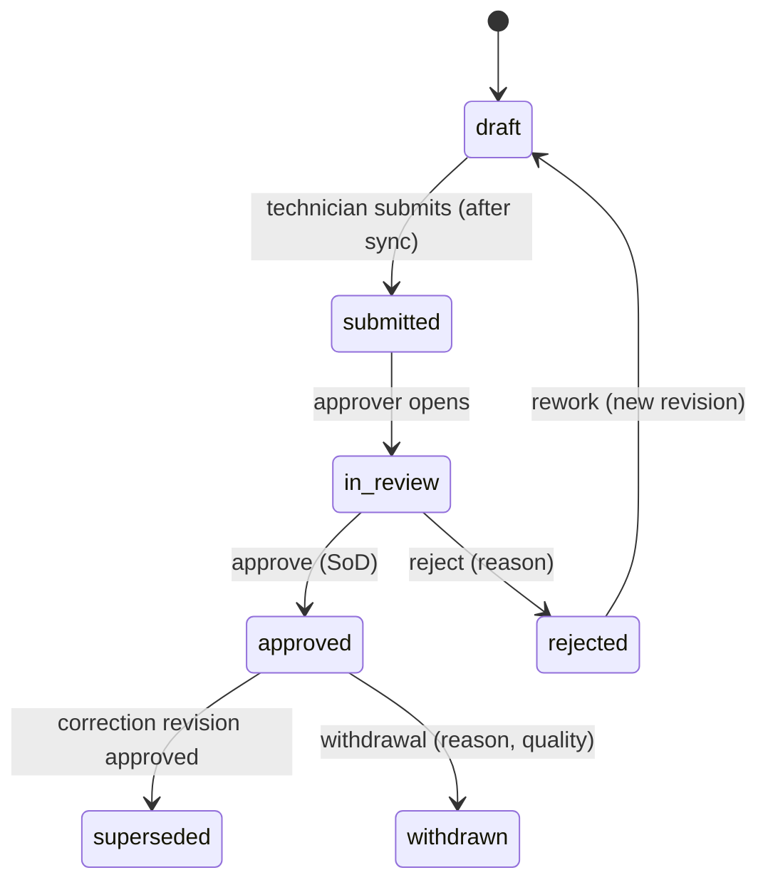

# DOMAIN_MODEL.md

| | |
|---|---|
| Status | Draft 0.2 — rebased on the metadata engine |
| Related | [NO_CODE_ARCHITECTURE §4](NO_CODE_ARCHITECTURE.md#4-metadata-engine) · [PROCEDURE_SCHEMA](PROCEDURE_SCHEMA.md) · [METROLOGY_REQUIREMENTS](METROLOGY_REQUIREMENTS.md) |

This is the logical model (not DDL). It separates **configuration** (what the platform is told: instruments, drivers, procedures, rules, screens, reports — stored as Configuration Items) from **operational records** (what happened: runs, readings, evidence, results, audit). Operational records *pin* configuration versions; they never reference "latest".

## 1. Bounded contexts

| Context | Owns | Mutability |
|---|---|---|
| **Identity & Tenancy** | DeploymentIdentity, Tenant, Laboratory, Station, User, Role, RoleAssignment, RoleGrantRequest, Authorization (competence), TrustRoot, TrustedReleaseIssuer | Mutable with audit |
| **Release & Change Control** | ReleaseCandidate, ReleasePackage, ReleaseRecord, ChangeRequest | Append-only history; approvals immutable |
| **Safety** | SafetyProfile (a config kind), HardwareLimitsPack | Pack versions immutable; installed read-only |
| **Configuration (Metadata)** | ConfigKind, ConfigItem, ConfigDraft, ReviewSnapshot, ConfigVersion, ConfigDependency, AppPackage, Assignment, ConfigApproval | Versions immutable; drafts and assignment pointers mutable |
| **Equipment & Traceability** | Asset (instrument instance), ReferenceStandard, CertificateRecord, Customer, CalibrationJob | Mutable with audit; certificate data frozen into snapshots |
| **Execution** | Run, RunBinding, JournalEvent, NodeExecution, Reading, EvidenceItem, Evaluation, Prompt, RunLease | Append-only |
| **Results & Reporting** | ResultRevision, ResultSnapshot, ResultApproval, ReportInstance | Approved = immutable |
| **Audit** | AuditEvent | Append-only, hash-chained |
| **Sync** | StationCursor, SyncConflict, ChangeFeedEntry | Operational |
| **Extensions** | TechnicalPlugin, PluginVersion, PublisherKey, Revocation | Versions immutable |

## 2. Entity-relationship overview



## 3. Key entities

### 3.1 Identity & tenancy
| Entity | Essential attributes / rules |
|---|---|
| Tenant | `tenant_id`, name, status, data-residency tag, quotas. Boundary for RLS. |
| DeploymentIdentity | `deployment_id` (generated at install), `environment_kind ∈ {test, production}`; **immutable**; stamped into signed metadata, tokens, journals, audit. Test and Production are separate installations — not partitions. |
| TrustedReleaseIssuer | Public release-signing key of a Test deployment trusted by this (Production) deployment; added/removed only with dual control. |
| RoleGrantRequest | Proposed grant of a privileged role: proposer, grantee, role, state (pending/approved/rejected), approver (≠ proposer, ≠ grantee). |
| Laboratory | `lab_id`, tenant, accreditation info (optional, inputs MI-18/25), time zone, policy refs |
| Station | `station_id`, lab, enrolment key fingerprint, status, agent version, **capability report**, last sync |
| User / Role / RoleAssignment | Roles scoped to tenant or lab (SECURITY_MODEL §5) |
| Authorization | `(user, scope: procedure/instrument family/hazard class, granted_by, valid_until)` — competence matrix (MI-21) |

### 3.2 Configuration (see NO_CODE_ARCHITECTURE §4.1)
Referenced by operational records as `ConfigRef = {kind, key, version, digest}`.

### 3.3 Equipment & traceability
| Entity | Attributes / rules |
|---|---|
| **Asset** | Physical instrument instance. `(tenant, manufacturer, model, serial)` unique. `model_ref: ConfigRef (InstrumentModel)` resolved at binding time; options installed; customer; location; `simulated:false` always (simulated instruments are **not** assets). |
| **ReferenceStandard** | Asset subtype with `role_capabilities`, status (`in_service`, `overdue`, `withdrawn`, `out_for_cal`), current CertificateRecord. |
| **CertificateRecord** | Issuer, accreditation ref, number, date, due date, **values & uncertainties as stated** (structured Quantities with provenance), traceability statement, attachment digest. Immutable once approved; superseded by new record. |
| **Customer** | Identity, contact, **default decision rule / report template preferences** (config refs). |
| **CalibrationJob** | Optional workflow container: asset, requested application/procedure (floating allowed until run creation), due date, decision rule selection, customer requirements. |

### 3.4 Execution
| Entity | Attributes / rules |
|---|---|
| **Run** | `run_id` (UUIDv7), `mode ∈ {simulation, validation, production}` (`production` only in Production deployments; `simulation`/`validation` only in Test), `station_id`, `operator_id`, `execution_state`, `created_at`, `lease_epoch`, `job_id?`. |
| **RunBinding** | Immutable at `run.started`: `procedure: ConfigRef`, `config_manifest_digest` (full closure), `instrument: {asset_id? , identity snapshot, transport info}`, `standards[]: {role, standard_id, certificate snapshot digest}`, `safety_profiles[]` (versions), `hardware_limits_pack_digest`, `decision_rule`, `plugin_versions[]`, `engine_version`, `expr_lang_version`, `catalog_versions`. |
| **JournalEvent** | See ARCHITECTURE §11.2. Hash-chained, per run. |
| **NodeExecution** | Projection: node id, attempt no., state, started/ended, resume_policy applied, error. |
| **Reading** | `reading_id`, `run_id`, `node_id`, `test_point_id`, `phase`, `attempt`, `raw_response` (verbatim), `value: Quantity`, `unit`, `timestamp {wall, monotonic}`, `instrument_state_ref`, `status ∈ {accepted, superseded, rejected}`, `flags {simulated}`. |
| **EvidenceItem** | Typed (reading_set, instrument_state, operator_confirmation, file, photo, environment_log, wire_log), content digest, blob ref, captured_by, captured_at. |
| **Evaluation** | `kind ∈ {limit_check, decision, tur, uncertainty, calculation}`, inputs (typed), config refs used, outcome, expression trace digest. A **limit_check** outcome is `within_limits|outside_limits`; a **decision** outcome is the vocabulary of MR-DEC-02 (default `not_evaluated`). |
| **Prompt** | Operator interaction record: node, prompt content version, response, responder, time. |
| **RunLease** | `(run_id, station_id, epoch, granted_at, state)`. |

### 3.5 Results & reporting
| Entity | Attributes / rules |
|---|---|
| **ResultRevision** | `(run_id, revision_no)`; `review_state ∈ {draft, submitted, in_review, approved, rejected, superseded, withdrawn}`; `supersedes?`; `reason`. Simulation runs: `review_state` limited to `draft`/`withdrawn`; `sealed_simulation_record` optional (non-certificate). |
| **ResultSnapshot** | Canonical JSON + SHA-256 (ADR-0007). Contains all pins & evaluated data. Created on `submitted`; sealed on `approved`. |
| **ResultApproval** | Reviewer, decision, reason, timestamp, optional e-signature artifact; SoD check result. |
| **ReportInstance** | `{result_revision, template ConfigRef, dataset_contract version, dataset_digest, locale, renderer_version, output_digest, kind ∈ {draft, issued}, number?}`. Issued only from approved, non-simulation revisions. |

### 3.6 Audit & sync
| Entity | Attributes |
|---|---|
| **AuditEvent** | `audit_id`, `tenant_id`, `actor` (user/service/station), `action` (verb.noun), `entity` ref, `before_digest`, `after_digest`, `reason`, `client` (ip, ua, station), `correlation_id`, `occurred_at`, `prev_hash`, `hash`. Covers config lifecycle, authz denials, safety violations, approvals, sync conflicts. |
| **SyncConflict** | `conflict_id`, class (duplicate_claim, stale_basis, integrity, clock, revoked_used), run/entity refs, state (open, resolved, dismissed-with-reason), resolution notes. |
| **StationCursor** | Station's downstream feed cursor and upstream acked seq per run. |

### 3.7 Release, change control and safety artifacts
| Entity | Attributes / rules |
|---|---|
| **ReleaseCandidate** (Test) | Package version ref, evidence bundle digest, state (candidate/test_approved/rejected/exported), approvals. |
| **ReleasePackage** | `.calapp` + `release_manifest.json` + evidence; signed by Test release key; immutable; digest. |
| **ReleaseRecord** (Production) | Package digest, issuer, import actor, validation report digest, approvals (independent), resulting `ConfigVersion`s, state (imported/validated/approved/released/rejected), timestamps. |
| **ChangeRequest** | Non-content setting change; subject, proposed value, impact summary, approvals, applied version; append-only. |
| **HardwareLimitsPack** | Version, entries (identity/capability class → absolute limits & forbidden ops), expiry, signatures (`hardware-limits` role, threshold met), digest; installed read-only; each run pins the digest. |

## 4. Invariants (testable)

| ID | Invariant |
|---|---|
| INV-01 | A published `ConfigVersion`'s content never changes; `content_digest = sha256(canonical(content))` always holds. |
| INV-02 | Published versions reference only pinned, published (or withdrawn-but-existing) versions; dependency graph is acyclic. |
| INV-03 | A `RunBinding` is immutable once `run.started`; all later events must carry the same `pins`. |
| INV-04 | Journal: `seq` strictly increasing by 1; `prev_hash` matches; `hash` recomputes. |
| INV-05 | A Reading's unit dimension equals its quantity definition's dimension. |
| INV-06 | A run with `mode=simulation` has only simulated transports, only `synthetic_demo`/simulated content allowed, and cannot reach `approved`; a run with `mode=validation` uses only allow-listed test instruments, is watermarked "VALIDATION — NOT A CALIBRATION" and cannot reach `approved`. |
| INV-07 | A run with `mode=production` exists only in a Production deployment, has no simulated transport, and no `synthetic_demo`/unapproved/unreleased configuration. |
| INV-08 | Superseded readings are never deleted or edited; selection is by `status`. |
| INV-09 | `ResultRevision(approved)` and its snapshot are immutable; a correction creates `revision_no+1` with `supersedes`. |
| INV-10 | Approver ≠ executor when policy `separation_of_duties=on` (default). |
| INV-11 | `Evaluation(kind=decision)` outcome other than `not_evaluated` requires an approved DecisionRule **and** approved UncertaintyBudget pinned in the binding. |
| INV-12 | Assignment history is append-only; the "current" assignment is derived. |
| INV-13 | Tenant isolation: every row's `tenant_id` equals the session tenant (RLS). |
| INV-14 | A station can have at most one active run per instrument resource. |
| INV-15 | H2+ commands on a real transport execute only when an **Absolute Hardware Limits** entry and an approved Safety Profile both cover every typed argument and the value lies within **AHL ∩ Safety Profile ∩ procedure bounds**; simulated transports may use `simulated` profiles only. |
| INV-16 | Every record, token, manifest and journal event carries the deployment identity of its deployment; a mismatch is rejected. |
| INV-17 | In a Production deployment: no `ConfigDraft` rows exist, no run has `mode ≠ production`, and every `ConfigVersion` has `origin = release` with a verified release record. |
| INV-18 | No configuration, API or role can create, alter or override an AHL entry; the Hardware Limits Pack store is read-only to the application. |
| INV-19 | No account holds both `platform_admin` and any of `safety.*`, `config.approve.*`, `release.approve.*`, `result.approve`; no lab has the same person as LSMA and Safety Officer. |
| INV-20 | A Safety Profile version approval set includes a Safety Officer ≠ author, and a Quality Manager when the classified impact is metrological/compliance. |

## 5. State machines (summary)

- **ConfigVersion lifecycle:** `published → deprecated → withdrawn` (forward only). Draft lifecycle: `draft → in_review → approved → published` (NO_CODE_ARCHITECTURE §4.5).
- **Run execution:** ARCHITECTURE §11.1.
- **ResultRevision review:**


## 6. Quantities and units (domain value objects)

```
Quantity   { value: Decimal, unit: UnitSymbol, display_digits?: int }
Dimension  { L, M, T, I, Θ, N, J exponents as integers }   # SI base dims
Unit       { symbol, dimension, to_si_factor: Decimal, to_si_offset: Decimal=0 }
Interval   { lo: Quantity, hi: Quantity, lo_inclusive: bool, hi_inclusive: bool }   # inclusivity REQUIRED, no default (MI-14)
Provenance { source: DocumentRef, entered_by, verified_by?, status ∈ {synthetic_demo, draft, verified, approved, superseded, withdrawn}, input_ref?: MI-id }
```
`Interval` construction without both inclusivity flags is a type error.

## 7. Data classification
| Class | Examples | Handling |
|---|---|---|
| Records | Journals, readings, snapshots, audit | Integrity-protected, retained per policy |
| Configuration | Config versions | Integrity-protected, signed in packages |
| Secrets | Keys, tokens, instrument credentials | Never in records/logs; SecretProvider |
| Personal data | User names/emails, signatures | Minimized; pseudonymous IDs in logs |
| Operational telemetry | Logs, metrics | Redacted, expirable |
