# IMPLEMENTATION_ROADMAP.md

| | |
|---|---|
| Status | Draft 0.3 — **No-Code foundations and a working minimal Application Builder are in the MVP (Phase 1)**; **Q-13/Q-14 resolved**: role-based safety ownership with immutable hardware limits (ADR-0023) and separate Test/Production deployments (ADR-0024) |
| Related | [PRODUCT_REQUIREMENTS](PRODUCT_REQUIREMENTS.md) · [NO_CODE_ARCHITECTURE](NO_CODE_ARCHITECTURE.md) · [NO_CODE_CAPABILITY_MATRIX](NO_CODE_CAPABILITY_MATRIX.md) |

> Durations are **planning estimates**, expressed in team-weeks assuming a core team of about 8–10 engineers (backend/runtime ×3–4, frontend/designers ×3, QA/test-automation ×1–2, platform/security ×1) plus part-time metrologist, UX researcher and safety officer. They must be re-baselined after Phase 0. They are not commitments and not derived from any measurement data.

## 1. Strategy

1. **Build the metadata engine and runtimes first**; every feature is delivered *as configuration of the platform*, including the 34401A demo (dogfooding, FR-NC-06).
2. **Vertical slices over horizontal layers**: each phase ends with something that runs end to end.
3. **Risk-first**: de-risk the hardest unknowns early — expression/dimension semantics, resume correctness, driver interpreter + safety, designer usability, Hebrew PDF rendering, Windows isolation.
4. **Tests are part of the feature**: fault injection and golden vectors from the first sprint.
5. **Metrology inputs gate content, not code**: the platform proceeds with `synthetic_demo` content; real content waits on MI closure.
6. **Two deployments from day one**: Test and Production are built and exercised as separate deployments (isolated Compose projects in Phase 0/MVP); the Release workflow is part of the MVP, not a later feature.
7. **Safety boundaries are not features to add later**: the Absolute-Hardware-Limits enforcement path, fail-closed behavior, and the safety role separation exist in the MVP (with simulator-scope packs).

## 2. Phases overview

```mermaid
gantt
  dateFormat  X
  axisFormat  %s
  title Phase sequence (relative weeks; planning estimate)
  section Foundations
  P0 Foundations & decisions            :p0, 0, 6
  section MVP / Vertical slice
  P1 MVP: metadata engine + Builder + 34401A demo :p1, 6, 26
  section Platform
  P2 Central platform & governance      :p2, 32, 20
  P3 Class B plugins & distribution     :p3, 52, 12
  section Hardware & hardening
  P4 Real hardware & safety validation  :p4, 64, 14
  P5 Commercial readiness               :p5, 78, 14
  section Extension
  P6 Designers maturity & ecosystem     :p6, 92, 12
```

(P3 partly overlaps P2/P4 in practice; shown sequentially for clarity.)

## 3. Phase details

### Phase 0 — Foundations and decisions (≈ 6 weeks)
| Work | Output |
|---|---|
| Repo, CI, boundary enforcement (import-linter, eslint-boundaries), codegen (schemas → Pydantic/TS), lint for runtime "no model strings" | Walking skeleton builds in CI (Linux + Windows runner) |
| Ratify ADRs (**ADR-0022/0023/0024 already Accepted**; Q-01, Q-13, Q-14 resolved); resolve Q-15 | ADRs Accepted |
| Stand up **two isolated Docker Compose deployments** (`calos-test`, `calos-prod` rehearsal): separate DB, secrets, keys, networks, volumes, ports, station enrolments; implement the CI **isolation test** | AC-ENV-01, AC-ARCH-08 green |
| Define role catalog and permissions for ADR-0023 (LSMA, Safety Officer, Quality Manager, Calibration Engineer, Platform Admin); toxic-combination rules; dual-control grant design | Role/permission matrix reviewed by Safety Officer + QM |
| Specify and freeze v1 of: envelope, expression grammar + conformance vector format, procedure IR, driver definition, catalog format | Schemas + vectors in repo |
| Spikes (time-boxed): Windows service host choice; Job Object isolation PoC; PDF engine (Hebrew bidi, determinism); canvas library choice; Postgres RLS + immutability triggers; SQLite journal crash tests | Spike reports → ADR updates |
| Metrology intake: MI register triage, owners assigned, gates agreed; **role holders and deputies named (MI-34)**; hardware-limits signing custody plan drafted (MI-33) | MI owners + dates |
| Threat-model workshop; test strategy sign-off | Updated THR scores |
| UX discovery: interviews with calibration engineers & technicians; prototype of Procedure Designer paper tests | Research synthesis |
**Exit criteria:** ADRs accepted; skeleton CI green incl. architecture contracts; isolation test green for the two Compose deployments; expression conformance suite skeleton passes in Python; MI register owned.

### Phase 1 — MVP (Vertical Slice VS-1) (≈ 26 weeks)
Goal: **a non-programmer builds, simulates, publishes, installs and runs the 34401A demo application**; the station discovers the simulated instrument, verifies identity, runs the procedure, persists, resumes after kill, and produces a watermarked draft report. Also contains the ten AC-NC operations.

Milestones:
| M | Content | Key acceptance |
|---|---|---|
| **M1.1 Metadata engine core** (≈ 4w) | Kind registry, schemas, draft/snapshot/version, content digests, deps DAG, immutability enforcement, audit chain (central), RLS minimal, **deployment identity**, packages (`.calapp`) export/import, Ed25519 signing | AC-GOV-01/02 (subset), INV-01/02 tests |
| **M1.2 Expression engine** (≈ 4w, parallel) | Parser, type/dimension checker, decimal evaluator, canonical AST, function lib v1 (exact set + pending_review flagged), conformance vectors, TS presentation subset | AC-MET-02/03/08, NFR-17 |
| **M1.3 Driver runtime + simulator + broker** (≈ 5w) | Driver interpreter (templates, formatters, parsers, error handling), Instrument Broker (hazard + **AHL ∩ SafetyProfile effective-limit enforcement**, fail-closed; simulator-scope Hardware Limits Pack + loader), SimulatorTransport + declarative SimulationProfile engine, transport port, VISA adapter stub (compiled but not exercised until P4) | AC-SEC-04, fuzz tests for formatter/parsers |
| **M1.4 Workflow engine + journal** (≈ 5w) | Procedure IR compiler, engine, journal (SQLite), resume/reconcile, limits evaluation, preflight gates, run modes + simulation marking | AC-PD-05, NFR-01, FS-01/02/03/09 tests |
| **M1.5 Station Agent + Operator shell** (≈ 5w) | Windows service, local API, config manager (CAS, stage/activate), UI runtime with auto-generated operator screen, discovery & identity, run console, resume modal, draft report (local renderer) | AC-UX-01/05/07 |
| **M1.6 Application Builder (minimal)** (≈ 8w, starts M1.1+, overlaps) | Per BUILDER_SPEC §13 and PROCEDURE_DESIGNER_SPEC §18 MVP cuts; Simulation Lab; validation pipeline; governance (draft/review/approve/publish, SoD), deployments & rollback (single lab) | AC-NC-01…10 automated E2E |
| **M1.6b Release management, safety governance & deployment lock** (≈ 5w, overlaps M1.5/M1.6) | Release Candidate → Test approvals → signed Release Package → Production import/verification/production-mode validation/independent approvals → release → canary/stable (`calos-test` → `calos-prod` rehearsal); Trusted Release Issuers (dual control); Change Requests; **production authoring lock**; Safety Console (LSMA/Safety Officer/QM approval path, AHL band, effective-limit viewer); role catalog + toxic-combination validator + dual-control grants; station deployment pinning; `validation` run mode with test-instrument allow-list | AC-ENV-01…12, AC-SAF-01…12, AC-NC-11/12 |
| **M1.7 Hardening & demo** (≈ 3w) | Fault-injection matrix, a11y/RTL passes, usability test round 1, docs, demo script, OpenTAP spike report (ADR-0002 addendum) | VS-1 acceptance (§4), AC-NC (§5) |

**Out of Phase 1:** multi-tenant management UI, full sync, approval of results, issued reports, real hardware, Class B plugin infrastructure (SDK spec only), OIDC, dashboards/custom-page builders, budget/TUR/CMC editors, real (non-simulator) Hardware Limits Packs and the signing ceremony tooling, production-grade infrastructure (the MVP Production deployment is a rehearsal).

**Exit criteria:** all of §4 and §5 pass in CI and in a recorded demo by a non-programmer; no open critical defects; MI register updated with Phase-1 learnings; Capability Matrix reviewed.

### Phase 2 — Central platform and governance (≈ 20 weeks)
Multi-tenant central (RLS across all tables), RBAC/ABAC + SoD, local+OIDC auth, station enrolment, **full sync** (idempotent journal replication, leases, conflicts UI), change feed + assignment manifests, review/approval workflow for results, **immutable sealing**, issued report generation (non-simulation), standards register & certificates, release-management hardening (multi-lab policies, drift dashboards), full privileged-grant workflow, production Change Request catalog, backups, impact analysis (full), metrology editors (budget, TUR, decision rule, CMC, units, rounding), dashboards/custom pages/menus builders, localization workspace v2, audit explorer.
**Exit:** AC-GA-03/04, AC-GOV-05..09, AC-SEC-01/02/09, sync soak tests.

### Phase 3 — Class B plugins and secure distribution (≈ 12 weeks)
Plugin host with Windows isolation, IPC/broker API, SDK + dev CLI + conformance kit, registry + review workflow, TUF-style metadata service + key ceremony runbooks, revocation, agent secure updater, second plugin (e.g., a parser/function pack) proving catalog extension.
**Exit:** AC-SDK-01..07, AC-SEC-03, update tests.

### Phase 4 — Real hardware and safety validation (≈ 14 weeks; **gated by MI-01/02/03/04/06/07/26/33/36 and by the production-infrastructure gate for any production use**)
VISA transport hardening (GPIB, serial, LAN/USB gateways), station-mode driver diagnostics, real-instrument driver and Safety Profile content authored by the metrologist/safety officer **in the Builder**, HIL test bench, verification vs. manufacturer documentation, adjustment (H3) validation process, performance measurement for NFR-09.
**Exit:** first real **Hardware Limits Pack** threshold-signed (MI-33 ceremony) and verified at stations; Safety Profile approved per ADR-0023 (LSMA author, Safety Officer, + Quality Manager if compliance-affecting) in both deployments; HIL regression green on **Test-deployment test instruments** (`validation` mode); documented verification of every `unverified_against_manual` command used.

### Phase 5 — Commercial readiness (≈ 14 weeks)
**Production infrastructure gate (ADR-0024):** separately secured production hosting (hardened hosts/network, managed secrets/KMS, backup/restore drill, monitoring/alerting, access review) verified and signed off before operational use; Installer/MSI signing, SBOM/signing pipeline, observability stack, load/soak tests (k6/Locust, multi-station simulator), DR drills, pen test, validation pack for labs (IQ/OQ/PQ-style documentation, traceability matrix), e-signature (if Q-03), hosted/on-prem packaging (Q-10), customer portal (Q-11 optional), support runbooks.
**Exit:** AC-GA-01..07.

### Phase 6 — Designer maturity and ecosystem (≈ 12 weeks, continuing)
Parallel flows (if justified), richer charts/report blocks, library/marketplace of shared components, scripted operator responses, coverage analysis, LIMS connectors (Class B or mapping), air-gapped authoring option (Q-16), additional locales.

## 4. Vertical Slice 1 acceptance criteria

(Automated unless marked [M] manual. Each is traceable to requirements.)

### 4.1 Discovery and identity
| ID | Criterion | Req |
|---|---|---|
| AC-VS-01 | Scan lists the simulated 34401A flagged `[SIM]` with identity `exact` against the published model; scanning sends only the identification query. | FR-DISC-01..04 |
| AC-VS-02 | With a simulated wrong model or identity swap, verification returns `mismatch` and run creation is blocked. | FR-DISC-03 |
| AC-VS-03 | Simulated identity cannot be registered as an Asset (API returns 422). | FR-DISC-04 |

### 4.2 Procedure, execution, persistence
| ID | Criterion | Req |
|---|---|---|
| AC-VS-04 | Run pins procedure version and digest; modifying the stored config bytes causes load refusal. | FR-EXEC-01, NFR-18 |
| AC-VS-05 | Readings recorded through engine → driver interpreter → broker → simulator transport; each reading has raw text, parsed Decimal, unit, UTC+monotonic times, attempt, flags `simulated`. | FR-EXEC-06 |
| AC-VS-06 | Limits evaluation output matches golden vectors for nominal/marginal/failing scenarios; boundary inclusivity honored per declared flag. | FR-EXEC-07, AC-MET-02 |
| AC-VS-07 | Every event is journaled and chain-verifies; replay into empty projection reproduces identical projections. | FR-EXEC-02, AC-ARCH-05 |
| AC-VS-08 | Production-mode attempt with the demo application is rejected at preflight, naming `synthetic_demo`/simulated-only content. | FR-EXEC-10, AC-MET-01 |
| AC-VS-09 | A broker-level test sending an out-of-envelope argument (from a deliberately malicious test procedure) — exceeding the Safety Profile, or the AHL even when the profile is permissive — is refused and journaled; no bytes reach the simulator transport. | FR-EXEC-12, AC-SAF-06 |

### 4.3 Interruption and resume
| ID | Criterion | Req |
|---|---|---|
| AC-VS-10 | Agent is killed (`kill -9`) at **every** journal boundary in the demo run (matrix test); on restart, run appears as interrupted, resume completes, final dataset equals uninterrupted run (excluding attempt metadata). | FR-EXEC-03, NFR-01 |
| AC-VS-11 | Simulated disconnect mid-acquisition leads to node failure handled per `on_error`; run pauses; reconnect + resume works; superseded attempt retained. | FS-01 |
| AC-VS-12 | A `non_repeatable` node interrupted mid-flight requires an operator decision; resume refuses to proceed without it; decision is journaled. | FR-EXEC-04 |
| AC-VS-13 | Resume with a different (simulated) instrument serial is blocked. | FS-03 |

### 4.4 Reporting
| ID | Criterion | Req |
|---|---|---|
| AC-VS-14 | Draft report generated from complete and from partial runs; contains non-removable watermark/banner, "Uncertainty: not evaluated", "Conformity: not evaluated (no approved uncertainty budget)", config version footer; in `en` and `he` (RTL). | FR-REP-01..05, AC-MET-04 |
| AC-VS-15 | Report records template + dataset + renderer digests; re-render produces identical content hash. | FR-REP-03/04 |
| AC-VS-16 | Attempt to add/remove watermark via template design is impossible (designer UI locks; schema rejects). | FR-RPD-04 |

### 4.5 Offline, security, observability (slice level)
| ID | Criterion | Req |
|---|---|---|
| AC-VS-17 | Complete run + draft report with network blocked at OS level. | NFR-02 |
| AC-VS-18 | Structured logs contain correlation IDs; secrets canary never appears; diagnostics bundle is produced and redacted. | FR-OPS-01/02, AC-SEC-08 |
| AC-VS-19 | Local UI rejects wrong Host/Origin/token. | AC-SEC-06 |
| AC-VS-20 | Architecture contracts pass (import-linter, eslint boundaries, no model strings in runtime). | AC-ARCH-01/02 |

### 4.6 Environments and release management (ADR-0024)

| ID | Criterion | Req |
|---|---|---|
| AC-ENV-01 | The `calos-test` and `calos-prod` Compose projects share no network, volume, secret, port or signing key; the automated isolation test passes and fails when sharing is introduced. | FR-ENV-01, NFR-21 |
| AC-ENV-02 | Deployment identity is stamped into tokens, manifests, journals and audit records; tokens/manifests/packages from the other deployment are rejected with `DEPLOYMENT_MISMATCH` (or `RELEASE_ISSUER_UNTRUSTED` for packages). | FR-ENV-02 |
| AC-ENV-03 | A station enrolled in one deployment cannot be enrolled in the other without wipe + re-enrolment; a Test agent opens only the simulator and allow-listed test instruments. | FR-ENV-06 |
| AC-ENV-04 | In Production, every authoring route returns `PRODUCTION_CHANGE_CONTROL` and no Builder entry point is displayed; the DB role cannot modify versions, approvals or audit. | FR-ENV-04 |
| AC-ENV-05 | Happy-path Release (GUI only): candidate → Test approvals → export → import → production validation → independent approvals → release → canary → stable; resulting Production digests equal Test digests. | FR-ENV-05 |
| AC-ENV-06 | Release is rejected, with a specific finding, for each of: `synthetic_demo` content, `simulated` Safety Profile, unresolved `$input`, `intended_modes` without production, untrusted issuer, tampered signature/digest, incompatible schema/catalog versions. | FR-ENV-04/05 |
| AC-ENV-07 | Production approvals are independent: the importer cannot approve; Test approvals do not satisfy Production; Safety Officer (+QM) approval is required again for safety content. | FR-ENV-05, FR-SAF-02 |
| AC-ENV-08 | Adding/removing a Trusted Release Issuer requires admin proposal + Quality Manager + Safety Officer approval; alone, no role can complete it. | FR-ENV-08 |
| AC-ENV-09 | Production policy/threshold changes occur only via approved Change Requests (versioned, auditable, rollback-able); direct edit attempts via UI/API/DB role fail. | FR-ENV-07 |
| AC-ENV-10 | Production rejects `simulation`/`validation` runs; Test rejects `production` runs; `validation` runs are watermarked and non-approvable. | FR-ENV-03 |
| AC-ENV-11 | After running the full workflow suite, a data scan finds no production-origin records in the Test database; cross-deployment diagnostics sharing applies redaction. | FR-ENV-06 |
| AC-ENV-12 | Emergency withdrawal and rollback-by-reassignment work in Production under break-glass rules (flagged for review); no emergency path loosens safety limits or skips approvals. | FR-ENV-07, FR-SAF-06 |

### 4.7 Safety ownership and hardware limits (ADR-0023)

| ID | Criterion | Req |
|---|---|---|
| AC-SAF-01 | Role matrix test: LSMA can author but not approve; Safety Officer can approve but not author the same change; Quality Manager co-approves; Calibration Engineers have no `safety.*` write; Platform Admin has no approval permission anywhere. | FR-SAF-01 |
| AC-SAF-02 | A Safety Profile cannot publish without Safety Officer approval on the frozen digest; compliance/metrology-affecting classification additionally requires Quality Manager approval; classification can be raised but not lowered; author/contributors cannot approve. | FR-SAF-02 |
| AC-SAF-03 | The toxic-combination validator rejects every prohibited role combination via UI, API and import; rejection is audited. | FR-SAF-06 |
| AC-SAF-04 | Privileged role grants take effect only after approval by a distinct Safety Officer/Quality Manager who is neither grantor nor grantee. | FR-SAF-06 |
| AC-SAF-05 | A Safety Profile envelope outside the AHL is rejected at edit time and at publish (PR-023); the AHL band is read-only in the UI. | FR-SAF-03/07 |
| AC-SAF-06 | The broker refuses (and journals `safety.violation`) any command whose arguments exceed AHL **or** the profile **or** procedure bounds; no bytes reach the transport; safe-state runs. | FR-EXEC-12, FR-SAF-03 |
| AC-SAF-07 | Hardware Limits Pack with a missing/expired/rolled-back/unsigned/insufficient-threshold signature is rejected; H2+ on real transports fails closed while H0/H1 continue. | FR-SAF-03, NFR-22 |
| AC-SAF-08 | No UI, API, configuration kind, procedure, or DB-role path can create/alter/delete an AHL entry (negative tests + ACL test). | FR-SAF-03 |
| AC-SAF-09 | No change during calibration: runs pin profile versions and pack digest; new assignments do not affect in-flight runs; execution roles have no write path; Production has no draft. | FR-SAF-05 |
| AC-SAF-10 | Withdrawing a pinned Safety Profile during a run halts it at the next node boundary into safe-state; resume under that profile is refused. | FR-SAF-05 |
| AC-SAF-11 | Safety Profiles demonstrate versioning, audit trail, impact analysis, canary → stable deployment and rollback with immutable history. | FR-SAF-04 |
| AC-SAF-12 | The complete Safety Profile lifecycle (AC-NC-12) is performed GUI-only by the three roles. | FR-SAF-07, FR-ENV-10 |

## 5. No-Code acceptance scenarios

Executed (a) as Playwright E2E using only GUI actions from a clean sandbox with only the platform's shipped catalog, and (b) as moderated sessions with **non-programmer calibration engineers**. Click paths are in [BUILDER_SPEC §14](VISUAL_APPLICATION_BUILDER_SPEC.md#14-acceptance-walkthroughs-non-programmer-gui-only).

| ID | Scenario | Pass conditions (automated) | Usability pass (manual) |
|---|---|---|---|
| AC-NC-01 | Create new instrument model | Model published; appears in selectors; validation shows only expected "Input required" items | Participant completes unaided |
| AC-NC-02 | Define communication configuration | Identify + configure + read work against simulator; parser test vectors stored | " |
| AC-NC-03 | Build procedure from reusable steps | Lint clean; sub-procedure extracted & reused | " |
| AC-NC-04 | Standards, measurements, limits, calculations | Limits table + calc test vectors pass; role bound | " |
| AC-NC-05 | Operator interface | Screen renders he/en, a11y OK, conditional field works in sim run | " |
| AC-NC-06 | Report design | PDF with bindings in he/en; watermark injected | " |
| AC-NC-07 | Test against simulator | Scenario run, breakpoint, fault injection, kill-and-resume; app test saved | " |
| AC-NC-08 | Publish and install on compatible station | Station active manifest equals published digest; run executes | " |
| AC-NC-09 | Modify and republish new version | Distinct digest; both versions exist; SoD enforced; station runs v1.1 | " |
| AC-NC-10 | Roll back to earlier approved version | Station activates v1.0; audit has rollback; in-flight run unaffected | " |
| AC-NC-11 | Release a package Test → Production (rehearsal deployment) | Digests identical; independent Production approvals; `synthetic_demo` package rejected with specific finding; every step GUI-only | Participant (release manager role) completes unaided |
| AC-NC-12 | Author, review and approve a Safety Profile (LSMA → Safety Officer → Quality Manager if flagged) | Approval path matches classification; AHL band enforced; author/admin cannot approve; profile enforced in simulated run | Participants in the three roles complete unaided |

**Global NC conditions** for all twelve (AC-NC-01…10 run in the Test deployment; AC-NC-11 spans Test and the Production rehearsal deployment; AC-NC-12 runs in Test): no source edits, no CLI, no direct DB access, no API calls outside the UI (checked by test harness that fails if non-UI network calls to admin endpoints are made); prerequisites performed once by IT (station enrolment, VISA backend) are listed and excluded (matrix 1.17, 6.11).

## 6. Test strategy

### 6.1 Principles
Test pyramid with **risk-weighted** emphasis on the trusted runtime; every requirement ID (`FR-…`, `NFR-…`, `AC-…`) tagged in tests (`@req`) with CI-generated traceability matrix; determinism and fault tolerance tested as first-class properties.

### 6.2 Layers

| Layer | Scope | Tools | Examples |
|---|---|---|---|
| Unit | Pure functions in `domain`, `expr`, `metadata`, `procedure`, `driver` | pytest, Vitest | Dimension algebra, decimal rounding, template formatting |
| **Property-based** | Invariants over generated inputs | Hypothesis, fast-check | Quantity round-trip, unit mismatch rejection, interval monotonicity, canvas↔JSON round-trip, diff oracle |
| **Golden / conformance** | Bit-exact vectors | YAML vector suites run in Python and TS (presentation subset) | Expression results; limit evaluation; report content hashes |
| **Fuzz** | Parsers & loaders | Atheris/Hypothesis + corpus | Expression parser, driver parsers/formatters, package loader, sync ingest |
| **Mutation** | Strength of tests for evaluators | mutmut / Stryker | Limits evaluation, decision logic, journal chain |
| Component/integration | Engine+driver+simulator, API+Postgres (Testcontainers), agent+SQLite | pytest | Run end-to-end with `SimulatorTransport` and socket simulator |
| **Contract** | API & schema compatibility | Schemathesis, oasdiff, JSON Schema fixtures corpus | Draft→publish stateful flows; schema N/N-1 |
| **Fault injection / chaos** | Kill, disconnect, disk full, corrupt, clock jump | Custom harness (kill at every journal boundary), toxiproxy-like for HTTP | AC-VS-10/11, FS-01…25 |
| Security | AuthZ matrix, RLS probes, injection, DNS rebinding, tamper | pytest, ZAP baseline, Semgrep, pip-audit, npm audit, Trivy, gitleaks | AC-SEC-01…10 |
| E2E UI | Operator/Admin/Builder flows, he/en, RTL | Playwright | AC-NC-01…10 (GUI-only) |
| Visual regression | Screens & PDFs, LTR/RTL, themes | Playwright snapshots, PDF text/hash compare | AC-UX-01 |
| Accessibility | WCAG checks | axe-core, manual SR passes | AC-UX-04 |
| Performance/load | API, sync, designers | k6/Locust, browser perf traces | NFR-07/09 |
| Windows-specific | Service, Job Object isolation, DPAPI, installer, updater | GitHub-Actions-class Windows runners / self-hosted | AC-SDK-03, update rollback |
| HIL (P4) | Real instruments on bench | Bench rig + marked tests | Driver verification |
| Usability | Non-programmer task studies | Moderated sessions | NFR-19 |

### 6.3 Test data and fixtures
- Simulator **scenarios** (nominal/marginal/failing/faulty) as configuration items shipped in `content/` — authored via the Builder where practical.
- All numeric fixtures are labelled `synthetic_demo`; CI forbids their presence in production-targeted packages (PR-014).
- Golden vector files are metrologist-reviewed when they encode metrological expectations (MI-17/32).

### 6.4 Quality gates (CI)
Merge: lint, type-check (mypy/pyright strict on core packages, `tsc --strict`), unit/property/golden tests, architecture contracts, codegen drift, schema fixtures, SAST/SCA/secret scan, coverage thresholds on trusted runtime packages (thresholds set by team after baseline; **branch coverage + mutation score** for evaluators).
Nightly: fuzz, fault-injection matrix, Windows isolation tests, full E2E (he/en), load smoke.
Release: SBOM, signing, pen-test status, traceability matrix export, Capability Matrix review sign-off, migration rehearsals, rollback rehearsal.

### 6.5 Defect policy
Metrology-critical defects (evaluation, limits, units, journal integrity, safety enforcement) are Sev-1: block release, require regression test + root-cause note.

## 7. Risks and mitigations

| ID | Risk | Likelihood | Impact | Mitigation | Phase |
|---|---|---|---|---|---|
| R-01 | MVP scope too large (engine + builder + station) | H | H | Strict MVP cuts (BUILDER §13, PD §18); parallel tracks; weekly vertical-slice integration; descope list pre-agreed (dashboards, switch, capture media) | P1 |
| R-02 | Inner-platform effect (language grows) | M | H | Capability Matrix reviews; catalog-gap process; Class B route | All |
| R-03 | Designer usability fails with non-programmers | M | H | Early prototypes, usability rounds in P0 and M1.6, outline view, guided wizards | P0–P1 |
| R-04 | Expression/dimension semantics wrong or ambiguous | M | H | Metrologist review of spec, golden vectors, mutation tests | P1 |
| R-05 | Resume correctness bugs | M | H | Kill-at-every-boundary matrix, reconcile design, property tests | P1 |
| R-06 | Hebrew/bidi PDF fidelity | M | M | Early PDF engine spike; golden PDFs | P0 |
| R-07 | Windows isolation harder than expected | M | M | Spike in P0; defense-in-depth; Class B not on MVP critical path | P0/P3 |
| R-08 | Missing metrology/safety inputs delay real hardware | H | M | Simulator-first; MI gates; owners and dates in P0 | P4 |
| R-09 | VISA backend variability on stations | M | M | Capability report, pyvisa-py fallback, HIL matrix | P4 |
| R-10 | Schema evolution pain | M | M | Migration framework + corpus from day one | P1+ |
| R-11 | Over-engineering governance for MVP | M | M | MVP governance minimal but real (draft/review/publish/SoD/rollback) | P1 |
| R-12 | OpenTAP interest from customers | L | M | ExecutionEnginePort, spike result, interop adapter option | P1 end |
| R-13 | Vendor trademark/IP concerns (Q-08) | L | M | Nominative use only; legal review; configurable naming | P1 |
| R-14 | Team skill gaps (metrology, Windows, a11y) | M | M | Hire/consult; pair with metrologist | P0 |
| R-15 | Two-deployment overhead slows delivery / release friction | M | M | Automate packaging and isolation tests from Phase 0; excellent Release console UX; expedited-approval policy (never skipped) | P0–P1 |
| R-16 | Approver availability (dual control) blocks releases or safety changes | M | M | Named deputies (MI-34), approval aging dashboard, emergency fail-safe actions only | P1 |
| R-17 | AHL pack turnaround/key custody slows hardware enablement | M | M | Start MI-26/33 early; candidate tooling; rehearsed ceremony; simulator-scope work continues meanwhile | P4 |

## 8. Definition of done (per feature)
Requirement IDs referenced; schema + validators + editor binding + tests + docs; he/en strings; a11y check; audit events; observability; negative tests; Capability Matrix row updated; no instrument/model strings in runtime; changelog entry; if configuration kind: migration + fixtures.

## 9. Open decisions required to start
1. ~~Accept or decline baseline extensions E1–E6~~ — **Accepted** (ADR-0022). ~~Q-13 and Q-14~~ — **Resolved** (ADR-0023, ADR-0024); Phase 0 proceeds.
2. Name role holders and deputies for Lab Safety/Metrology Administrator, Safety Officer / Technical Authority, Quality Manager and Release Manager (MI-34), plus metrologist reviewers (MI owners).
3. Confirm translation ownership (Q-15).
4. Confirm launch scope: hosted vs on-prem (Q-10).
