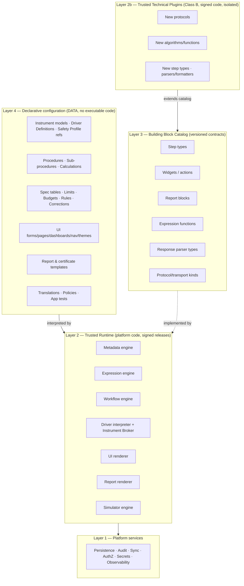
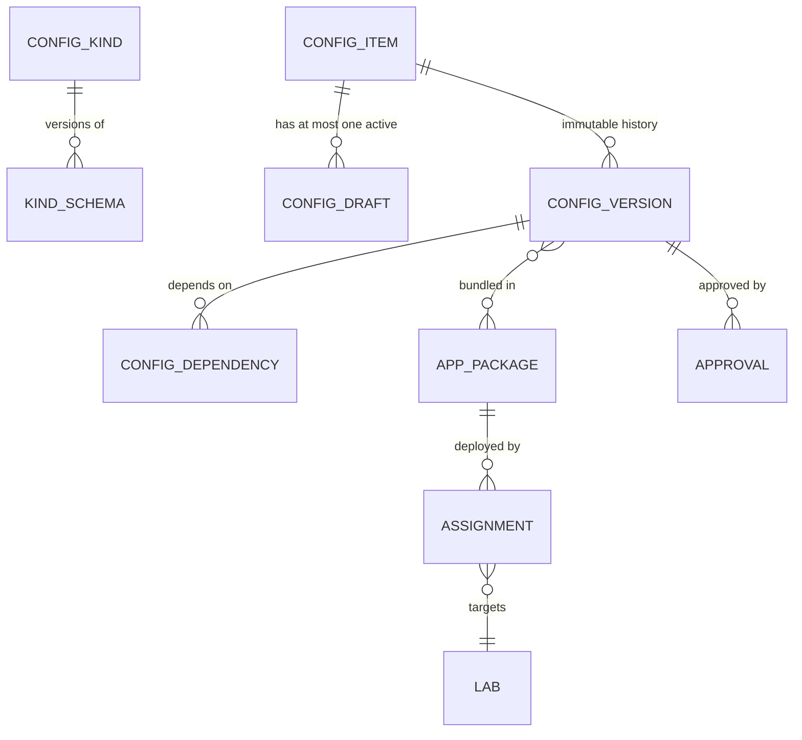
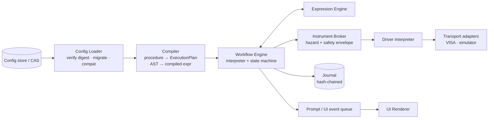
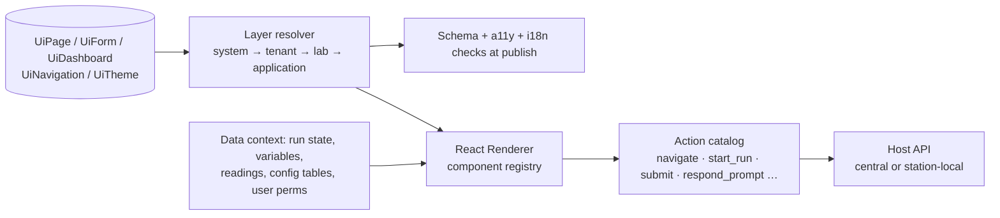
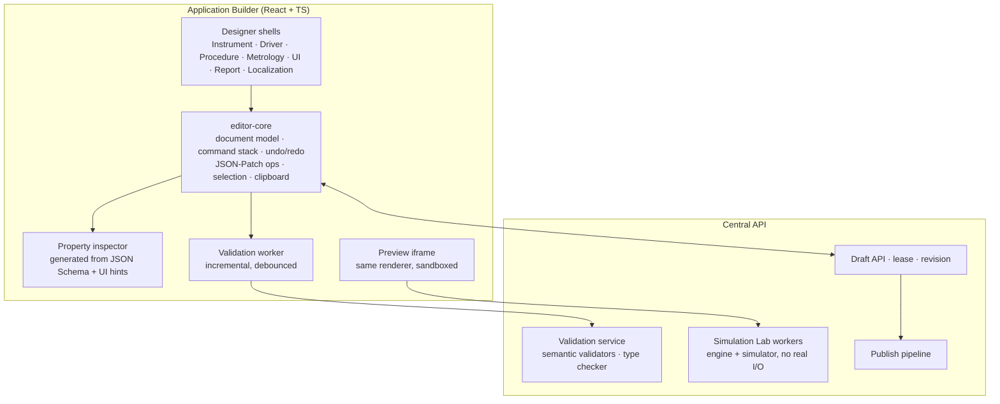
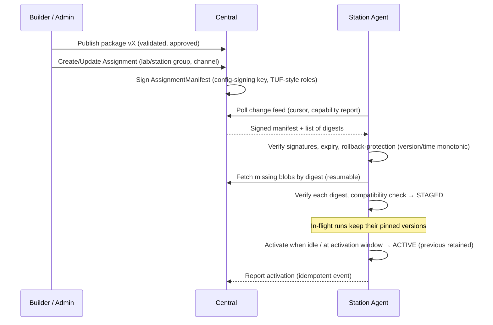

# NO_CODE_ARCHITECTURE.md

| | |
|---|---|
| Status | Draft 0.1 — **foundational; takes precedence over any conflicting statement elsewhere** |
| Mandate | CalOS is a No-Code-First, metadata-driven, configuration-driven platform. Ordinary operation, customization, extension and maintenance must not require source-code changes. |
| Related | [CAPABILITY_MATRIX](NO_CODE_CAPABILITY_MATRIX.md) · [BUILDER_SPEC](VISUAL_APPLICATION_BUILDER_SPEC.md) · [PROCEDURE_DESIGNER_SPEC](VISUAL_PROCEDURE_DESIGNER_SPEC.md) · [GOVERNANCE](CONFIGURATION_GOVERNANCE.md) · [SCHEMAS](PROCEDURE_SCHEMA.md) · [ARCHITECTURE](ARCHITECTURE.md) |

> Numeric literals anywhere in this set are syntax placeholders. No instrument specification, tolerance, test point, safety limit or uncertainty value is defined by engineering (see METROLOGY_REQUIREMENTS §12).

---

## 1. Purpose and the central design bet

**The bet:** calibration applications are *data interpreted by a small, rigorously tested, trusted runtime* — not programs. If the runtime's building blocks are expressive enough, a calibration engineer composes new instruments, drivers, procedures, metrology, screens and reports entirely in graphical tools, and every artifact is a versioned, diffable, auditable, signable document.

**The risk we manage deliberately:** the "inner-platform effect" (a configuration language that slowly becomes a worse programming language). We counter it with:
1. **Constrained, total languages** — expressions and workflows are bounded and terminating *by construction*, which also gives us static validation, safe preview, and reliable resume.
2. **A precise escape hatch** — Trusted Technical Plugins (Class B) *add building blocks* to the catalog; they do not sit inside applications. Once a block exists, it is reused with no code.
3. **A measured boundary** — the [Capability Matrix](NO_CODE_CAPABILITY_MATRIX.md) states which operations are No-Code, Configuration-driven, or genuinely Development, and every release re-audits it.

---

## 2. Layered model and the declarative/trusted-code boundary



### 2.1 Boundary rules (normative)

| # | Rule | Enforcement |
|---|---|---|
| B-1 | Layer 4 artifacts contain **no executable code**: no scripts, no embedded HTML/JS, no SQL, no shell, no native expressions escaping the typed language. | JSON Schema forbids unknown keys; `additionalProperties:false`; static scan; renderer ignores unknown nodes by *failing*, not skipping |
| B-2 | Every behavior in Layer 4 is a **reference to a catalog entry** (`block_type@major`) with typed parameters validated against that entry's schema. | Validator + loader |
| B-3 | Layer 2 contains no instrument-, model-, customer- or method-specific logic (no `if model == "34401A"`). Model-specific safety data exists only as *data* in the signed Hardware Limits Pack, an artifact separate from runtime packages. | Architecture tests (grep-style lint for model names in runtime packages), code review rule in AGENTS.md |
| B-4 | Layer 2b plugins only *register catalog entries and implement them*; they cannot read configuration of other tenants, cannot reach the network or filesystem beyond declared capabilities, and run out-of-process. | [PLUGIN_SDK_SPEC](PLUGIN_SDK_SPEC.md), [SECURITY_MODEL](SECURITY_MODEL.md) |
| B-5 | **Two-tier safety (ADR-0023).** *Absolute Hardware Limits* live in a signed Hardware Limits Pack enforced by trusted components and are **not configuration**; *Safety Profiles* are separately governed Layer-4 items that may only **narrow** within them. Neither is editable by application authors, procedures, UI, or administrators beyond their own governed channel. | Pack signature + loader; permission split; author≠approver; broker enforces AHL ∩ profile ∩ bounds; fail closed |
| B-6 | No capability may require code *per application*. If a requirement can only be met with per-application code, it is a catalog gap → raised as a Class B or platform work item and tracked in the matrix. | Process (matrix review) |
| B-7 | Published configuration is immutable and content-addressed; runtime refuses mismatching digests. | Loader |

---

## 3. The two extension classes

| | **Class A — No-Code Calibration Application** | **Class B — Trusted Technical Plugin** |
|---|---|---|
| Artifact | `.calapp` — signed bundle of configuration items | `.calplug` — signed code + manifest |
| Authored by | Calibration engineers in the Application Builder | Software engineers (internal or third-party) |
| Contains | Instrument models, driver definitions, procedures, metrology config, UI, reports, translations, app tests | Python code implementing new transports, parsers/formatters, expression functions and step types (UI widgets, report blocks and new config kinds are platform-release items in v1) |
| Executes in | Trusted runtime (interpreted) | Isolated child process via broker; capability-gated |
| Typical reason to exist | New instrument, new method, new customer template | Binary/proprietary protocol, vendor SDK driver, novel numerical method, new widget kind, external-system connector |
| Review | Configuration governance (metrologist/quality approvals) | Code review + security review + conformance suite + signing |
| Install | Assign via deployment; offline-capable | Install + lab enablement + capability grant review |
| Needed for ordinary app creation/maintenance? | **Yes — that is the point** | **No** |

A Class A package declares which catalog entries (including Class B-provided ones) it needs; the compatibility engine (§15) ensures target stations have them.

---

## 4. Metadata engine

### 4.1 Configuration Item model



| Entity | Fields (essential) | Mutability |
|---|---|---|
| `ConfigKind` | `kind`, `current_schema_version`, `approval_policy`, `change_classes`, `owner_scope` | platform-controlled |
| `ConfigItem` | `item_id`, `tenant_id`, `kind`, `key` (slug), `scope` (platform\|tenant\|lab), `lab_id?` | identity immutable |
| `ConfigDraft` | `draft_id`, `item_id`, `base_version`, `content` (JSON), `revision` (int), `lease` {holder, expires_at}, `validation` {state, findings[]} | mutable |
| `ConfigReviewSnapshot` | `snapshot_id`, `draft_id`, `content_digest`, `frozen_at` | immutable — reviewers approve a **digest** |
| `ConfigVersion` | `version_id`, `item_id`, `version` (SemVer), `schema_version`, `content` (JSONB), `content_digest` (SHA-256 over RFC 8785 canonical JSON), `deps[]` `(kind,key,version,digest)`, `change_class`, `status` ∈ {published, deprecated, withdrawn}, `published_by`, `approvals[]`, `published_at`, `parent_version` | **immutable** (only `status` may transition forward, via audited event rows, never by editing content) |
| `ConfigDependency` | `from_version_id`, `to_kind`, `to_key`, `to_version`, `to_digest`, `role` | immutable |
| `AppPackage` | `package_id`, `application_key`, `version`, `closure[]` (all item versions), `requires` (catalog/runtime versions), `manifest_digest`, `signature` | immutable |
| `Assignment` | `assignment_id`, `package_id`, `target` {lab \| station_group \| station}, `channel`, `activation_policy`, `state`, `assigned_by`, `assigned_at`, `supersedes` | **mutable pointer, append-only history** |
| `Approval` | `approval_id`, `version_or_snapshot_digest`, `role`, `approver`, `decision`, `reason`, `signed_at` | immutable |

**Key point:** a *version* is content; an *assignment* is a pointer. Rollback re-points; it never mutates content.

### 4.2 Content addressing and references

- Identity of content = `sha256(canonical_json(content))`. Test and Production deployments importing the same Release Package see identical digests (promotion proof, ADR-0024).
- References from a **draft** may be *floating* (`kind:key@^1`), resolved at publish into **pinned** references `(kind,key,version,digest)` — a lock-file model. Published items contain only pinned references.
- Cycles are rejected (dependency graph must be a DAG), except permitted self-structure inside one item.
- Pinning means: republishing a shared component (e.g., a calibration sub-procedure) does **not** change existing applications until they are re-published against it (explicit, reviewed, impact-analysed upgrade).

### 4.3 Schema registry and migrations

- Each `ConfigKind` has a JSON Schema (draft 2020-12) per `schema_version`, plus **semantic validators** (named, versioned, deterministic functions in the trusted runtime — e.g., "all referenced variables defined", "dimension check").
- Evolution: `schema_version` increments with a **migration** `vN → vN+1`: a pure, tested function applied by the Builder to *copy a published version into a new draft*. Published versions are never rewritten.
- The runtime supports the current and previous `schema_version` for execution through a **lossless in-memory up-converter** (policy: N-1 minimum; announced deprecation windows). Original digest is preserved for provenance.
- Migration tests: fixture corpus of every published fixture per schema version round-trips through migrators (golden).

### 4.4 Storage

**Central (PostgreSQL):** `config_item`, `config_draft`, `config_review_snapshot`, `config_version` (JSONB + generated digest column, **immutable via grants + triggers**), `config_dependency`, `app_package`, `assignment`, `assignment_event`, `approval`, `config_audit` (hash-chained). Row-Level Security on `tenant_id` (+ `lab_id` where scoped). Environment is a **deployment constant** (`deployment_id`, `environment_kind`), not a column: Test and Production are separate deployments with separate databases (ADR-0024). GIN indexes on JSONB for impact-analysis queries (e.g., references to a unit or driver op).
**Blob store:** assets (logos, images, fonts), exported packages, rendered report fixtures.
**Station (SQLite):** content-addressed store `cas(digest → bytes)`, `config_index(kind,key,version,digest)`, `active_assignment`, `staged_assignment`. Compiled caches are derived and disposable.

### 4.5 Lifecycle (summary; full in [GOVERNANCE](CONFIGURATION_GOVERNANCE.md))

```mermaid
stateDiagram-v2
  [*] --> Draft
  Draft --> InReview: submit (freezes digest)
  InReview --> Draft: changes requested
  InReview --> Approved: required approvals (SoD)
  Approved --> Published: publish (validation passes, deps pinned)
  Published --> Deprecated: deprecate (no new assignments)
  Deprecated --> Withdrawn: withdraw (blocked for new runs; history kept)
  Published --> Withdrawn: safety/regulatory withdrawal
  Published --> [*]
```



### 4.6 Deployments and release (ADR-0024)

- **Test and Production are separate deployments** with separate databases, credentials, secrets, signing keys, trust roots, agents and audit chains. Each has an immutable identity `{deployment_id, environment_kind ∈ {test, production}}` stamped into signed metadata, tokens, journals and audit records; services and agents reject mismatches.
- The **Builder/authoring exists only in Test**. In Production the draft/authoring surface is disabled (`PRODUCTION_CHANGE_CONTROL`); configuration arrives **only** as a verified **Release Package**, is re-validated in production mode and **independently approved** there, then created as versions (`origin = release`, identical digest) and assigned (canary → stable). Rollback and withdrawal are the only emergency actions.
- **Release Package** = `.calapp` + `release_manifest.json` (digests, change class, impact analysis, validation report, application-test results, approvals) signed by the Test deployment's release-signing key; Production verifies against its **Trusted Release Issuers** (dual-controlled) and re-attests on release.
- Non-content production settings (policies, thresholds, issuer trust) change via audited **Change Requests**, never by direct edit.
- Test stations are pinned to Test and may use only the simulator and an explicit allow-list of **test instruments** (`validation` mode); production instruments and data never exist in Test.
- MVP/Phase 0: two isolated Docker Compose projects on development infrastructure; production-grade separately secured infrastructure is a gate before operational use.

---

## 5. Configuration kind catalog

| Kind | What it models | Primary designer |
|---|---|---|
| `Manufacturer` | Name, aliases (for `*IDN?` matching), branding-neutral | Builder |
| `InstrumentFamily` | Shared capabilities, shared driver library refs | Builder |
| `InstrumentModel` | Functions, ranges, options, capabilities, identification rule, default connection profiles, driver ref, safety profile ref | Builder: Instrument editor |
| `DriverDefinition` | Connection profiles, identification, command templates, parsers, error handling, init/teardown | Driver Designer |
| `CommandLibrary` | Shared command templates (e.g., IEEE 488.2 common commands) | Driver Designer |
| `SafetyProfile` | Operational safety envelopes, forbidden combinations, required states, interlocks, safe-state — **narrow-only within the Absolute Hardware Limits** (LSMA authors; Safety Officer approves; Quality Manager additionally when compliance-affecting) | Safety Console |
| `SimulationProfile` | Declarative simulated instrument behavior & scenarios | Driver Designer (Sim tab) |
| `StandardRole` / `StationRequirement` | Required reference standards by capability; bench requirements | Builder |
| `Procedure` | Structured workflow | Procedure Designer |
| `SubProcedure` | Reusable parameterized workflow | Procedure Designer |
| `Calculation` | Reusable typed formula | Expression editor |
| `SpecTable`, `LimitsPolicy`, `CorrectionSet`, `UncertaintyBudget`, `TURPolicy`, `DecisionRule`, `CMCTable`, `UnitDefinition`, `RoundingRule` | Metrology configuration (METROLOGY §11A) | Metrology workspace |
| `UiForm`, `UiPage`, `UiDashboard`, `UiNavigation`, `UiTheme` | Screens | UI Builder |
| `ReportTemplate`, `ReportDatasetContract` | Reports & certificates | Report Designer |
| `TranslationBundle`, `Glossary` | Localization | Localization workspace |
| `Policy` | Lab policies (gates, offline staleness, SoD, as-found/as-left behavior) | Admin |
| `ApplicationTest` | Scenario tests (simulation + expectations) | Simulation Lab |
| `ApplicationManifest` | The application as a composition (what's in it, what it requires) | Builder |
| `WorkflowDefinition` (governance) | Approval workflow definitions (steps, roles) | Admin |

New kinds are added by platform release (registry entry + schema + validators + editor binding) — a deliberate DEV activity recorded in the matrix.

**Not a configuration kind:** the **Hardware Limits Pack** (Absolute Hardware Limits) is a separately signed artifact on its own distribution channel (§8.3.1); `Release` records and `ChangeRequest`s are governance records (CONFIGURATION_GOVERNANCE), not application content.

---

## 6. Building Block Catalog

A **building block** is a versioned contract: `{ type_id, major.minor, schema (JSON Schema), semantics (documented), required_capabilities, editor_metadata (icon, palette group, property-inspector hints), implementation_ref }`.

| Category | v1 examples (not exhaustive; authoritative list in PROCEDURE_SCHEMA) | Implemented by |
|---|---|---|
| Step types | `flow.sequence/if/foreach/while/repeat_until/try`, `flow.delay`, `flow.wait_until`, `flow.call_subprocedure`, `driver.call`, `operator.instruct/confirm/input/choice/capture`, `measure.acquire`, `compute.set`, `evaluate.limits`, `evaluate.decision`, `phase.begin`, `adjust.apply`, `repair.record`, `record.result`, `record.condition` | Runtime (Class B may add) |
| Widgets/actions | form fields, table, chart, stat tile, instruction panel, reading display, prompt dialog; actions `navigate`, `start_run`, `submit`, `respond_prompt`, `open_report` | Renderer (platform release only in v1) |
| Report blocks | text, heading, table, chart, key-value grid, image, signature block, repeater, conditional section, page header/footer | Report renderer (platform release only in v1) |
| Expression functions | arithmetic, aggregate, lookup/interpolation, comparison helpers (library versioned; each with `metrology_status`) | Expression engine (Class B may add) |
| Response parser types | `number_with_unit`, `enum_map`, `delimited_numbers`, `regex_groups`, `ieee_block`, `register_bits`, `scpi_bool` | Driver interpreter |
| Transport kinds | `visa`, `simulator` (core); `raw_socket`/others by Class B | Transport adapters |

**Extension protocol (v1 categories: `transport`, `parser`/`formatter`, `function`, `step`; see PLUGIN_SDK_SPEC §1.1):** a Class B plugin's manifest lists `provides: [{category, type_id, version, schema}]`. On install, entries enter the catalog with `origin = plugin:<id>@<ver>`. The Builder palette shows them (marked with origin), validators know their schemas, and packages that use them record `requires`. A station lacking the plugin is *incompatible* for that package (clear message).

---

## 7. Typed expression engine

### 7.1 Design goals
Safe by construction, deterministic, dimension-checked, terminating with a computable cost bound, explainable (every evaluation yields a trace), and shared by calculations, conditions, limits, bindings, validation and visibility rules.

### 7.2 Type system
| Type | Notes |
|---|---|
| `bool`, `int`, `decimal` | `decimal` = arbitrary-precision decimal under a declared **context** (precision, rounding mode recorded in every evaluation) |
| `quantity<D>` | decimal + **dimension vector** D over SI base dims (+ declared custom units). Units are first-class literals: `1.5 mV` |
| `string`, `enum<E>` | Strings are data only; no string-to-code coercion. Enums come from catalogs |
| `instant`, `duration` | `duration` = `quantity<time>`; `instant` values only come from journal-recorded step outputs (no `now()`) |
| `list<T>`, `record{…}`, `table<…>` | `table<…>` = read-only configuration tables (spec tables, correction sets). Lists have declared max length |
| `option<T>` | No `null`; absence is explicit (`present(x)`, `or_else(x, d)`) |

### 7.3 Syntax (informal grammar)
```
expr     := or
or       := and ('or' and)*
and      := cmp ('and' cmp)*
cmp      := add (('<'|'<='|'=='|'!='|'>='|'>') add)?
add      := mul (('+'|'-') mul)*
mul      := pow (('*'|'/') pow)*
pow      := unary ('^' INT_LITERAL)?          -- integer exponent literal only
unary    := ('-'|'not')? primary
primary  := literal | ref | call | '(' expr ')' | 'if' '(' expr ',' expr ',' expr ')'
literal  := DECIMAL [UNIT] | INT | STRING | 'true' | 'false'
ref      := scope '.' name ('.' name)* | name '[' expr ']'
call     := FUNC '(' (expr (',' expr)*)? ')'
```
Scopes: `param.*` (procedure parameters), `var.*` (run variables), `step.<id>.out.*` (outputs of completed steps), `item.*` (current foreach element), `cfg.<kind>.<key>` (pinned config tables), `ctx.*` (read-only run context: mode, phase, operator role — no clock).

### 7.4 Semantics (normative)
1. `+ -` require equal dimension; the result carries the left operand's unit (exact decimal conversion). `*`/`/` combine dimension vectors. `^` allowed only with integer literal exponents (so dimension is computable).
2. Comparison requires equal dimension; cross-unit comparison converts exactly.
3. Division by zero, overflow of declared bounds, empty-aggregate misuse → typed `EvalError(code, location)` — never `NaN`/`inf`.
4. No loops, recursion, user-defined functions, I/O, reflection, randomness, time. Reuse is by **`Calculation` items** (typed signature, pure, acyclic dependency graph).
5. Cost bound = f(AST node count, list sizes); evaluation is cut off with `EvalBudgetExceeded` above the platform limit (hard-coded safe limit, not configurable per application).
6. Aggregate/statistical functions are only usable in production mode if the library entry has `metrology_status = approved` (MI-12); otherwise permitted only in simulation/what-if.
7. Evaluation yields `(value, type, trace)`; the trace (operator tree with intermediate quantities) is stored for metrological expressions in the result snapshot.

### 7.5 Compilation and storage
`source text → parse → resolve refs → type/dimension check → canonical AST (JSON)`. Both `source` and `ast` are stored; **`ast` is authoritative** and is what the digest covers. Decompilation back to canonical source is possible, so formulas shown in the UI are normalized.

### 7.6 Implementations and drift control
- **Authoritative evaluator:** Python (`calos_expr`) — runs on stations and central.
- **Presentation evaluator:** a TypeScript subset (`bool/int/decimal/string/enum`, comparisons, `if`, presence checks, **no metrological functions**) for instant form visibility/validation in the browser.
- Both pass the same **conformance vector suite** (YAML: expression, context, expected value/error) in CI. Any divergence blocks release. Metrological computations are never evaluated only in the browser.

---

## 8. Declarative driver runtime and the safety architecture

### 8.1 Driver Definition (summary — schema in PROCEDURE_SCHEMA Part C)
```
DriverDefinition
  connection_profiles[]  : transport kind, VISA resource pattern, serial/GPIB/LAN settings, timeouts, terminators
  identification         : query template + parse rule + mapping to (manufacturer, model, serial, firmware)
  lifecycle              : init[] / teardown[] / safe_state[] (command sequences by name)
  commands[]             : CommandTemplate (below)
  error_handling         : error-queue query, parse rule, code→severity map, retry policy by hazard class
  libraries[]            : CommandLibrary refs (reuse)
CommandTemplate
  name, kind(write|query), template ("CONF:VOLT:DC {range},{res}"),
  params[]               : typed {name, type(quantity<D>|enum|int|string-pattern), bounds, default?, format(spec)}
  response               : parser ref (for queries)
  hazard_class           : H0..H4
  timeout, retry         : retry only if idempotent (derived from hazard class + declared)
  preconditions          : expressions over driver state (e.g., output must be off)
  state_effects          : declarative updates to tracked driver state (e.g., output_enabled=false)
```

### 8.2 Injection and misuse resistance
- Parameters are **typed and formatted by the interpreter**; there is no free-text interpolation. String params must declare an allow-pattern; `; \n \r` and control characters are rejected unless the command is declared `compound` (permission-controlled).
- A procedure can only *call named operations* (`driver.call: set_dc_range(range=10 V)`), never send text.
- Interpreter produces a **wire log** (command, args, response, duration) as evidence.

### 8.3 Hazard classes and the Safety Profile

| Class | Meaning | Examples (categories only) | Who may author | Who may use in a run |
|---|---|---|---|---|
| **H0** | Read-only query | identification, reading, status | `driver.author` | any authorized operator |
| **H1** | Configure measurement (no energizing/changing stored state) | select function/range/integration | `driver.author` | authorized operator |
| **H2** | Output/stimulus control, energizing, relay switching | enable source output, set stimulus | `driver.author.hazardous` + review | operators authorized for the **hazard** and procedure; Safety Profile envelope applied |
| **H3** | Writes calibration/adjustment constants, security/lock operations | store cal constants | `driver.author.hazardous` + Safety Profile coverage; approvals per ADR-0023 (LSMA authors, Safety Officer approves; author ≠ approver) | per-user adjustment authorization + reason + evidence; disabled in simulation→production mode switch until validated |
| **H4** | System/destructive (reset to defaults, firmware, erase) | factory reset | Not authorable in Class A by default; needs `driver.author.system` + Safety Officer approval (ADR-0023), or Class B | per-use confirmation, audited |

**Safety Profile** (`SafetyProfile` item; **separate kind, separate permission, separate approval chain**):
```
SafetyProfile
  applies_to: instrument model(s) / standard roles
  envelopes[]  : { quantity dimension, applies to (command.param | operation), min, max, … }   # values = MI-26
  forbidden[]  : operation/param combinations that must never execute
  required_states[] : preconditions before H2+ (e.g., "output_off_before_connection_change")
  safe_state   : named driver sequence executed on abort/fault/disconnect
  interlocks   : operator confirmations required (with wording)
```
Enforcement in the **Instrument Broker** (trusted runtime, Layer 2) on every command *after* template expansion and *before* transport write:
`check hazard permission → check effective limit (Absolute Hardware Limits ∩ Safety Profile ∩ procedure bounds) on each typed argument → check driver-state preconditions → write`. Failure ⇒ fail closed, journal `safety.violation`, trigger `safe_state`.
- Procedures **cannot** override, bypass or weaken envelopes. A procedure may only *narrow* (e.g., its own tighter parameter bounds).
- Real-instrument command publishing is **blocked** when the model has no approved SafetyProfile (production mode). Simulator-only profiles are marked `simulated` and cannot be assigned to real transports.
- The Builder's **Communication Test** tool is restricted: H0 only by default; hazardous testing requires `driver.test.hazardous`, a bound Safety Profile, a physical-presence confirmation, and is audited; it is unavailable from production run contexts.

### 8.3.1 Two-tier safety architecture (ADR-0023)

| Tier | Artifact | Defined by | Enforced by | Editable via No-Code? |
|---|---|---|---|---|
| **1 — Absolute Hardware Limits** | **Hardware Limits Pack**: signed data keyed by instrument/standard identity or capability class (absolute limits per command parameter / output quantity; forbidden operations) | Candidate authored in the Safety Console (Test only), then **threshold-signed offline** on the `hardware-limits` role (Safety Officer mandatory; Quality Manager additionally when compliance-impacting); imported via a separate signed channel | Trusted loader (signature, expiry, rollback protection, read-only store) + **Instrument Broker** | **No.** Cannot be created, edited, widened, narrowed or overridden by configuration, procedures, UI, API or administrators. Changes are *releases* (Capability Matrix class `REL`). |
| **2 — Safety Profiles** | `SafetyProfile` config items | LSMA authors; Safety Officer approves; Quality Manager co-approves compliance-affecting changes; independently re-approved in Production | Broker, as **narrowing** of Tier 1 | Yes (governed); validator rejects any envelope not contained in Tier 1 (PR-023) |

- **Effective limit = AHL ∩ Safety Profile ∩ procedure bounds**; the narrowest wins; AHL is never widened.
- **Fail closed:** H2+ on a *real* transport requires AHL coverage **and** an approved Safety Profile **and** in-limit arguments. No AHL for a model ⇒ H0/H1 still work; H2+ blocked.
- A run pins `{safety profile versions, hardware_limits_pack digest}`; withdrawn pinned profile ⇒ halt at next node boundary into safe-state; no resume under it.
- Simulator transports need no AHL; `simulated` profiles can never be assigned to real transports.
- The Safety Console shows AHL as a read-only band behind the editable profile envelope, plus an **effective-limit viewer**, hazard-path coverage and impact analysis — all graphical.

### 8.4 Simulator engine
`SimulationProfile` = declarative state machine: `state_vars`, `rules[]` (match command pattern → update state → produce response via template), `models` (noise/drift/offset as typed distributions with seeds), `scenarios` (named parameter sets: nominal/marginal/failing), `faults` (timeouts, garbled responses, error-queue entries, disconnects at step N). The generic **Simulator Engine** (trusted code) interprets it, exposing a `SimulatorTransport` (in-process) and optionally a TCP SCPI socket (to exercise the real LAN path). Simulated identity strings and values always carry the reserved simulation marker (FR-DISC-04).

---

## 9. Workflow execution engine

### 9.1 Representation: structured, bounded IR (the visual graph is a *view*)

The Procedure Designer shows a graph, but the stored and executed form is a **structured block tree** (sequence, branch, loop containers; no arbitrary back-edges / goto). Properties:
- **Termination:** every loop declares `max_iterations` and/or `timeout`; every wait declares timeout.
- **Resumability:** each node has a stable ID, deterministic position in the tree, and declared resume policy; the journal records node-level state so resume = "find the deepest incomplete node and apply its policy".
- **Static analysis:** definite assignment of variables, reachability, dimension checking, hazard-class path analysis, evidence completeness — all decidable.

### 9.2 Components



### 9.3 Execution semantics (essentials)
- **Lifecycle blocks:** `setup` → `main` (phases) → `teardown`. `teardown` and `safe_state` run on success, failure, abort and (after reconcile) on resume-abort.
- **Error handling:** per-node `on_error` handlers: `retry(n, backoff)`, `skip` (if declared skippable), `goto_handler(block)`, `escalate_to_operator`, `fail_run`. Retries re-execute only nodes with `resume_policy ∈ {idempotent, resumable}`; hazard class ≥H2 nodes never auto-retry.
- **Pause/resume/recovery:** pause at node boundaries (or cooperatively mid-acquisition); on interruption the engine writes `run.interrupted` at recovery; reconcile (identity, instrument state, safe-state) precedes continuation; `non_repeatable` in-flight nodes require operator decision.
- **Debug mode (Simulation Lab):** same engine with `debug` hooks: breakpoints, step-over, variable inspector, time-compression for delays, fault injection, "what-if" parameter overrides. Debug runs are labelled and never produce approvable results.
- **Determinism:** same plan + same inputs/readings ⇒ same decisions. Nondeterminism enters only through journal-recorded external inputs (readings, operator responses, instants).

---

## 10. Dynamic application rendering (UI)



- **Renderer** = one React app with a **component registry** (typed props validated against the widget schema). Unknown widget type ⇒ visible error placeholder (never silent skip).
- **Layout** = responsive grid with breakpoint-specific placement (`sm/md/lg/xl`); RTL handled by logical properties; no pixel-absolute positioning in the metadata.
- **Binding** = typed expressions against a **data context** (read-only) — presentation evaluator in browser, authoritative evaluator on host for anything metrological.
- **Actions** are drawn from a fixed catalog; each has a permission check on the host. No `eval`, no arbitrary HTTP, no script nodes.
- **Layering**: system defaults (shipped, read-only) → tenant → lab → application, composed through declared **extension points** (e.g., "add column to runs table", "add tile to dashboard"), never deep-patching internals; resolution is deterministic and shown in a "why is this field here" inspector.
- **Auto-generation**: if an application defines no operator screen, the runtime generates a default from the procedure (parameters → form; readings → live table; prompts → dialogs). Customization overlays the generated default (so a minimal application is already usable).
- **Security**: sanitize rich text (restricted Markdown subset), image assets by content type allow-list, CSP without `unsafe-eval`.

## 11. Report and certificate rendering

- `ReportDatasetContract` (versioned, platform-defined per report family, extensible via config for custom fields) declares the exact data tree available to templates (run header, instrument, standards snapshot, readings, evaluations, As Found/As Left, environment, approvals, simulation flags, config versions used).
- `ReportTemplate` = block tree + bindings (typed expressions) + styles tokens + localization keys. Validated against the contract (missing/mistyped binding ⇒ publish error).
- **Renderer** (trusted): template + dataset snapshot + locale ⇒ sanitized HTML ⇒ PDF (server-side, deterministic fonts embedded). Stores `{template_version, template_digest, dataset_digest, locale, renderer_version, output_digest}`.
- **System-injected elements** (not template-editable): simulation watermark/banner, "draft/not a certificate" legend when applicable, configuration-version footer, page numbering/integrity code.
- Approved certificates reference the **exact** template/dataset digests; re-render with those reproduces the same content hash (renderer version pinned in the record; old renderer versions retained for reproducibility).

## 12. Visual editor architecture



- **Schema-driven**: designers are not hand-coded per kind; each kind's JSON Schema + `x-calos-editor` hints drive the property inspector, validation messages, defaults, and diffing. Rich designers (flow canvas, report page, UI grid) are *specialized views over the same document model*.
- **Operations are commands** (`add_node`, `move_node`, `set_property`, …) applied as JSON Patch to the draft: gives undo/redo, collaboration-friendly granularity, audit-quality diffs.
- **Structural diff**: kind-aware diff (node-level for procedures, row-level for tables, key-level for translations) → used for review UI, version compare, change-class suggestion, and impact summaries.

## 13. Safe multi-user editing

| Mechanism | Behavior |
|---|---|
| **Edit lease** | One active editor per draft (lease w/ heartbeat, default expiry configurable); others see read-only live view + presence; takeover requires permission + notifies holder |
| **Optimistic concurrency** | Every save carries `base_revision`; stale ⇒ `409` with server revision and patch rebase attempt; unresolved ⇒ user chooses (keep mine/theirs/merge by node) |
| **Fork** | Create a new draft from any version (including another's draft snapshot) for parallel work; later **three-way merge** by kind-aware structural merge (conflicts flagged per node/key) |
| **Atomic composite edits** | Cross-item changes (e.g., rename a variable across procedure + UI + report) occur as a **change set** with transactional apply |
| **Audit** | Every saved revision is retained until publish/discard; publish keeps a compressed edit history reference |

(Real-time co-editing via CRDT is explicitly deferred — see ADR-0019.)

## 14. Validation and testing framework for configuration

**Publish pipeline (all stages must pass; findings carry stable codes, severity, JSON-pointer location, and fix hints):**

1. **Schema** validation (per kind, per `schema_version`).
2. **Reference resolution** and DAG check; floating→pinned resolution; availability of referenced versions in target environment.
3. **Semantic validators**: variable definite assignment; unreachable nodes; unbounded constructs; evidence completeness; phase consistency (As Found before As Left); resume policy sanity (non_repeatable not under auto-retry).
4. **Type/dimension check** of all expressions.
5. **Hazard & safety**: path analysis of hazard classes; Safety Profile coverage for every H2+ command argument; permission requirements declared.
6. **Metrology checks**: provenance present, statuses allowed for mode, test vectors present and passing (MR-CFG-09), boundary inclusivity declared.
7. **Compatibility**: compute required building-block/runtime versions; verify against target station capabilities.
8. **Localization & accessibility**: all keys translated for required locales (or flagged policy), contrast checks for themes, form labels present.
9. **Application tests**: run all `ApplicationTest` scenarios in the Simulation Lab (nominal / marginal / fail / interrupt-and-resume / fault-injection); compare against recorded expectations (outcomes, counts, key values).
10. **Report render test**: render sample datasets in each locale; check required blocks & watermark injection.
11. **Impact analysis** summary (reverse dependencies) attached to the review.

**Test kinds available to non-programmers (in the Simulation Lab, no code):** scenario tests (simulated behavior + assertions on outcomes), formula test vectors (table of inputs→expected), report snapshot approvals (visual/text approvals recorded by digest), interruption tests (kill-at-step-N and resume).

**Platform-level tests** (engineering): golden vectors, schema fixtures, property/fuzz tests of the expression engine and driver interpreter, mutation testing on evaluators, contract tests for catalog entries.

## 15. Dependency and compatibility management

- **Graph:** `ConfigDependency` edges (item→item) + `requires` edges (package→catalog entries→runtime/plugin versions). Queries: *uses*, *used-by*, *impact-of(version)*, *closure(package)*.
- **Catalog versioning:** each building block has `major.minor`. Within a major, changes are backward compatible (additive optional fields). A package's `requires` records the **minimum** minor of each major it uses (computed automatically).
- **Station capability report:** the agent reports `{runtime_version, catalog: {type_id: [majors+max minor]}, installed technical plugins, supported schema versions, transports available (VISA backend, adapters)}`.
- **Compatibility matrix computed centrally** per (package, station); deployment UI shows compatible / incompatible-with-reason / needs-plugin / needs-agent-update.
- **Run start check** repeats compatibility locally (defense in depth).
- **Deprecation:** catalog entries and schema versions go through announced deprecation windows; the Builder warns and offers migration.

## 16. Offline distribution and synchronization of configuration



- **Offline:** once ACTIVE, nothing needs the network. Staleness policy (Q-06) decides whether new production runs are allowed when revocation/assignment data is too old.
- **Rollback at station:** re-activating the retained previous bundle, or applying a manifest that re-points to an older version; **runs started under a version always complete under that version**.
- **Deployment pinning:** manifests carry `deployment_id` / `environment_kind`; a station accepts metadata only from its own deployment (ADR-0024). Configuration crosses deployments only through the Release workflow (§4.6). Hardware Limits Packs arrive on a separate signed `hardware-limits` channel (ADR-0023).
- **Revocation** (withdrawn versions, compromised keys) travels in the same signed feed; a withdrawn version blocks *new* runs, never silently invalidates recorded ones (flagged for review).

## 17. Governance integration (pointer)
Roles, approval matrices, separation of duties, environments, backups, impact-analysis workflow and deployment controls: [CONFIGURATION_GOVERNANCE](CONFIGURATION_GOVERNANCE.md).

## 18. Building the 34401A demo with the platform (dogfooding map)

| Demo element | Realized as | Needs code? |
|---|---|---|
| Manufacturer/family/model "34401A" | `Manufacturer`, `InstrumentFamily`, `InstrumentModel` items | No |
| Identification & SCPI commands | `DriverDefinition` (IEEE 488.2 common commands from a `CommandLibrary`; function/range/read commands from the programming reference — **to be verified**, MI-01) | No |
| Simulated 34401A + reference source | `SimulationProfile` items, simulation marker | No |
| Procedure with test-point loop | `Procedure` (foreach over a `SpecTable`'s test points, `driver.call`, `measure.acquire`, `evaluate.limits`) | No |
| Limits | `SpecTable` flagged `synthetic_demo` | No |
| Operator screen | `UiForm`/auto-generated + small overrides | No |
| Draft report | `ReportTemplate` + `ReportDatasetContract` | No |
| Package & install | `ApplicationManifest` → `.calapp` → `Assignment` → station | No |
| Safety | `SafetyProfile` (simulated-only) | No |

Platform code contains **no 34401A knowledge**. A lint test greps runtime packages for the model strings and fails the build if found.

## 19. Failure modes specific to the no-code approach

| ID | Failure | Mitigation |
|---|---|---|
| NC-F1 | Valid-but-wrong configuration (e.g., wrong sign in a formula, transposed limit) | Mandatory test vectors; independent reviewer; scenario tests; diff review; metrology approval; what-if comparison against prior version outputs |
| NC-F2 | Config bug reaches production station | Staged activation, canary assignment (one station first), instant rollback by re-assignment, journal pins versions |
| NC-F3 | Runtime bug in an interpreter affects *all* applications | Golden/fuzz/mutation tests, versioned catalog with per-block conformance tests, canary releases of runtime, `requires` pinning of block minor versions |
| NC-F4 | Expressiveness cliff leads to hacks (encoding logic in strings) | Capability Matrix reviews, catalog-gap process, no free-text execution paths |
| NC-F5 | Malicious/careless hazardous command authored | Hazard classes, separate permissions, AHL ∩ Safety Profile in broker, role-separated approval (ADR-0023), review UI highlighting H2+ |
| NC-F6 | Config drift between deployments | Content addressing, promotion only by Release Package, digest comparison dashboard (Test vs Production) |
| NC-F7 | Builder UI concurrency overwrites | Lease + optimistic concurrency + revision history |
| NC-F8 | Schema migration corrupts semantic meaning | Migrations create new drafts, semantic-equivalence tests, review required for metrological kinds |
| NC-F9 | Unauthorized widening of safety envelope | Tier-1 AHL immutable and separately signed; profile can only narrow (PR-023); author ≠ Safety Officer approver (+ QM); toxic-role validator; broker enforces pinned approved profile ∩ AHL |
| NC-F10 | Preview touches real hardware | Preview workers have no VISA/network egress to instruments; Simulation Lab transports limited to simulator kind (NFR-20) |
| NC-F11 | Test content or agents leak into Production (or Production data into Test) | Separate deployments, pinned stations, deployment identity checks, Release-only promotion, isolation test (NFR-21) |
| NC-F12 | AHL missing/expired/tampered for an instrument | Loader verification; H2+ blocked (fail closed); alerting; pack release process (MI-33) |

## 20. Decisions this document depends on
ADR-0002 (engine), ADR-0013 (simulation marking), ADR-0016 (metadata engine), ADR-0017 (expression language), ADR-0018 (declarative drivers & safety), ADR-0019 (editing/concurrency), ADR-0020 (UI/report rendering), ADR-0021 (config distribution), ADR-0023 (safety ownership & hardware limits), ADR-0024 (separate Test/Production deployments).
