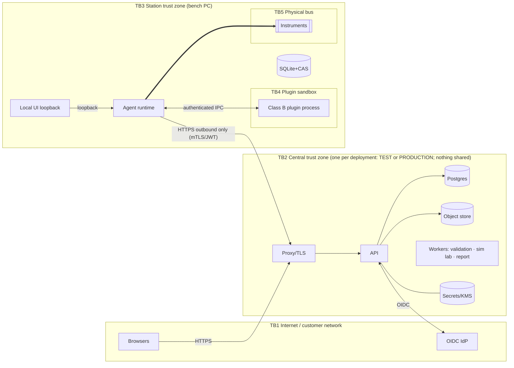

# SECURITY_MODEL.md

| | |
|---|---|
| Status | Draft 0.2 — includes no-code-specific threats (authored configuration as an attack surface) |
| Related | [ARCHITECTURE](ARCHITECTURE.md) · [NO_CODE_ARCHITECTURE](NO_CODE_ARCHITECTURE.md) · [CONFIGURATION_GOVERNANCE](CONFIGURATION_GOVERNANCE.md) · [PLUGIN_SDK_SPEC](PLUGIN_SDK_SPEC.md) · ADR-0004/0005/0007/0008/0014/0018 |

## 1. Security principles

| ID | Principle |
|---|---|
| SEC-P1 | **No cloud-to-instrument path.** Central never sends instrument commands; stations make outbound connections only. |
| SEC-P2 | **Instrument safety is enforced by trusted components outside editable content**: Absolute Hardware Limits (signed pack) are immutable to configuration; Safety Profiles may only narrow within them (ADR-0023). |
| SEC-P3 | **Configuration is data, never code** in Class A; Class B code is isolated, signed, capability-limited. |
| SEC-P4 | **Least privilege** everywhere: RBAC + ABAC authorizations; plugins and services get minimum capabilities. |
| SEC-P5 | **Tamper evidence** for journals, audit, configuration and results (hash chains, signatures, immutability). |
| SEC-P6 | **Tenant isolation** by construction (RLS) and by test. |
| SEC-P7 | **Secrets are never data**: never in config, manifests, logs, images, plugins. |
| SEC-P8 | **Fail closed**: unverifiable signature, digest mismatch, uncovered hazard, expired metadata ⇒ deny. |
| SEC-P9 | **Verify, don't trust** content from any source, including authors with permissions (validation pipeline, review). |
| SEC-P10 | **Defense in depth** and honest limits: isolation is not a guarantee against malicious signed code. |
| SEC-P11 | **Test and Production are separate deployments** sharing no database, secret, key, network, agent, queue or trust root; configuration crosses only via verified Release Packages (ADR-0024). |
| SEC-P12 | **Administrators administer; they do not approve.** Platform Administrators cannot hold or bypass safety/configuration/result approval authority; privileged grants require dual control. |

## 2. Assets and trust boundaries

| Asset | Why it matters |
|---|---|
| Calibration records (journals, results, snapshots) | Legal/commercial evidence |
| Published configuration (procedures, limits, rules, safety profiles) | Determines what is measured/accepted; safety |
| Signing keys & trust roots | Authenticity of everything deployed |
| Instruments & reference standards | Physical safety, expensive equipment |
| Credentials/tokens/secrets | Access |
| Personal data (users) | Privacy |

## 3. Actors
Authenticated users (by role); external attacker; malicious/careless **authorized author** (Builder user); malicious plugin publisher; compromised station; compromised update/registry source; insider with DB access; local OS user on a station; network attacker on LAN; malicious customer-supplied file (CSV/XLSX/package/image).

## 4. Authorization model

### 4.1 Layers
1. **RBAC**: permissions are `resource:action`; roles = sets; assigned at tenant or lab scope.
2. **Scope**: deployment (fixed per installation), tenant, lab (RLS + app checks).
3. **ABAC authorizations**: per-user competence (procedure/instrument family/hazard class) — required to run or author hazardous items.
4. **Separation of duties** rules (author ≠ approver; executor ≠ result approver; two safety approvers).
5. **Policy gates** (lab policies): block vs. warn, staleness, offline duration.

### 4.2 Permission families (see GOVERNANCE §2 for config domain)
`tenant.*`, `lab.*`, `user.*`, `role.*`, `station.*`, `asset.*`, `standard.*`, `customer.*`, `job.*`, `run.view/execute/abort`, `result.submit/review/approve/withdraw`, `report.generate/issue`, `audit.view/export/verify`, `config.*`, `driver.*`, `safety.*`, `metrology.*`, `package.*`, `deploy.*`, `release.*`, `change.*`, `trust.issuer.*`, `grant.*`, `hardware_limits.*`, `plugin.review/enable/revoke`, `backup.manage`, `policy.edit`.

### 4.3 Default role matrix (excerpt; Y = permitted, A = with additional authorization, — = no)

| Capability | Technician | Approver | Lab Mgr | Quality | Builder | Safety Officer | Platform Admin | Auditor |
|---|---|---|---|---|---|---|---|---|
| Execute run (production) | A | — | — | — | — | — | — | — |
| Execute run (simulation) | Y | — | Y | — | Y | — | — | — |
| Submit result | Y | — | — | — | — | — | — | — |
| Approve result | — | Y (≠ executor) | — | Y | — | — | — | — |
| Edit drafts | — | — | — | — | Y | Y (safety) | — | — |
| Approve config | — | metrology | — | Y | — | safety | — | — |
| Publish / deploy | — | — | — | publish | — | — | — | — |
| Manage users/stations | — | — | lab-level | — | — | — | Y | — |
| View audit | — | — | Y | Y | — | — | Y | Y |

(Full matrix generated from the role catalog and tested — AC-SEC-02.)

### 4.4 Decision logging
Allow/deny for sensitive actions is audited; denials on safety/approval paths raise alerts.

### 4.5 Safety ownership and separation of duties (ADR-0023)

| Role | Key permissions | Cannot |
|---|---|---|
| **Lab Safety / Metrology Administrator** | `safety.manage` (create/maintain Safety Profiles in the Safety Console), submit for approval | Approve; hold Safety Officer role for the same lab |
| **Safety Officer / Technical Authority** | `safety.approve`, `safety.withdraw`, hardware-limits signing key (threshold policy) | Author the same change; be a platform admin |
| **Quality Manager** | `safety.approve.compliance` (additional approval for metrological/compliance-affecting changes), policy/report approvals | Author the same change |
| **Calibration Engineer** | `run.execute` (production); Builder permissions for non-safety kinds in **Test** deployments only | Modify Safety Profiles; modify anything during a calibration |
| **Platform Administrator** | Users, roles (propose), stations, infrastructure | Any `safety.*`, `config.approve.*`, `result.approve`; complete dual-control grants; edit approvals or audit |

Enforcement mechanisms (not policy alone):
- **Toxic-combination validator** on every role assignment (platform admin ⟂ approval permissions; LSMA ⟂ Safety Officer per lab); violations rejected and audited. No override.
- **Privileged grant dual control**: a role containing `safety.*`/approval permissions takes effect only after approval by a Safety Officer (or Quality Manager for compliance roles) who is neither grantor nor grantee.
- **Approvals bind to digests** and are produced by step-up re-authentication.
- **No database path**: the application role cannot update approvals/audit/versions; migration role is not used at runtime; production DB superuser access is break-glass, monitored, and cannot silently alter hash-chained records (verification detects).
- **Absolute Hardware Limits** are signed on a separate TUF-style `hardware-limits` role with offline keys held by the Safety Officer (and Quality Manager where compliance-impacting); the Platform Administrator cannot sign or substitute a pack; stations verify signature, expiry and monotonic version.
- Break-glass is available only in the **fail-safe direction** (withdraw, rollback) for Safety Officer or Quality Manager; there is no break-glass for loosening a limit.

### 4.6 Deployment isolation and production change control (ADR-0024)
- Separate deployments: DB, object store, queue, secrets/KMS, JWT/config/release/result signing keys, trust roots, audit chains, backups, OIDC client registrations and stations. No shared network or volume (CI isolation test, NFR-21).
- Deployment identity `{deployment_id, environment_kind}` in tokens, signed metadata, journals; services/agents reject mismatches (`DEPLOYMENT_MISMATCH`).
- **Station pinning:** enrolment binds a station to one deployment; changing it requires wipe + re-enrolment (audited). Test stations use only the simulator and an explicit test-instrument allow-list; they never receive production data or manifests.
- **Production change control:** authoring endpoints/UI disabled; only Release import/approval, assignment/rollback, withdrawal and Change Requests exist; every action audited; Change Request approvals follow the approval matrix.
- **Release trust:** Production accepts Release Packages only from **Trusted Release Issuers** (public keys of Test deployments), managed under dual control; packages are re-validated in production mode and independently approved; signature chain re-attested on release.
- No production run/measurement data is ever copied to Test; diagnostics bundles shared across deployments are redacted of production data by policy.

## 5. Authentication
Per ADR-0014: local (Argon2id, optional TOTP), optional OIDC (Auth Code + PKCE, JWKS validation, `iss`/`aud`/`exp`/`nonce`, group→role mapping), short-lived JWT access tokens, rotating refresh tokens with reuse detection, step-up re-authentication for approvals/publish/safety actions, session binding and idle timeouts, brute-force throttling, account lockout with audit. **Stations**: enrolment → keypair → client-assertion tokens; mTLS optional; immediate revocation. **Offline operators**: signed offline grants + local credential; scope-limited and expiring.

## 6. Tenancy and isolation
RLS on every tenant table (ADR-0008) with generated coverage test; per-request `SET LOCAL` of tenant/lab (environment is a deployment constant, not a partition); DB role cannot bypass RLS; object-store keys prefixed by tenant with per-tenant access checks (no client-visible raw keys; pre-signed URLs short-lived and scoped); caches and job queues carry tenant context; logs carry tenant_id. Cross-tenant package import denied unless explicit export/import by authorized users.

## 7. Secrets handling

| Secret | Storage | Rotation |
|---|---|---|
| DB credentials | Docker secrets / `SecretProvider` (Vault/KMS adapters) | Scheduled |
| JWT signing keys | KMS/secret store; JWKS publishes public keys with `kid` | Overlapping rotation |
| Config-signing & result-signing keys | KMS/HSM-capable (Ed25519) | Ceremony + metadata update |
| OIDC client secret | `SecretProvider` | Per IdP policy |
| Station private key | Windows CNG/DPAPI (TPM-backed where available) | Re-enrol |
| Instrument credentials (LAN passwords) | Station secret store; referenced by name in driver connection; resolved by broker | Admin action |
**Per-deployment separation:** Test and Production use different secret stores/KMS, signing keys (config-signing, release-signing, JWT, result-signing), DB credentials and OIDC client registrations; no secret or key is valid in both. Rules: pre-commit and CI secret scanning (gitleaks); no secrets in config items (validator rejects high-entropy strings in designated fields and known patterns); redaction processors in logging; diagnostics bundles scrub; error messages never echo secrets.

## 8. Cryptography
| Use | Algorithm |
|---|---|
| Transport | TLS 1.2+ (prefer 1.3); HSTS; modern ciphers |
| Signatures | Ed25519 |
| Hashes | SHA-256 (digests, hash chains) |
| Passwords | Argon2id with tuned parameters |
| Token signing | EdDSA or ES256 (decided by IdP interop; ADR-0014) |
| At-rest (DB, object store) | Platform disk/volume encryption required in deployment guide; field-level encryption for sensitive personal data optionally; station SQLite encryption *should* (SQLCipher/OS-level BitLocker policy) |
| Canonicalization | RFC 8785 JSON |
Key hierarchy: offline `root` → `targets`/`snapshot`/`timestamp` (online, short expiry) → signing keys per role; compromise runbook with revocation propagation (ADR-0004).

## 9. Trust model for configuration (Class A)
- **Threat**: an authorized author (or compromised account) publishes harmful configuration. **Controls**: no code execution in Class A; typed bounded languages; hazard classes + Safety Profile in broker; mandatory review/SoD (Safety Officer ≠ LSMA author; + Quality Manager where compliance-affecting) and immutable Absolute Hardware Limits; staged/canary activation; impact analysis; immutable audit; production gating of `synthetic_demo`/unresolved inputs; rollback.
- Runtime treats configuration as **untrusted input** even when signed: it validates schemas/limits again on load (resource caps: AST size, nesting depth, list lengths, string lengths, asset sizes) to prevent DoS.
- **Expression DoS**: cost bound and size caps (ADR-0017); evaluation in worker with time limit centrally.
- **UI/report injection**: no raw HTML/JS; restricted Markdown sanitizer; allow-listed widgets/actions; CSP; image MIME sniffing; SVG disallowed unless sanitized (default disallow); report text escaping at render; fonts from approved set.
- **Template/parameter injection to instruments**: typed parameters, fixed formatters, control-char rejection, compound flag gated (ADR-0018).
- **CSV/XLSX import**: parsed server-side with strict type mapping; formula cells treated as text; macro-bearing files rejected; size/row caps.

## 10. Trust model for Class B plugins
See PLUGIN_SDK_SPEC: signed + countersigned, capability declarations, out-of-process, Job Object, firewall isolation, IPC auth, resource limits, revocation, SBOM, conformance kit, per-lab enablement. Honest limit: a malicious but correctly signed plugin with broad capabilities is mitigated by review and revocation, not eliminated by sandboxing.

## 11. Secure updates
| Artifact | Mechanism |
|---|---|
| Agent | Signed MSI + signed TUF-style update metadata; staged install; health check; automatic rollback; no update during runs |
| Plugins & configuration | Signed manifests via feed; staged; activation when idle; rollback-protection (monotonic versions/expiry) |
| Central | Container images signed (cosign/Notary) and scanned; migrations via separate job; backups before schema change; rollback plan per release |
| Revocation | Propagates in signed feed; stations apply under staleness policy |
| Hardware Limits Pack | Separate `hardware-limits` TUF-style role, offline threshold signing (Safety Officer mandatory), expiry + monotonic version, read-only store at station, loader verification at start and run start; unverifiable pack ⇒ H2+ refused |
| Release Package (Test → Production) | Signed by Test release-signing key; verified against Production's Trusted Release Issuers; digests re-checked; re-validated and independently approved in Production; re-attested by Production on release |
Mix-and-match, rollback, freeze, and key-compromise attacks are covered by TUF roles (snapshot/timestamp expiry, thresholds).

## 12. Data protection and privacy
Data minimization (user name/email only), pseudonymous IDs in logs, configurable retention (Q-04), export/deletion workflow honoring legal retention for calibration records (cryptographic erasure for personal fields where permitted), backups encrypted, access to production data by operators audited. Customer data segregation by tenant.

## 13. Audit
Hash-chained append-only audit (ADR-0007) of: authentication events, authorization denials on sensitive paths, config lifecycle, safety events, approvals, deployments, sync conflicts, key operations, admin changes, plugin enablement. Verification job + external anchoring option. Separate from application logs; no PII beyond IDs.

## 14. Threat model (STRIDE)

Likelihood/Impact: L/M/H (qualitative; to be re-scored in the Phase 0 threat-modeling workshop). "Test" references acceptance tests in §17.

| ID | Threat | STRIDE | Component | L | I | Mitigations | Residual | Test |
|---|---|---|---|---|---|---|---|---|
| THR-01 | Stolen user credentials used to approve results | S | API | M | H | MFA/step-up, SoD, rate-limit, anomaly alerts, audit | Insider collusion | T-AUTH-3 |
| THR-02 | Forged station impersonates a real one | S | Sync | L | H | Enrolment keypair, client assertion, optional mTLS, revocation | Key theft from station | T-STN-1 |
| THR-03 | Replay/duplicate sync batches | T | Sync | H | M | event_id+hash idempotency, seq checks, TLS | — | T-SYNC-1 |
| THR-04 | Tampering with local journal/SQLite | T | Station | M | H | Hash chain, startup verification, ACLs, central verification on sync | Local admin can destroy (not forge) data | T-JRN-1 |
| THR-05 | Tampering with approved results in DB | T | DB | L | H | Immutability grants/triggers, hash chain, signed snapshot, backup compare | DB superuser | T-IMM-1 |
| THR-06 | Cross-tenant data access (IDOR, SQLi, missing filter) | I | API/DB | M | H | RLS, generated authz tests, parameterized queries, opaque IDs | — | T-TEN-1 |
| THR-07 | Malicious Class B plugin exfiltrates/damages | E/I | Plugin host | M | H | Review, signing, capability limits, isolation, firewall, revocation | Malicious but reviewed code | T-PLG-1 |
| THR-08 | Supply-chain compromise of dependency or build | T | CI/Build | M | H | Pinned hashes, SCA, SBOM, signed releases, reproducible builds, provenance | Zero-day | T-SC-1 |
| THR-09 | Update channel compromise (malicious update) | T/E | Updater | L | H | TUF roles, thresholds, offline root, signature verification, rollback protection | Root key compromise | T-UPD-1 |
| THR-10 | DNS rebinding / CSRF against station local UI | S/E | Local UI | M | M | Loopback bind, Host/Origin checks, per-session token, SameSite, CSP | — | T-LUI-1 |
| THR-11 | Local OS user abuses service (reads secrets, drives instruments) | E | Station | M | M | Service account ACLs, DPAPI/TPM key, kiosk hardening, audit; physical/OS security is IT-owned | Local admin | T-OS-1 |
| THR-12 | Hazardous SCPI sent by authored procedure | E | Driver/Broker | M | H | Hazard classes, permissions, AHL ∩ SafetyProfile enforcement, role-separated review (ADR-0023), fail closed | Wrong Safety Profile values (content error) | T-SAF-1 |
| THR-13 | Safety Profile weakened or bypassed | T/E | Config/Broker | L | H | Separate kind/permission/approval, broker enforces pinned approved profile, audit, no procedure override | Collusion of LSMA and Safety Officer (bounded by immutable AHL tier, audit, periodic independent review) | T-SAF-2 |
| THR-14 | Template/command injection via typed parameters | T | Driver interpreter | M | H | Typed formatters, control-char rejection, no free interpolation, fuzz tests | Parser bug | T-INJ-1 |
| THR-15 | Expression engine DoS / unbounded cost | D | Expr | M | M | Total language, cost bound, size caps, worker time limits | — | T-EXPR-1 |
| THR-16 | XSS/HTML injection via authored UI/report text | T/I | UI/Report | M | M | Restricted Markdown, sanitizer, CSP, no raw HTML, escaping | — | T-XSS-1 |
| THR-17 | Malicious package/CSV/image upload | T/D | Import | M | M | Signature/digest checks, allow-lists, size caps, type sniffing, sandboxed parsing | — | T-IMP-1 |
| THR-18 | Valid-but-wrong configuration (error or sabotage) published | T | Governance | M | H | Test vectors, review, SoD, scenarios, canary, impact analysis, rollback | Reviewer miss | T-GOV-1 |
| THR-19 | Simulation output presented as calibration | R/I | Whole | M | H | Non-removable marking, mode invariants, negative tests (ADR-0013) | — | T-SIM-1 |
| THR-20 | Repudiation of actions by users | R | API | M | M | Attributed audit, step-up auth, e-signature (if enabled) | — | T-AUD-1 |
| THR-21 | Clock manipulation to hide/alter timing or bypass due dates | T | Station | M | M | Monotonic+wall, skew detection at sync, central authority for due-date gates, flagged events | Offline skew within threshold | T-CLK-1 |
| THR-22 | Preview/Simulation Lab used to reach real hardware or data | E | Workers | L | H | No VISA/network egress, simulator-only transports, separate network policy | — | T-PRV-1 |
| THR-23 | Secrets leakage via logs/diagnostics/config | I | All | M | H | Redaction, secret scanning, validators, bundle scrubbing | — | T-SEC-1 |
| THR-24 | Backup theft or malicious restore | I/T | Ops | L | H | Encrypted signed backups, governed restore, second approver | Key compromise | T-BKP-1 |
| THR-25 | Privilege escalation through role/permission edits | E | RBAC | L | H | Role edits audited, SoD, step-up, no self-escalation, config of roles under `role.admin` only | Admin abuse | T-RBAC-1 |
| THR-26 | Denial of service on API / sync | D | API | M | M | Rate limits, quotas, autoscaling workers, back-pressure | — | T-DOS-1 |
| THR-27 | Wrong instrument connected on resume / identity spoof | S | Engine | M | M | Serial binding, reconcile identity, simulation marker rules | Spoofing at SCPI level | T-ID-1 |
| THR-28 | Platform administrator bypasses or forges safety/config approvals | E/T | RBAC/DB | L | H | Toxic-combination validator, dual-control grants, approvals bound to digests, no approval-edit path, audit chain verification, DB break-glass monitoring | Colluding privileged insiders with DB superuser | T-RBAC-2 |
| THR-29 | Absolute Hardware Limits pack tampered, replaced, or downgraded | T/E | Station/loader | L | H | Offline threshold signing, expiry, monotonic version, read-only store, verification at start/run start, fail-closed | Compromise of signing keys | T-AHL-1 |
| THR-30 | Test content/agent reaches Production (or vice versa) | E/I | Deployments | M | H | Separate deployments, identity pinning, DEPLOYMENT_MISMATCH rejections, Release-only promotion, isolation test, network segmentation | Operator error in network config | T-ENV-1 |
| THR-31 | Malicious/forged Release Package | T/S | Release import | L | H | Signature against Trusted Release Issuers, digest checks, production-mode re-validation, independent approval, importer ≠ approver | Compromised Test release-signing key | T-REL-1 |
| THR-32 | Direct edit of production configuration outside change control | T | Production | M | H | Authoring surface disabled, DB immutability, Change Request workflow, audit | DB superuser (detected by chain) | T-PROD-1 |
| THR-33 | Trusted-issuer list manipulated to accept hostile packages | T/E | Release trust | L | H | Dual control (Admin proposes; QM + Safety Officer approve), audit, alerts | Collusion | T-REL-2 |
| THR-34 | Test station pointed at production instruments (misconfiguration) | E | Station | M | H | Test-instrument allow-list, simulator default, deployment pinning, no production assets in Test DB, network segmentation | Physical cabling error | T-ENV-2 |

## 15. Secure SDLC
Threat-model reviews per release; SAST (Bandit/Semgrep, ESLint security), SCA (`pip-audit`, `npm audit`, Dependabot-class), secret scan, container scan (Trivy-class), IaC scan, DAST baseline (ZAP) against staging, fuzzing (expression parser, driver formatter/parser, package loader, sync ingest), SBOM (CycloneDX) per artifact, signed releases with provenance, dependency pinning and review, mandatory code review, security regression tests per fixed vulnerability, annual external penetration test (and before GA), vulnerability disclosure policy.

## 16. Incident response hooks
Alerts on: audit chain failure, repeated signature failures at stations, safety violation spikes, authz-denial bursts, revoked-artifact use, sync integrity conflicts, mass login failures. Runbooks: key compromise, tenant isolation bug, malicious config, malicious plugin, station theft.

## 17. Security acceptance criteria / tests

| ID | Criterion |
|---|---|
| AC-SEC-01 | Every tenant-scoped table has RLS and a passing cross-tenant probe test (generated). |
| AC-SEC-02 | RBAC matrix is generated from code and equals the documented matrix; every endpoint has a deny test. |
| AC-SEC-03 | A forged/garbled/expired/rolled-back config bundle, plugin package, or agent update is rejected (separate tests per attack: tamper, mix-and-match, rollback, freeze, wrong signer). |
| AC-SEC-04 | A command with an out-of-envelope argument is refused by the broker regardless of procedure content; with no approved Safety Profile, H2+ publish for real transports is blocked. |
| AC-SEC-05 | Fuzzing campaigns (parser, formatter, package loader, ingest) run in CI nightly with zero open crashes. |
| AC-SEC-06 | Local UI rejects requests with wrong Host/Origin/token (DNS-rebinding test). |
| AC-SEC-07 | XSS test corpus in authored text/report fields never executes script in UI or PDF. |
| AC-SEC-08 | Secret scanning finds none in repo, images, manifests; injected canary secrets never appear in logs/diagnostics. |
| AC-SEC-09 | Tamper tests on journal, audit, config versions and results are detected by verification routines. |
| AC-SEC-10 | External penetration test completed; no unresolved critical/high. |
| AC-SEC-11 | Toxic role combinations are rejected for every assignment path (UI, API, import); privileged grants take effect only after dual-control approval by a different Safety Officer/Quality Manager. |
| AC-SEC-12 | A configuration, API call or admin action cannot widen or override an Absolute Hardware Limit; a pack with a bad/expired/rolled-back signature is rejected and H2+ operations fail closed. |
| AC-SEC-13 | Cross-deployment probes (token, manifest, package, enrolment, station) from Test against Production and vice versa are rejected with `DEPLOYMENT_MISMATCH` or `RELEASE_ISSUER_UNTRUSTED`. |
| AC-SEC-14 | Production exposes no authoring endpoint (`PRODUCTION_CHANGE_CONTROL` on all draft/edit routes) and the application DB role cannot modify versions, approvals or audit. |
| AC-SEC-15 | Test stations cannot open any resource outside the simulator and the explicit test-instrument allow-list; no production data exists in the Test database after a full workflow run. |
