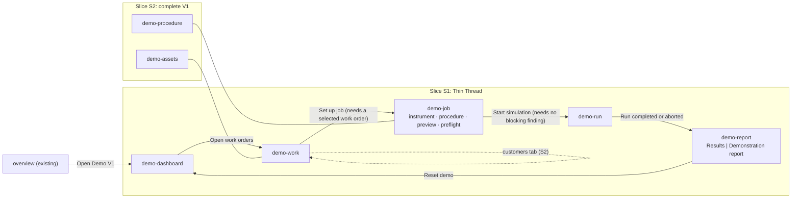
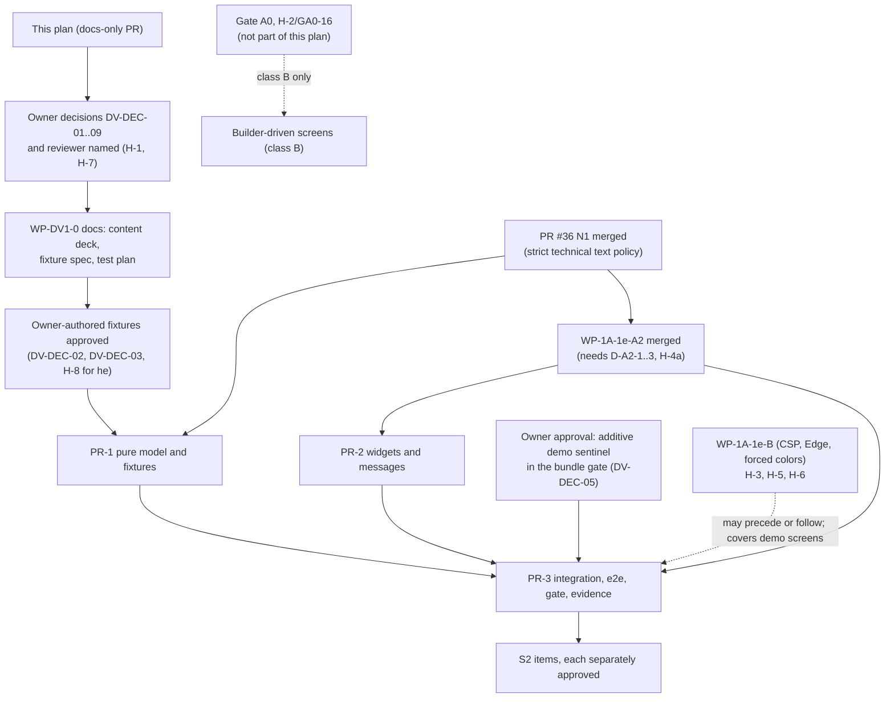

# DEMO_V1_PLAN.md — Accelerated Demo V1: product, UX and delivery plan

| | |
|---|---|
| Status | **Proposal, documentation only, for product-owner approval.** It is not an ADR and grants no approval. It authorises no code, workflow, dependency, schema, gate or governance change and starts nothing. Every package below is assigned only by the owner, manually. |
| Assignment | [Issue #37](https://github.com/avihafif/calibration-os/issues/37) (owner direction approved 2026-11-06: plan the demo in parallel with the closure of PR #36, without weakening any gate). |
| Baseline | `main` at `763593d` (2026-11-06). [PR #36](https://github.com/avihafif/calibration-os/pull/36) (WP-1A-1d-N1, Unicode display policies; draft, head `8fe0f95` when this was written) is **not** in `main`; this plan neither modifies nor depends on its branch, only on its *merge* (section 14). |
| Owner decisions | Defaults of DV-DEC-01 to DV-DEC-09 accepted by the owner on 2026-11-07 (section 18.1). The document itself still authorises no code and starts no work package. |
| Revision 2026-11-07 (b) | Corrected after the WP-DV1-0 review (draft PR #39): scenario step counting (11 counted steps plus an implicit end marker), serial id format `SYN-SER-nnn`, the banned wording "no approved rule" (now "no decision rule defined") and the wireframe control labelled "Approve" (now "Record actions: unavailable"), the `MI-xx` placeholder (now MI-07), the digest wording in the report wireframe, a fifth work-order status (On hold), the sample table rows, the start-rule precedence (DV-FN-04) and the Vitest discovery note. Scope (S1), decisions and constraints are unchanged. |
| Written by | The same agent family (Claude) that wrote the N-1 proposal, the WP-1A-1e specification and the PR reviews. A human or a different reviewer should weigh this plan (H-7); it is not an independent audit of anything. |
| Related | [`AGENTS.md`](../../AGENTS.md) · [NO_CODE_ARCHITECTURE](../NO_CODE_ARCHITECTURE.md) · [UI_UX_SPEC](../UI_UX_SPEC.md) · [CAPABILITY_MATRIX](../NO_CODE_CAPABILITY_MATRIX.md) · [Gate A0](../PHASE1A_GATE_A0.md) · [PHASE1A plan](../PHASE1A_IMPLEMENTATION_PLAN.md) · [SEQUENCE_AND_A2](../wp-1a-1e/SEQUENCE_AND_A2.md) · [HUMAN_APPROVALS](../wp-1a-1e/HUMAN_APPROVALS.md) · [design system](../phase1a/01_DESIGN_SYSTEM.md) · [design prototypes](../../design/README.md) |
| Wireframes | [`wireframes/`](wireframes/): dashboard (en, light) · dashboard (he, RTL, dark) · run console · results and report. Composition only; every number and Hebrew string in them is a placeholder. |

## 1. Summary and what the owner is asked to decide

**Goal.** A visible, interactive, end-to-end CalOS demonstration that a person can run locally on Windows in five minutes: *dashboard → customer and work-order selection → calibration job and read-only procedure preview → scripted step-by-step simulation → synthetic results and a watermarked, explicitly non-official demonstration report*. It is enterprise-quality in look and accessibility, bilingual (he/en, RTL), and **entirely synthetic and in memory**.

**What it is not.** It is not a Builder, not a metadata renderer, not a calibration, not an execution engine, not authentication, and it contains no metrology. Nothing in it can be mistaken for, or turned into, a calibration record.

**Recommendation.**

| Question | Recommendation |
|---|---|
| Adopt this plan as the basis for Demo V1? | **GO**, after the owner answers or accepts the defaults in section 18. |
| Smallest useful vertical slice | **S1 "Thin Thread"** (section 11): 5 of the 8 planned screens (the registry, the full procedure view and the customers segment come later), 1 scripted scenario, he/en, delivered as 3 code PRs after N1 and A2. It tells the *whole* story end to end. |
| Reuse | Most of the UI is existing `ui-kit` (DataTable, DetailList, StatePanel, FindingsList, form controls, Badge, Card, Dialog, AppFrame) plus six small new generic widgets (section 7.3). No new dependency. |
| Sequence | **Keep the approved sequence** (N1, then A2, then demo code). Docs-only work (content deck, fixture specification) can start now beside PR #36 because it touches no code (SEQUENCE §1). Parallel *code* branches are a **separate reviewed change** the owner may choose (section 13.3, option P1); this plan does not assume it. |
| What blocks demo code | N1 merged; A2 merged (or an explicit owner reordering); owner decisions DV-DEC-01 to DV-DEC-05 and DV-DEC-08 (DV-DEC-05 is the owner's approval of one additive bundle-gate edit); a named independent reviewer. Section 18. |
| What the demo does **not** unblock | Gate A0, H-2, the Builder, any station, instrument, safety, metrology, signing or Production work (class C, section 3). |

## 2. Design principles and the Demo Safety Contract

The product principles in UI_UX_SPEC §1 apply unchanged: trust through clarity, operator calm, progressive disclosure, bilingual from the first pixel, accessible by default. Demo V1 adds one rule above them: **everything on screen is honest about being a demonstration**.

Each row below turns an existing normative rule into a design consequence. Rows are tested (section 15); none is optional.

| ID | Source rule | Design consequence for Demo V1 |
|---|---|---|
| DV-G-01 | AGENTS §2.2 simulation is never a calibration | The two protected markings stay on every route and cannot be themed away. Every report-like surface carries a permanent watermark (section 6.8). There is **no** approve, sign, issue, release, publish or export action for results, and the screen says why (disabled with reason). A lexicon test (Appendix B) bans claim words in both languages. |
| DV-G-02 | AGENTS §2.1 never invent metrology | The only unit is the synthetic unit `su` (the convention the design prototypes already use, with no physical meaning). **No** specification, tolerance, limit, test-point value, range, interval, standard, uncertainty or safety value. Where such a value would exist the screen shows `Input required` with its `MI-nn` marker. Fixture values are owner-authored `synthetic_demo` content (DV-DEC-02). |
| DV-G-03 | AGENTS §2.3 No-Code boundary | Demo code is **quarantined** in `apps/web/src/demo/**`, contains no instrument, manufacturer, model, customer or method logic (synthetic names are data), and is never reused as the Builder's renderer. It is a Test-only presentation exception that needs an explicit owner record (DV-DEC-01, DV-RISK-03). |
| DV-G-04 | AGENTS §2.4, ADR-0023 safety outside editable content | No Safety Profile editor, no hazard classes, no limit values, no envelope. Preflight shows "not applicable in simulation (no instrument)". |
| DV-G-05 | AGENTS §2.5, §2.6 | No SCPI or wire text is shown, no free-form command input exists, nothing connects to an instrument or a transport. |
| DV-G-06 | AGENTS §2.7 immutability | Nothing is called published, approved, final or issued. Run and report objects are labelled "scripted, this session"; no digest, hash chain or "verified" claim is displayed (the prototypes' simulated audit chain is exactly what the handoff says never to ship as real). |
| DV-G-07 | AGENTS §2.8, §2.9 decimals, determinism | Values are decimal strings with `su`; no float arithmetic, no computed statistics in S1; no clock, no `Date.now`, no `new Date()`, no randomness, no timers in S1. The run is a scripted state machine advanced by the user. |
| DV-G-08 | AGENTS §2.10, §2.11, §2.14 | No secrets, no personal data, no tenants, **no authentication, no login, no user menu, no persona switcher, no roles** (issue #37). The run header says "scripted operator step", never a person. |
| DV-G-09 | AGENTS §2.12 baseline stack | No new dependency or infrastructure. No chart, state, router, PDF or date library (`approvedExternal` is closed). Charts are in-house SVG or semantic HTML. |
| DV-G-10 | AGENTS §2.13, §9, ADR-0024 | Test only. The Production Rehearsal bundle contains **no** demo route, component, fixture or sentinel; a gate asserts it (DV-DEC-05). No `synthetic_demo` content ships in production-targeted output. |
| DV-G-11 | UI_UX_SPEC §11 content rules | "limit check", "within limits", "not evaluated"; never "pass", "fail", "calibrated", "certified". |
| DV-G-12 | AGENTS §5 Definition of Done | he/en keys, RTL, a11y, requirement IDs, docs and capability-matrix rows, evidence of what was and was not verified. |
| DV-G-13 | SEQUENCE_AND_A2 §1 | Code branches stay sequential unless the owner records a reviewed change. This document changes no approval or sequence. |

## 3. Classification model and inventory

Issue #37 asks for three classes. This plan classifies **every** feature and refuses to deliver anything outside class A.

| Class | Meaning | Delivered by Demo V1? |
|---|---|---|
| **A** | Pure presentation with entirely synthetic in-memory state, Test deployment only | **Yes. This is the whole scope.** |
| **B** | True schema-driven No-Code Builder functionality (metadata kinds, editors, renderers) | **No.** Waits for Gate A0, H-2/GA0-16 and the decisions listed. |
| **C** | Real station, instrument, calibration, security, metrology, signing or Production functionality | **No.** Each item needs its own specification, review and approval. |

### 3.1 Class A: in scope (all in memory, reload resets)

| # | Feature | Slice |
|---|---|---|
| A1 | Operations dashboard: KPI tiles and status meters derived from the in-memory demo state, a session activity list | S1 |
| A2 | Work-order list with search, status filter and sort; customer and instrument detail panels | S1 |
| A3 | Instrument and asset registry (list, filters, detail, scripted identity-check states) | S2 |
| A4 | Customer list and in-memory "new synthetic work order" form with local validation | S2 |
| A5 | Calibration job set-up: instrument, procedure choice with compatibility reasons, simulated standard roles, preflight findings, mode confirmation | S1 |
| A6 | Read-only visual procedure preview from a typed synthetic descriptor (outline, groups, input-required markers, no editing) | S1 (embedded), S2 (own route) |
| A7 | Simulated execution console: scripted state machine, user-advanced steps, readings table, operator prompt, event log, abort with confirmation, reset | S1 |
| A8 | Synthetic results table and the non-official demonstration report sheet with watermark | S1 |
| A9 | Second and third scripted scenarios (interrupted run, scripted communication fault) | S2 |
| A10 | Print stylesheet for the report with the watermark preserved (owner decision DV-DEC-07) | S2 |
| A11 | Navigation grouping for the demo entries, in-house SVG bar chart with a table alternative | S2 |
| A12 | he/en/RTL, pseudo-locales, light/dark, forced colors, 320 to 1440 px | S1 and S2 |

### 3.2 Class B: not delivered; what it would take

| # | Item | Why it is B | Waits for |
|---|---|---|---|
| B1 | Registry, work-order, job and dashboard screens **rendered from metadata** (UiPage, UiForm, dashboard widgets from the catalog; matrix rows 4.1 to 4.5) | Demo screens are code. The product renders configuration. | Gate A0, H-2/GA0-16, ADR-0020 ratification, WP-1A-3 (inspector/editor-core), `ui-runtime` |
| B2 | Real `InstrumentFamily`, `InstrumentModel`, `Asset`, `Customer`, `CalibrationJob` kinds, schemas, fixtures, codegen | Only the `manufacturer` and `package-manifest` schemas (and a schema-proof fixture) exist today | WP-1A-2, D-11, R-4 follow-ups |
| B3 | Procedure preview from a real `Procedure` item and the step catalog; the Procedure Designer | The demo uses a typed descriptor shaped like, but not validated against, the step catalog | Procedure kind and catalog entries, WP-1A-3 to 5 |
| B4 | Authoring (create or edit a procedure, screen, report template, translation) | Builder functionality | WP-1A-5 and Gate A0/H-2 |
| B5 | Schema-driven forms for customers and work orders (editor-core, inspector renderer) | Generic inspector is Builder scope | WP-1A-3 |
| B6 | Synthetic review, approve and publish UX over drafts (D-28) | Approved as a **Builder** UX simulation, not for run results | WP-1A-4/5 |
| B7 | Authored-content localization through `TranslationBundle` with fallback and reviewed terminology | ADR-0015/0020 amendments, Q-15, MI-31 | their own gates |
| B8 | Report templates designed in a Report Designer and rendered by a report block runtime | Matrix rows 5.x | Report work package |
| B9 | Simulator profiles authored as `SimulationProfile` items and executed by the simulator engine | Demo scenarios are scripts, not a simulator | Engine and driver work |

### 3.3 Class C: out of scope; each needs its own authorisation

Real station and instrument access (Station Agent, PyVISA, transports, Instrument Broker, identity verification over a wire); the engine, journal and resume semantics; Safety Profiles and Absolute Hardware Limits; any metrology (limits, uncertainty, decision rules, standards, certificates, intervals, rounding); authentication, authorisation, roles, SoD; persistence, tenants, RLS, audit trail; signing, Release Packages, trust roots, Production; real reports, certificates, PDF, accreditation text; real customers, assets or contacts; synchronisation and offline operation; ERP/LIMS integrations; desktop packaging; CSP enforcement and external deployment (WP-1A-1e-B).

## 4. Baseline: what exists on `main` and what Demo V1 reuses

Verified against `main` at `763593d`.

| Area | Exists | Demo V1 use |
|---|---|---|
| Shell | `AppFrame` (top bar, flat navigation, drawer at small widths, command palette, F6 regions, locale and theme switchers), `PageHeader`, `ProtectedMarkings` (Test and simulation markings), `WorkspaceErrorBoundary`, hash router (`#/<route-id>`, ids `[a-z][a-z0-9-]{0,31}`, no other URL state), focus-on-heading navigation controller | Unchanged. Demo routes plug into the existing route table. |
| Routes | `overview`, `technical`, `forms`, `data`, `host` (Test); `overview`, `technical` (Rehearsal). `routes.test.ts` asserts the exact Test list | Demo routes are added through a **separate** `buildDemoRoutes(kind)` so that existing assertions are not edited (section 13.2). |
| Data display | `DataTable` (sort, keyboard scroll region, sticky first column, locale-aware sort), `DetailList`, `StatePanel` (loading, empty, no-results, error, read-only), `FindingsList`, `DisplayText` with the technical policy (N1 hardens it) | Registry, customers, work orders, readings, procedure details, preflight findings |
| Forms | `TextField`, `TextArea`, `NumberTextField`, `Select`, `Checkbox`, `FormSummary`, `FormAnnouncement`, `isExactDecimalText` | Filters and the S2 "new work order" form |
| Primitives | `Button`, `Badge` (tones ok, warn, error, info, simulation), `Card`, `Notification`, `Dialog` | Status chips, panels, confirmations |
| Formatting | `formatQuantity`, `formatUtcDate`, `isolateLtr`, ICU system bundles (en, he, en-XA, he-XB), `messageReviewStatus` (Hebrew is `needs_review`) | Values, dates, plurals, pseudo-locale tests |
| Host status | Fake, memory-only `HostStatusView` and bar (A2 will harden it) | Shown unchanged ("simulated host status") |
| Tokens | Approved light and dark semantic tokens, protected `--sim`, `--deployment-test`, `--focus`; system font stack; 24 contrast pairs gate | No new colours (section 7) |
| Tests and gates | Vitest (jsdom), Playwright with axe (en/he, light/dark, 320/768/1440, forced colors, network isolation), boundary lint (90 negative probes as recorded in `docs/wp-1a-1e/EVIDENCE.md`; each PR re-measures), logical-CSS lint, design-token gate, bundle gate with Test-only sentinels | Reused; extended additively (section 16) |
| Design references | `design/phase1a-prototype` (Builder), `design/procedure-designer-prototype` (procedure outline, simulation lab, `su` convention, `MI-nn` markers), six procedure-designer screenshots | **Visual and behavioural reference only.** Never copied (design/README, Codex handoff §6). |

**Gaps** the demo needs that `ui-kit` lacks: KPI tile, status meter list, segmented control, step list, event log, and a read-only outline. They are listed with their accessibility behaviour in section 7.3.

**Constraints discovered while reading the code** that shape the plan:

- Vitest (`vitest.config.mjs`) discovers `packages/ts/i18n/src/**/*.test.ts`, `packages/ts/ui-kit/src/**/*.test.tsx`, and `apps/web/src/**/*.test.ts` and `*.test.tsx`. A new `ui-kit` test named `*.test.ts` would silently not run (the failure mode behind A2-15). New `ui-kit` tests are `.test.tsx`; `apps/web` demo tests may be either.
- ESLint forbids network, storage, `Date.now`, zero-argument `new Date()`, `innerHTML`, `eval`, `import.meta.glob` and `URL` construction, and `calos/no-hardcoded-ui-text` applies to `apps/web` and package `.tsx` files. Timers and `Math.random` are not lint-banned, but DV-G-07 bans them anyway in S1.
- `matchesSearchQuery` is documented as palette-only ("never use for identifiers or equality"). Record filtering uses a demo-local, documented helper unless the owner widens that helper's scope (DV-RISK-15).
- `check:browser-types` lists each Playwright spec by name: a new spec needs a one-line `package.json` edit (shared with A2/B).
- Existing Test-only UI strings already live in the system bundle (`route.data`, `views.*`). The demo follows that precedent for **chrome** strings, and keeps **fixture content** (names, ids, readings) in the quarantined module so the Rehearsal bundle contains none of it.

## 5. User journey and screen map

### 5.1 Story (about 5 minutes)

A synthetic lab ("Synthetic Lab 01") opens its day. The person at the keyboard plays the role of a lab manager and then a technician, without any persona switch: they simply move along the path.

| Step | Route id | What happens | Class |
|---|---|---|---|
| 1 | `demo-dashboard` | Sees synthetic KPIs and the work-order pipeline; the next-step card points to work orders | A |
| 2 | `demo-work` | Filters work orders, selects `SYN-WO-001`, reads its customer and instrument details | A |
| 3 | `demo-job` | Chooses a compatible procedure (an incompatible one is disabled with its reason), reviews the read-only preview and the preflight findings, confirms "Simulation", starts | A |
| 4 | `demo-run` | Steps through the scripted run, confirms one scripted operator step, watches readings and events appear; can abort or reset | A |
| 5 | `demo-report` | Reads the results table, then the watermarked demonstration report; sees why approval is unavailable; resets the demo | A |

S2 adds `demo-assets` (registry), `demo-procedure` (full preview) and a customers view inside `demo-work`.

### 5.2 Screen map



Every route is reachable directly (hash route) and by the command palette. Selection state lives in one in-memory store above the router, so Back and Forward do not lose context; a reload resets everything, and the dashboard says so.

### 5.3 Route and navigation table

| Route id | Navigation label (key) | Slice | Notes |
|---|---|---|---|
| `demo-dashboard` | Dashboard | S1 | Entry. `#/overview` stays the default landing route (existing canonicalisation tests unchanged); a card on `overview` links here. |
| `demo-work` | Work orders | S1 | S2 adds a Work orders / Customers segmented control. |
| `demo-job` | Job set-up | S1 | Contains the embedded procedure preview. |
| `demo-run` | Run console | S1 | Reached from `demo-job`; direct entry without a started job shows an empty state with the reason. |
| `demo-report` | Results and report | S1 | Direct entry without a completed run shows an empty state. |
| `demo-assets` | Instruments and assets | S2 | Registry. |
| `demo-procedure` | Procedure preview | S2 | Full lane view. |

Navigation is flat in S1 (five more items in the existing list). Grouping needs an `AppFrame` change owned by PR #28/A2, so it is a S2 item scheduled after A2 (section 13).

## 6. Screen specifications

Common to all demo screens: `PageHeader` with the page title; a `synthetic_demo` provenance chip beside every data block; the localized Hebrew `needs_review` note already used by the shell; `StatePanel` for loading, empty, no-results and error states; every identifier through `DisplayText technical` (LTR isolate, strict Unicode policy from N1); every quantity through `formatQuantity` with unit `su`; logical CSS only; no hard-coded strings.

### 6.1 Operations dashboard (`demo-dashboard`, S1) · [wireframe en](wireframes/01-dashboard-en.svg), [wireframe he RTL](wireframes/02-dashboard-he-rtl.svg)

Persona: P3 Lab Manager. Purpose: orientation and the invitation to start.

| Block | Content | Source |
|---|---|---|
| KPI tiles (4) | Open work orders; instruments available of total; jobs ready to simulate; simulated runs in this session | Derived from the in-memory store; a completed run changes the numbers without reload |
| Status meters | Work orders by status: Received, Ready, In simulation, Demo report ready, On hold (five statuses, so that ten work orders can be "open" at seed and none is "in simulation" before a run), each bar with its label and number as text | `StatusMeterList` (semantic list, not colour only) with "Show as table" toggle |
| Next step | "Start the demonstration path" button to `demo-work` | Link button |
| Activity | Session events (job created, run started, run completed or aborted, demo reset) | Store event list; empty state text when none |

Words to avoid: "completed" and "approved" for work orders (they imply real status); the last status is **"Demo report ready"**.

### 6.2 Work orders, customers and instruments (`demo-work`, S1)

Persona: P3 then P1. Layout: filter row, `DataTable`, two detail cards.

```
┌ Work orders ───────────────────────────────────────────  [synthetic_demo] ┐
│ Search [____________]   Status [ All ▾ ]          10 of 10 shown            │
│ ┌ DataTable (sortable, keyboard scroll region, sticky first column) ─────┐ │
│ │ ID          Customer            Instrument     Priority  Status  Detail │ │
│ │ SYN-WO-001  Synthetic cust. 001 SYN-AST-003    Normal    Ready   [Select]│ │
│ │ SYN-WO-002  Synthetic cust. 002 SYN-AST-004    High      Ready   [Select]│ │
│ └────────────────────────────────────────────────────────────────────────┘ │
│ ┌ Customer ───────────────┐ ┌ Instrument ───────────────────────────────┐ │
│ │ DetailList: id, name,   │ │ DetailList: id, class, serial, status,    │ │
│ │ site, contact (none)    │ │ last scripted event                       │ │
│ └─────────────────────────┘ └───────────────────────────────────────────┘ │
│ [ Set up job → ]   disabled until a row is selected; the reason is visible │
└─────────────────────────────────────────────────────────────────────────────┘
```

The table also has a synthetic due-slot column (a slot number, never a date). Reuse: `DataTable`, `DetailList`, `Select`, `TextField`, `Button`, `StatePanel` (no-results). Selecting a row is a button in a column (the existing pattern); the selected row id moves focus to the detail card. Sorting is locale-aware; the filter is a documented demo-local substring match. S2 adds the Customers segment and a "New synthetic work order" form (local validation, in memory, labelled as a UI sample, not the schema-driven form of class B).

### 6.3 Instrument and asset registry (`demo-assets`, S2)

Table of 12 synthetic assets with status (Available, In job (simulated), Needs attention, Out of service), filters, a detail pane, and a "scripted identity check" showing the four states from UI_UX_SPEC §7.2 (Exact ✔, Partial ⚠, Mismatch ✖, Unreachable ✖) with text, icon and colour, each tagged **scripted**. No `*IDN?` string, no resource name, no transport appears.

### 6.4 Calibration job set-up with embedded procedure preview (`demo-job`, S1)

Persona: P1. This is UI_UX_SPEC §7.3 reduced to what can be shown honestly.

```
┌ Job set-up · SYN-WO-001 ──────────────────────────────  [synthetic_demo] ┐
│ 1 Instrument   SYN-AST-003 · synthetic instrument class A · Available ✔    │
│ 2 Procedure    (•) SYN-PROC-001 v1.0.0   Compatible ✔                      │
│                ( ) SYN-PROC-002 v0.9.0   Incompatible ✖ (reason, disabled) │
│ 3 Standards    Role "reference" → simulated substitute (synthetic)          │
│                Validity: Input required (MI-07) ⚠                           │
│ 4 Preflight    FindingsList: error / warning / info groups                   │
│ 5 Mode         ◆ Simulation: results are scripted and are not a calibration │
│ [ Start simulation ]  disabled while any error finding exists, with reason   │
├────────────────────────────── Procedure preview (read-only) ───────────────┤
│ ▾ Setup       ⓘ operator.instruct  Read the synthetic setup note            │
│ ▾ Points      ↻ flow.foreach over 3 synthetic points                        │
│                  ⇄ driver.call (named operation)   ◉ measure.acquire (3)    │
│                  ⇹ evaluate.limits  Input required (MI-04)                  │
│ ▾ Teardown    ⓘ operator.confirm                                            │
│ [ Edit in Builder ]  unavailable: the Application Builder is not available   │
└─────────────────────────────────────────────────────────────────────────────┘
```

- Any work order can be reviewed here; **Start simulation** requires status Ready and shows a single visible reason in the order given in DV-FN-04 (details in `CONTENT_DECK.md` section 6).
- Compatibility, preflight and standards outcomes are **scripted data** in the fixture, not evaluated rules. One deliberately blocked pairing demonstrates disabled-with-reason (the ARIA pattern A2 introduces as `ActionWithReason`; until A2 merges, a demo-local equivalent with the same semantics is used).
- Preflight reuses `FindingsList` with severity groups. Findings are display shapes only; no shared Finding contract is claimed (that decision is open).
- Step type names (`flow.foreach`, `driver.call`, `measure.acquire`, `evaluate.limits`) are the documented catalog names, shown as **illustrative** with a visible note; the descriptor is not validated against a schema and no driver operation exists.
- The preview shows no SCPI, no command templates, no hazard classes and no limits.
- Production-only gates appear greyed with the explanation required by UI_UX_SPEC §7.3 ("requires a Safety Profile and hardware limits; not available in simulation").

### 6.5 Procedure preview, full view (`demo-procedure`, S2)

Lane view (setup, phase, teardown, safe state) and a read-only step inspector built from `DetailList`. Reference visuals: the procedure-designer prototype screenshots (`docs/procedure-designer/screenshots/`), as reference only. Every control is a navigation or disclosure control; nothing edits.

### 6.6 Simulated execution console (`demo-run`, S1) · [wireframe](wireframes/03-run-console-en.svg)

Persona: P1. UI_UX_SPEC §7.4 layout, with the honest footer.

| Region | Content |
|---|---|
| Header | Marking, `SIM-RUN-0001`, procedure and version, state chip (Ready, Running (scripted), Paused at operator step, Completed, Aborted), simulated elapsed counter, controls **Step**, **Run to end**, **Abort…** (confirmation `Dialog` with consequence text), **Reset** |
| Steps (left) | Step list with icon, text and state; current step marked with text and a non-colour cue |
| Now (right) | Current scripted reading as `12.3401 su` (example), the labels "scripted demonstration reading (not measured, not computed)", test-point value "Input required MI-03", limit check "Not evaluated, input required MI-04" |
| Readings | `DataTable` of recorded readings (point, number, value in `su`, limit check) |
| Operator prompt | One scripted confirm step that blocks until activated (never times out) |
| Event log | `role="log"`, oldest first, localized message per event |
| Footer | "Journal: simulated, not persisted · Safety: not applicable (no instrument) · Sync: not applicable" |

Behaviour is in section 9. No timers drive progress in S1, so there is nothing to race in tests and nothing a keyboard user cannot reach.

### 6.7 Results (`demo-report`, S1, segment 1)

Table of scripted readings per point; summary ("Run completed (scripted)", number of points and readings); **Limit check: not evaluated** per row (text from a catalog key, never "pass"); **Conformity: not evaluated, no decision rule defined (input required MI-08)**; an aborted run shows "Incomplete (aborted)" and the report segment is unavailable with its reason. A visible "Not approvable" notice explains that simulation results cannot be approved, signed, issued or exported as a record, with a disabled control carrying the reason.

### 6.8 Demonstration report (`demo-report`, S1, segment 2) · [wireframe](wireframes/04-report-en.svg)

A paper-like sheet (white in both themes so it previews as paper).

| Element | Rule |
|---|---|
| Title | "DEMONSTRATION REPORT — NOT A CALIBRATION CERTIFICATE" (localized, plus the English constant, DV-DEC-08) |
| Watermark | Repeated diagonal "SIMULATION ONLY — NOT A CALIBRATION"; part of a protected `ReportSheet` component; no prop, theme, locale or print setting removes it; present as real text in the DOM and in the print stylesheet; test fails if hidden |
| Header block | `DEMO-RPT-0001`, synthetic customer and instrument, procedure id and version, "Data: scripted demonstration values, provenance `synthetic_demo`" |
| Body | Readings table in `su`; "Conformity: not evaluated" |
| Negations | "No uncertainty statement. No traceability claim. No signature. No accreditation mark. No certificate number. Not for any record or decision." |
| Absent | Logos, signature blocks, QR codes or barcodes, certificate-like numbering, issue dates presented as official, "approved by" |
| Actions | "Back to results", "Start another run" (reset), "Print draft" only in S2 and only if the owner approves (DV-DEC-07). No download, no Blob, no PDF library in V1. |

## 7. Design system for the demo

### 7.1 Principles

Use the approved Phase 1A system unchanged: one accent, semantic colours reserved for meaning, borders over shadows, status always **icon + text + colour**, tabular numerals, system fonts. **No new colour, token or font.** The design-token gate (24 contrast pairs) must stay unchanged and green.

### 7.2 Token and vocabulary use

| Need | Existing token or component | Note |
|---|---|---|
| Synthetic or simulated marking | `--sim`, `--sim-bg`, `Badge tone="simulation"` | Non-themeable |
| Meaning chips | `ok`, `warn`, `error`, `info` badges | "ok" is used for "Available", "Compatible", never for conformity |
| Provenance chip | `Badge` text `synthetic_demo` | Required next to data, UI_UX_SPEC §6 |
| Data visualisation | `--primary`, `--info`, `--ok`, `--warn`, `--sim` with text labels | No palette beyond these; chart state is never colour-only |
| Density | `comfortable` default | Compact table density is a later option |
| Layout | Existing responsive rules: 16 px gutters, no horizontal page scroll, tables as scroll regions with sticky key column | |

### 7.3 New generic widgets (S1 unless noted)

New files in `packages/ts/ui-kit/src/` (trusted platform primitives like `DataTable`; none performs I/O or holds domain state); none edits an existing component. They are generic on purpose: real dashboards (matrix row 4.5) and run screens will need the same pieces, so this is not demo-only code.

| Widget | Purpose | Accessibility and RTL behaviour |
|---|---|---|
| `MetricTile` | KPI: label, value, caption | Value and label in one `dl` group; caption carries the status icon and text; value isolated LTR |
| `StatusMeterList` | Labelled bars | `role="list"`; each item exposes label and value as text; bar is `aria-hidden`; paired "Show as table" disclosure; bars fill from the inline-start side |
| `SegmentedControl` | Results / Report, Work orders / Customers | `role="tablist"` pattern with roving tabindex, arrow keys follow reading direction, `aria-controls` |
| `StepList` | Journey strip, run steps, outline groups | Ordered list; state in text and icon; `aria-current="step"`; collapsible groups with `aria-expanded` |
| `EventLog` | Run events, session activity | `role="log"`, polite, rate-limited announcements (batched), keyboard-focusable region |
| `OutlineView` (S1 minimal, S2 lanes) | Read-only procedure outline | Tree semantics with disclosure buttons; every node a readable text line; no editing affordance |
| `BarChart` (S2) | In-house SVG bars | SVG with `role="img"` summary **and** a data table alternative; no colour-only encoding |

Demo-local composites (not in `ui-kit`): `ReportSheet` and `Watermark` (they must stay unmistakably non-product and are quarantined with the demo), `JobPreflightPanel`, `DemoShellCard`. Each ships with unit tests as `*.test.tsx` and is exercised in the e2e suite (axe cannot run in jsdom).

## 8. Synthetic data, content and localization rules

### 8.1 Mock-data rules (DV-DATA)

| ID | Rule |
|---|---|
| DV-DATA-01 | All fixtures live in `apps/web/src/demo/model/` as typed, frozen, readonly TypeScript data. They are **owner-authored `synthetic_demo` configuration** (AGENTS §2.1): the owner approves the file, not the agent (DV-DEC-02). |
| DV-DATA-02 | Every record carries `provenance: "synthetic_demo"` and an id matching `^(SYN\|SIM\|DEMO)-[A-Z]+-[0-9]{3,4}$` (`SYN-AST-003`, `SYN-CUS-001`, `SYN-WO-001`, `SYN-PROC-001`, `SIM-RUN-0001`, `DEMO-RPT-0001`). |
| DV-DATA-03 | **Names are generic and obviously fictional**: "Synthetic customer 001", "Synthetic instrument class A". No real manufacturer, model, product, vendor, customer, standards body, accreditation or certificate wording. No trademark or logo (Q-08, MI-01). |
| DV-DATA-04 | No personal-looking data: no email, phone, street address or person name. Contacts read "not provided (synthetic)". |
| DV-DATA-05 | **Units:** only `su` (synthetic unit, no physical dimension). No SI or other real unit appears in fixtures. A fixture test enumerates every unit and fails on anything else. |
| DV-DATA-06 | **Numbers are scripted strings**, never computed: readings are decimal strings in the scenario script; counts are integers derived by counting records. No mean, deviation, rounding, interpolation or uncertainty in S1. (An exact-decimal helper for S2 is a separate owner decision, DV-DEC-06.) |
| DV-DATA-07 | **No limits, tolerances, test-point values, ranges, intervals, standards or uncertainty.** Each is shown as `Input required` with an `MI-nn` marker from METROLOGY_REQUIREMENTS §12 (MI-03 test points, MI-04 limits, MI-16 settling, MI-08 decision rules). Optional synthetic `su` limits are DV-DEC-02 option B and need the owner's explicit authorship. |
| DV-DATA-08 | **No dates or clock.** Due dates and run times are fixed synthetic strings rendered with `formatUtcDate` (a pure function) or shown as "simulated elapsed" counters derived from the step index. No `Date.now`, no `new Date()`. |
| DV-DATA-09 | Volumes: S1 about 6 customers, 8 assets, 10 work orders, 3 procedures, 1 scenario of 11 counted steps (plus an implicit end marker, see `FIXTURES_SPEC.md` section 6.1); S2 about 14 assets, 20 work orders, 3 scenarios. |
| DV-DATA-10 | No fixture content in the Rehearsal bundle (DV-ISO-01). Fixture id prefixes and a content marker make this greppable. |

### 8.2 Localization rules (DV-L10N)

| ID | Rule |
|---|---|
| DV-L10N-01 | **Chrome strings** (headings, labels, buttons, messages) are ICU keys in the system bundle, in `en` and `he`, delivered through one new file `packages/ts/i18n/src/messages-demo.ts` spread into the existing bundles by a single line, so the shared `messages.ts` is touched once. Precedent: existing Test-only keys. |
| DV-L10N-02 | **Fixture content** is `{ en, he }` pairs inside the quarantined module and is selected by locale. Both languages are required for every record. |
| DV-L10N-03 | All Hebrew stays `needs_review` (H-8, MI-31, Q-15). No agent marks anything reviewed. The existing review note is shown on each demo route. A separate content deck (WP-DV1-0) lists every Hebrew string for the human linguist. |
| DV-L10N-04 | Counts and statuses use ICU plurals with the Hebrew CLDR categories; no string concatenation of mixed-direction text; placeholders carry isolates. |
| DV-L10N-05 | IDs, `su` values, versions and any code-like text render through `DisplayText technical` or `bdi dir="ltr"`; numerals are Western in both locales. |
| DV-L10N-06 | Sort and filter are locale-aware; the demo-local filter is documented as non-normative. |
| DV-L10N-07 | Pseudo-locales `en-XA` and `he-XB` run on every demo route at 320 px with no clipping and no horizontal page scroll; layouts tolerate +40 percent text. |
| DV-L10N-08 | The report sheet is rendered in the active locale **and** always shows the English constant of the watermark and title (DV-DEC-08), so a needs-review Hebrew string is never the only disclaimer. |

## 9. Simulated run model (class A, not the engine)

The console is a small, pure, deterministic state machine in `apps/web/src/demo/model/`. It is **not** the workflow engine, the journal, the broker or the simulator, and it never claims to be.

| Aspect | Rule |
|---|---|
| Script | A typed, frozen `ScenarioScript`: 11 counted steps with a kind (`note`, `operator-confirm`, `reading`), a message key, and for readings a decimal string and a point id, followed by an implicit `end` marker that only emits the completion event and is not counted. The same script always yields the same event sequence. |
| State | `idle → ready → running ⇄ waiting-operator → completed`, plus `aborted` from any running state; `reset` returns to `ready`. Pure reducer, no I/O. |
| Advancing | **Step** advances one scripted step. **Run to end** advances until the next operator step or the end, synchronously. No timer, no polling, no `requestAnimationFrame` in S1. |
| Time | "Simulated elapsed" is a counter derived from the step index. No wall clock. |
| Events | Append-only list in memory (typed, localized by key). **No hash, no chain, no "verified" claim** (DV-G-06). |
| Operator step | Blocks until the user activates it. No timeout. |
| Abort | Confirmation dialog stating the consequence; the run becomes `aborted`; results are marked incomplete; the report segment is unavailable with its reason. |
| Faults (S2) | A scripted "communication timeout" scenario: the event log and a banner explain it; announcement is assertive; offers "Retry step" or "Abort". It illustrates presentation, not recovery semantics, and says so. |
| Playback (S2, optional) | An auto-play toggle with pause and reduced-motion respect is allowed by lint but is a separate owner decision (DV-DEC-06) because it adds timers and e2e flake risk. |
| Determinism test | Golden vectors: a fixed script produces a fixed event list; property tests for reducer totality (no illegal state reachable). |

## 10. Bilingual, RTL and accessibility specifics

Beyond the rules in sections 2 and 8:

- **Direction:** mirror with logical properties. Step lists, tabs and meters follow reading direction. A table's column order follows reading direction too; numeric `su` cells and ids stay LTR.
- **Charts:** a meter or bar fills from the inline-start side. A time axis is not used in S1 (no time series), so there is no temporal-direction exception to document. When S2 adds `BarChart`, its category order follows reading direction and the choice is documented per UI_UX_SPEC §5.
- **Keyboard:** the whole journey is operable by keyboard alone; focus moves to the page heading on route change (existing controller), to the detail card after row selection, to the first new event after "Run to end" announcements are batched, and back to the invoking control after a dialog closes.
- **Live regions:** one polite region for run events (batched, at most one announcement per user action); assertive only for S2 fault banners. Pending counts do not announce (the A2 lesson).
- **Targets and contrast:** touch target size follows the existing control size token; contrast uses the approved pairs; forced colors keep text and borders visible and never alter protected markings.
- **Motion:** none essential; `prefers-reduced-motion` respected; no auto-advancing UI in S1 (WCAG 2.2.2 not triggered).
- **Zoom:** 200 percent without loss of content or function (manual check; reported, not claimed).
- **Not verifiable in CI** and therefore reported as unverified until done by a person: NVDA, JAWS and VoiceOver reading of every flow, real Windows High Contrast themes, display scaling, Hebrew terminology review.

## 11. Smallest useful vertical slice and later slices

### 11.1 S1 "Thin Thread" (recommended first deliverable)

| Included | Excluded (S2 or later) |
|---|---|
| Routes `demo-dashboard`, `demo-work`, `demo-job`, `demo-run`, `demo-report` | `demo-assets`, `demo-procedure`, customers segment, new-work-order form |
| 6 customers, 8 assets, 10 work orders, 3 procedure descriptors, **1** scripted scenario | Interrupted-run and fault scenarios |
| Six widgets (`MetricTile`, `StatusMeterList`, `SegmentedControl`, `StepList`, `EventLog`, `OutlineView`) | `BarChart`, navigation grouping |
| he/en/RTL, pseudo-locales, light/dark, forced colors, 320/768/1440 | Print, auto-play, exact-decimal statistics |
| User-advanced run, scripted readings, "limit check: not evaluated" | Synthetic `su` limits (DV-DEC-02 option B) |
| Watermarked on-screen report | Print/PDF/export |

**Why this is the smallest useful slice.** It is the shortest path that shows the *whole* story (a manager's view, a selection, a setup, an execution and a report) in a form a stakeholder recognises as CalOS, while every item is cheap: tables, detail panels and findings are existing components; the run is a scripted state machine; the report is a static sheet with a fixed watermark.

**Run it locally on Windows** (no Docker, database, Python or network): with Node 22.22.2 or newer and pnpm 11.25.0, from the repository root, as in `README.md`:

```bash
pnpm install --frozen-lockfile --ignore-scripts
pnpm --filter @calos/web dev --host 127.0.0.1
```

For a production-like check use `pnpm build:web` and a static preview as the Playwright config does (`vite preview` on a loopback port). Reload resets the demo; the **Reset demo** button does the same without reloading.

### 11.2 S2 "Complete V1"

Registry (`demo-assets`), customers segment and the in-memory new-work-order form, standalone procedure preview, two more scenarios (interrupted run and scripted fault), navigation grouping (after an `AppFrame` change), `BarChart`, optional print stylesheet, optional exact-decimal helper and synthetic limits, optional auto-play. Each S2 item is individually optional; the owner can stop after S1 and still have an end-to-end demonstration.

### 11.3 Milestones

| Milestone | Content | Exit |
|---|---|---|
| M0 | This plan reviewed; decisions DV-DEC-01 to DV-DEC-09 recorded; reviewers named | Owner record |
| M1 | Docs-only content deck, fixture specification and test plan (WP-DV1-0, draft PR #39), in parallel with PR #36 | Merged docs |
| M2 | PR-1 pure model and fixtures (no UI) | Merged after review |
| M3 | PR-2 widgets and messages | Merged after review |
| M4 | PR-3 integration: routes, screens, gate, e2e, evidence | Merged after exact-SHA review with first-attempt green CI in both events |
| M5 | S2 items as separately approved PRs | Per item |

## 12. Work packages and PR boundaries

Sizes are relative (S, M, L), not time estimates. Allowed paths are exhaustive; everything else is forbidden, as in the existing handoffs.

| WP | Content | Class | Allowed paths | Depends on | Size |
|---|---|---|---|---|---|
| **WP-DV1-0** (docs only) | `docs/demo/CONTENT_DECK.md` (every he/en string and fixture text, for owner and linguist review), `FIXTURES_SPEC.md`, `TEST_PLAN.md` | docs | `docs/demo/**` | This plan approved; DV-DEC-02, -03, -08 | M |
| **PR-1 / WP-DV1-B** | Pure model: types, frozen fixtures, store reducer, scenario runner, selectors, lexicon and unit-set checks; **no UI, no route, not imported by the app** | A | `apps/web/src/demo/model/**` incl. `*.test.ts`; `docs/demo/EVIDENCE_PR1.md` | Fixtures approved (DV-DEC-02). No technical dependency on N1 or A2 (disjoint new files); under P0 it still waits for both by the sequence rule | M |
| **PR-2 / WP-DV1-A** | Six generic widgets with unit tests, plus `messages-demo.ts` and the one-line spread | A (trusted platform DEV primitives) | `packages/ts/ui-kit/src/` new files only plus additive lines in `index.ts`; `packages/ts/i18n/src/messages-demo.ts` plus one line in `messages.ts` and its tests; `docs/NO_CODE_CAPABILITY_MATRIX.md` (append) | N1 merged; A2 merged (for `index.ts` and `messages.ts`) | M |
| **PR-3 / WP-DV1-C+E+F** | Demo module (`DemoRoutes`, screens, `ReportSheet`, `Watermark`), `buildDemoRoutes`, App mount, CSS, e2e, evidence, one additive bundle-gate sentinel | A | `apps/web/src/demo/**`; `apps/web/src/App.tsx` (additive: route merge and mount, overview link); `apps/web/src/demo/routes.ts`; `tests/frontend/demo.e2e.spec.ts` (new); `package.json` (`check:browser-types` list only); `tools/check_frontend_bundle.mjs` (**only after owner approval**, DV-DEC-05); `docs/demo/EVIDENCE.md`; `docs/NO_CODE_CAPABILITY_MATRIX.md` (append) | PR-1, PR-2, A2 merged | L |
| PR-3a to 3d (optional split) | 3a dashboard + work orders, 3b job + preview, 3c run, 3d results + report | A | as PR-3, subset | sequential | 4 × M |
| **S2 PRs** | Registry; procedure view; customers + form; scenarios; nav grouping (needs an `AppFrame` owner slot); `BarChart`; print | A | per item, new files first | S1; owner decisions per item | M each |

Explicit non-goals for every WP: workflows, dependencies, schemas, ADRs, governance files, protected markings, `status.css`, `index.html`, `ProtectedFrame.tsx`, `AppFrame.tsx` (S1), `data-views.*`, `format.ts`, `technical-text.ts`, any Python package, any Station Agent code.

## 13. File ownership, overlaps and scheduling

### 13.1 Ownership matrix

`O` owns · `+` additive lines only · `R` reads only · `—` untouched. Columns for N1, A2 and B follow SEQUENCE_AND_A2 §3.

| File or area | PR #36 (N1) | A2 | B | PR-1 model | PR-2 widgets | PR-3 integration | Docs WPs |
|---|---|---|---|---|---|---|---|
| `apps/web/src/demo/model/**` (new) | — | — | — | **O** | — | R | — |
| `apps/web/src/demo/**` except `model` (new) | — | — | — | — | — | **O** | — |
| `packages/ts/ui-kit/src/` new widget files (new) | — | — | — | — | **O** | R | — |
| `packages/ts/ui-kit/src/index.ts` | — | + (host exports) | — | — | + | — | — |
| `packages/ts/ui-kit/src/data-views.*` | **O** | — | — | — | R | R | — |
| `packages/ts/ui-kit/src/AppFrame.tsx`, `frame.css`, `PageHeader.tsx` | — | `frame.css` only | — | — | — | — | — |
| `packages/ts/i18n/src/messages-demo.ts` (new) | — | — | — | — | **O** | R | — |
| `packages/ts/i18n/src/messages.ts` | no new strings | + (keys) | maybe | — | + (one line) | — | — |
| `packages/ts/i18n/src/index.ts` | + (classifier) | — | — | — | — | — | — |
| `packages/ts/i18n/src/format.ts`, `technical-text.ts` | **O** | R | — | R | R | R | — |
| `apps/web/src/App.tsx` | — | **O** | — | — | — | + (route merge, mount, overview link) | — |
| `apps/web/src/routes.ts`, `routes.test.ts` | — | — | — | — | — | — (new `buildDemoRoutes` instead) | — |
| `apps/web/src/SyntheticDataViewsDemo.tsx` | rows only | — | — | — | — | — | — |
| `apps/web/src/host/**`, `SyntheticHostStatusDemo.tsx` | — | **O** | — | — | — | — | — |
| `tests/frontend/demo.e2e.spec.ts` (new) | — | — | — | — | — | **O** | — |
| `tests/frontend/{routing,host,data-views,i18n}.e2e.spec.ts` | additive (data-views) | additive | CSP, Edge | — | — | — (see 13.2) | — |
| `package.json` (`check:browser-types`) | — | + | `test:e2e:edge` | — | — | + (one entry) | — |
| `tools/check_frontend_bundle.mjs` | — | + (after H-4a) | maybe | — | — | + (after DV-DEC-05) | — |
| `tools/check_ts_boundary.mjs` | + | + | — | — | + (probes if any) | + (probes if any) | — |
| `.github/workflows/**` | — | — | after H-3, H-5 | — | — | — | — |
| `docs/NO_CODE_CAPABILITY_MATRIX.md` | + | + | + | — | + (append) | + (append) | — |
| `docs/demo/**` | — | — | — | evidence file | — | evidence file | **O** |

### 13.2 Overlap register (what could conflict, and the mitigation)

| Overlap | With | Mitigation |
|---|---|---|
| `App.tsx` | A2 owns it | PR-3 starts from `main` after A2; its edits are two additive lines. No demo state or logic enters `App.tsx`. |
| `routes.ts` and `routes.test.ts` (asserts the exact Test list) | any new route | Demo routes live in a **separate** `buildDemoRoutes(kind)` with its own test. Existing assertions are not edited. If a hard-coded route list in an existing e2e test must change, PR-3 lists that edit with its reason, as A2-12 requires. |
| `messages.ts` | A2 adds keys | Demo keys in `messages-demo.ts`; one spread line in `messages.ts`, applied after A2. |
| `ui-kit/src/index.ts` | A2 adds exports | Additive lines after A2. |
| `check_frontend_bundle.mjs` | A2 (H-4a), B | One additive sentinel line group, after its own owner approval; never replaces an existing check. |
| `package.json` `check:browser-types` | A2, B | One entry for the new spec; serial branches avoid textual conflict. |
| Demo list/detail on `DataTable` | N1 changes `data-views` | Demo only consumes `DataTable`; if a needed enhancement (row selection, filter) tempts a `data-views` change, stop and ask. Selection uses a column button, as the existing demo does. |
| Capability matrix | everyone | Append-only rows, never rewritten. |
| Navigation list length | `AppFrame` (A2/B tests) | S1 adds 5 flat items; grouping waits for an `AppFrame` owner slot. |

### 13.3 Scheduling options (the approved sequence is the default)

| Option | Description | Effect | Needs |
|---|---|---|---|
| **P0 (default)** | Strict sequence: PR #36 N1 → A2 → PR-1 → PR-2 → PR-3 (→ B in any position the owner chooses). Docs-only WP-DV1-0 runs beside code branches because it touches none of their files. | Slowest, zero conflict risk, no process change | Nothing new |
| P1 | After the owner records a reviewed **sequence change**, PR-1 and PR-2's new-file parts are developed beside N1/A2 (their paths are disjoint), but **merge** only in order and PR-3 only after A2. | Faster; reviewer load and CI baseline become the constraint | Owner record; named reviewers; "first-attempt green CI" baseline rule kept |
| P2 | Demo before A2. | The demo appears sooner; A2 then rebases on a larger `App.tsx` and `messages.ts`, and A2's host-status hardening is delayed | Owner record; re-baselined A2 criteria |

This plan recommends **P0 for code and an immediate start of WP-DV1-0**, and presents P1 as the owner's lever if more speed is wanted. It does not change the approved process.

## 14. Dependency graph



**Critical path to S1:** N1 merge → A2 merge → PR-3 (with PR-1 and PR-2 merged before it). The content deck, fixture authoring, Hebrew review request and decision records proceed in parallel on the non-code path and are what actually keeps PR-1 and PR-3 from waiting.

## 15. Acceptance criteria

All unit tests are `*.test.ts` (in `apps/web`) or `*.test.tsx` (in `ui-kit`) so Vitest runs them. "e2e" means Playwright with axe against the static build. Criteria apply to S1 unless marked S2.

### 15.1 Functional (DV-FN)

| ID | Criterion | Verification |
|---|---|---|
| DV-FN-01 | Test shows the five S1 routes in navigation and the command palette; Rehearsal shows none and the five hashes are Not Found; `#/overview` remains the default; existing route tests pass unedited | unit (`buildDemoRoutes`), e2e |
| DV-FN-02 | Dashboard KPIs and status meters derive from the store; completing a run changes them without reload; empty and reset states are correct | unit, e2e |
| DV-FN-03 | Work-order list sorts (locale-aware), filters by text and status, shows a no-results `StatePanel`; selecting a row fills the customer and instrument cards and moves focus to them | unit, e2e |
| DV-FN-04 | Job set-up disables an incompatible procedure with a visible reason; preflight findings group by severity; "Start simulation" is disabled with one visible reason, chosen in this order: a run already exists for the work order, the work order is not Ready, no procedure chosen, a blocking finding exists, the simulation is not confirmed | unit, e2e |
| DV-FN-05 | Procedure preview is read-only: no edit control exists; every metrology slot shows `Input required` with its `MI-nn`; "Edit in Builder" is unavailable with its reason | unit, e2e |
| DV-FN-06 | The run advances only on user action; the same script always yields the same event list (golden vectors); the operator step blocks; Abort asks for confirmation and marks results incomplete; Reset returns to ready | unit (model), e2e |
| DV-FN-07 | Results show only scripted `su` readings; limit check reads "not evaluated"; an aborted run shows "incomplete" and no report | unit, e2e |
| DV-FN-08 | Report sheet shows the title, watermark, header block, negations and absent-element rules of section 6.8 | unit, e2e |
| DV-FN-09 | Reset demo returns to the seed state; reload does too; nothing is stored (storage and cookies empty after the full journey) | e2e |
| DV-FN-10 | Back and Forward behave on all demo routes; focus moves to the page heading; in-memory state survives navigation | e2e |

### 15.2 Safety and labelling (DV-SAFE)

| ID | Criterion | Verification |
|---|---|---|
| DV-SAFE-01 | Both protected markings are present on every demo route in en, he, en-XA, he-XB, both themes and forced colors, and are unchanged by any demo control | e2e (existing pattern) |
| DV-SAFE-02 | A `synthetic_demo` chip accompanies every data block | unit, e2e DOM assertion |
| DV-SAFE-03 | Watermark text is present in the DOM and print stylesheet, computed visibility and opacity above the threshold, not removable by locale, theme or forced colors; a negative test tries to hide it | e2e, unit |
| DV-SAFE-04 | **Lexicon test:** rendered text of every demo route, in en and he, contains none of the banned claim words (Appendix B) outside the exact allow-listed negations and protected phrases | e2e text scan, unit over message bundles |
| DV-SAFE-05 | No control named or labelled approve, sign, issue, release, publish, export, certify exists; the Not-approvable notice is present | e2e |
| DV-SAFE-06 | **Metrology guard:** fixtures contain only unit `su`; no limit, tolerance, range, interval, standard or uncertainty field; every metrology slot is a marker | unit over fixtures |
| DV-SAFE-07 | No login, user menu, persona control, role or "signed in as" text exists | e2e |
| DV-SAFE-08 | No hazard class, safety value, SCPI or wire text, resource name or transport text is rendered | e2e text scan |

### 15.3 Isolation and boundaries (DV-ISO)

| ID | Criterion | Verification |
|---|---|---|
| DV-ISO-01 | The Production Rehearsal bundle contains none of: the demo sentinel, any demo component name, any fixture id prefix (`SYN-`, `SIM-RUN`, `DEMO-RPT`) or fixture string; the Test bundle contains them. A negative probe proves the gate fires | bundle gate (needs DV-DEC-05); documented grep otherwise |
| DV-ISO-02 | Zero non-loopback requests; no fetch, XHR, WebSocket, storage, cookies or `URL` construction in demo code | e2e, existing ESLint rules |
| DV-ISO-03 | Boundary lint passes with no weakened contract: demo may import only `@calos/ui-kit`, `@calos/i18n`, `@calos/domain-types` and React; no new dependency; lockfile unchanged | `test:ts-boundary`, `lint:ts`, diff review |
| DV-ISO-04 | No `Date.now`, zero-argument `new Date()`, `Math.random`, `setTimeout`, `setInterval`, `requestAnimationFrame` in `apps/web/src/demo/**` and the new widgets (S1) | lint plus a grep test |
| DV-ISO-05 | No edit to an existing test assertion, gate, workflow, ADR, protected marking or schema; every unavoidable edit to an existing test is listed with its reason in the evidence file | diff review |

### 15.4 Accessibility (DV-A11Y)

| ID | Criterion | Verification |
|---|---|---|
| DV-A11Y-01 | axe finds no violation on every demo route in en and he, light and dark, and in forced colors | e2e |
| DV-A11Y-02 | The full journey is operable by keyboard alone; focus is visible and not hidden under the protected marking or status bar at 1280×560, 768×600 and 800×400 | e2e |
| DV-A11Y-03 | Names, roles and states for every widget (tablist, log, step list, meters, dialog); live announcements are batched and polite; fault banners (S2) assertive | unit, e2e |
| DV-A11Y-04 | No information is conveyed by colour alone; meters and chart expose text and a table alternative | unit, e2e |
| DV-A11Y-05 | No horizontal page scroll at 320 px in any locale including pseudo-locales; tables are scroll regions with a labelled keyboard-focusable container | e2e |
| DV-A11Y-06 | Reduced motion respected; nothing auto-advances in S1 | e2e (`prefers-reduced-motion`) |
| DV-A11Y-07 | Reported as **not verified** until a person does them: NVDA/JAWS/VoiceOver, real High Contrast, 200 and 400 percent zoom | evidence list |

### 15.5 Localization (DV-L10N tests)

| ID | Criterion | Verification |
|---|---|---|
| DV-L10N-T1 | Every chrome key has en and he values; every fixture record has both; no demo `.tsx` text literal (existing lint) | unit, lint |
| DV-L10N-T2 | Pluralised counts render correctly in en and he (CLDR categories) | unit |
| DV-L10N-T3 | IDs, `su` values and versions are LTR-isolated inside RTL text on every route (DOM check on tagged elements) | e2e |
| DV-L10N-T4 | Pseudo-locale run at 320 px shows no clipping; the Hebrew review note is visible on each demo route; no string is marked reviewed | e2e, unit |

## 16. CI acceptance checklist and evidence

Use only commands verified in `AGENTS.md` §6 and README. The `just` targets, Docker Compose and database migration remain unverified on this host and are not claimed.

| Gate | Command or evidence | Expectation for each code PR |
|---|---|---|
| Install | `pnpm install --frozen-lockfile --ignore-scripts` | No lockfile change |
| Types | `pnpm check:ts`, `pnpm check:browser-types` | Pass; the browser-types list gains the new spec |
| Lint | `pnpm lint:ts`, `pnpm lint:logical-css`, changed-file Prettier (the Linux job is the full-tree format gate) | Pass |
| Boundary | `pnpm test:ts-boundary` | Existing probes unchanged and passing; new probes additive only; the count is reported |
| Tokens, vectors | `pnpm test:design-tokens`, `pnpm test:schema-vectors` | Unchanged and passing |
| Unit | `pnpm test:frontend` | Counts reported; **discovered test files equal executed files** (a test that never runs is not evidence) |
| Builds | `pnpm build:web` for Test, then with `VITE_ENVIRONMENT_KIND=production_rehearsal`, each followed by `node tools/check_frontend_bundle.mjs` | Test bundle contains the demo; Rehearsal bundle contains none of it |
| Browser | `pnpm test:e2e` | All pass with `retries: 0`; the new demo suite and axe in en/he, light/dark, 320/768/1440, forced colors; run the stateful flows repeatedly under load and report the count |
| Python and security | `python tools/check.py` | Unchanged (no Python file is touched) |
| Supply chain | `pnpm audit`, CycloneDX, licence and OSV checker | Identical result (no dependency change) |
| CI | Both the `push` and `pull_request` runs for the **exact final SHA** | First-attempt green in both; any re-run disclosed |
| Evidence | `docs/demo/EVIDENCE*.md`: criterion-to-test table, commands with counts, versions, screenshots (en/he, light/dark, 320/768/1440), the list of edits to existing tests, and an honest "not verified" list | Required |
| Capability matrix | Append-only status paragraph: demo screens are trusted-platform **DEV** presentation primitives and a Test-only demonstration, not metadata-driven and not an NC capability; row counts unchanged | Required |

## 17. Risk assessment and risk-based review proposal

### 17.1 Risk register

L = likelihood, I = impact (H, M, L). Owners are proposed, not assigned.

| ID | Risk | L | I | Mitigation |
|---|---|---|---|---|
| DV-RISK-01 | The demo, a screenshot or a report is mistaken for a real calibration or certificate | M | **H** | Section 2 contract: markings, repeated watermark, negations, no approve/sign/issue, no certificate-like numbering, lexicon test, English constant beside Hebrew text |
| DV-RISK-02 | Fixtures introduce invented metrology (readings that look like specs, limits, real units) | M | **H** | `su` only, scripted strings, `MI-nn` markers, owner-authored fixtures, unit-set unit test, DV-DEC-02 |
| DV-RISK-03 | Hard-coded screens contradict AGENTS §2.3 and the demo becomes the de-facto product | M | **H** | Quarantine under `apps/web/src/demo/**`, explicit owner exception (DV-DEC-01), descriptors as data, no reuse by Builder, matrix row stating it is not an NC capability, named replacement path (class B1 to B3) |
| DV-RISK-04 | File conflicts with N1, A2 or B | M | M | Ownership matrix, separate `buildDemoRoutes` and `messages-demo.ts`, serial branches (P0), new files first |
| DV-RISK-05 | Scope creep into Builder, authentication, persistence or real data | M | **H** | Non-goal list per WP; existing lint bans storage and network; reviewer checklist; class C list |
| DV-RISK-06 | Demo content or routes leak into the Production Rehearsal bundle | L | **H** | Tree-shaking by `VITE_ENVIRONMENT_KIND`, bundle-gate sentinel, fixture-marker grep, negative probe; fixture strings only in the quarantined module |
| DV-RISK-07 | Hebrew terminology wrong or shown as reviewed | H | M | All `needs_review` (H-8), review note on each route, content deck for the linguist, English constant on disclaimers |
| DV-RISK-08 | Trademark or look-alike names, vendor wording, customer resemblance | L | M | `SYN-`/`SIM-`/`DEMO-` ids, generic names, owner review of the deck, Q-08/MI-01 respected |
| DV-RISK-09 | Accessibility regressions in new interactive widgets | M | M | Roles and keyboard model in 7.3, axe in every route and theme, keyboard-only e2e, manual list reported honestly |
| DV-RISK-10 | Flaky e2e from multi-step stateful flows | M | M | Deterministic state machine, no timers, per-test reset, stable test ids, `retries: 0` unchanged, repeated runs reported, both CI events checked |
| DV-RISK-11 | Review fatigue, shared authorship, no independent reviewer | M | M | Three small PRs, risk tiers below, authorship disclosure on every review, human H-7 |
| DV-RISK-12 | The demo suggests more product progress than exists | M | M | "Class A only" statement on the overview card, capability-matrix paragraph, EVIDENCE "not verified" list, naming ("Demo V1"), this plan's class B and C lists |
| DV-RISK-13 | Dependency creep (charts, PDF, state, dates) | M | M | `approvedExternal` closed; ADR-0022 required for anything else; S2 `BarChart` is in-house SVG |
| DV-RISK-14 | Coupling to A2's host-status and `ActionWithReason` | L | M | PR-3 after A2; demo-local disabled-with-reason fallback with identical semantics if the owner reorders |
| DV-RISK-15 | `matchesSearchQuery` reused for records against its documented palette-only scope | M | L | Demo-local filter, documented non-normative; any widening is a separate decision |
| DV-RISK-16 | Printed reports lose the watermark or circulate | L | M | Print only in S2 and only with owner approval; print stylesheet test; repeated watermark |
| DV-RISK-17 | Scripted identity-check states (Exact, Partial, Mismatch) read as real instrument communication | L | M | Tagged "scripted"; no `*IDN?`, resource or transport text (DV-SAFE-08) |
| DV-RISK-18 | Simulated elapsed counters or fixed dates read as real timestamps | L | L | Labelled "simulated" / "synthetic"; no clock |

### 17.2 Risk-based review proposal

Review depth follows risk. An independent reviewer is one who did not write the change; human GitHub approval (H-7) is separate and always required. Reviews approve nothing operational.

| Tier | Applies to | Required review | Required evidence |
|---|---|---|---|
| R0 | WP-DV1-0 docs, this plan | One independent reader plus owner | Link and ID checks, no claim beyond the repo's state |
| R1 | PR-1 pure model and fixtures (highest *safety* leverage, lowest UI risk) | **Adversarial** independent review of fixtures (metrology guard, units, names, lexicon) and of the state machine (illegal states, determinism) | Golden vectors, property tests, mutation checks of the guards, discovered-versus-executed test counts |
| R2 | PR-2 widgets | Independent review with keyboard, RTL and axe checks; accessibility reviewer if available | Component tests, e2e host page results, manual keyboard notes, screenshots |
| R3 | PR-3 integration (touches `App.tsx`, the gate, e2e, Rehearsal isolation) | **Exact-SHA review** in the style used for PRs #28, #32 and #36: clean worktree, full-diff scope check, isolation probes on both builds, both CI events first-attempt green, mutation checks of the shipped sources | Evidence file, bundle gate negative probe, list of edits to existing tests |
| R4 | Hebrew content, naming and trademarks | Human linguist (H-8) and owner | Reviewed deck, or `needs_review` remaining visible |
| R5 | Any gate, workflow or governance edit (DV-DEC-05) | Architecture owner decision recorded in the PR thread before the edit | Exact diff approved |
| R6 | S2 items | The tier of the part they touch | As above |

Review independence note: if the same agent family that wrote this plan reviews the implementation, the review is supplementary and must say so, as in the PR #36 reviews.

## 18. Decisions and approvals needed before any demo code begins

Nothing here is granted by this document. If the owner does not answer, the **recommended** option is the working assumption and each PR says so. Existing approvals (H-1 assignment and reviewer, H-7, H-8) are referenced, not redefined; H-4a is the nearest existing precedent for an additive bundle-gate edit.

| ID | Decision | Recommended | Alternative | Effect of the alternative |
|---|---|---|---|---|
| DV-DEC-01 | Record that issue #37 authorises **quarantined, Test-only, hard-coded presentation screens** (class A) as a scoped exception to AGENTS §2.3, with the quarantine, no-reuse and replacement rules of DV-G-03 | Yes, recorded in the plan-approval thread | Build the demo as data descriptors rendered by a generic demo renderer | More design work now; closer to class B; slower S1 |
| DV-DEC-02 | Source and meaning of the demonstration numbers | **Option A (S1):** scripted `su` readings, limit check "not evaluated", all limits and test points `Input required`; owner authors or approves the fixture file | **Option B (S2):** owner-authored synthetic `su` limits shown as "within synthetic range (demo)". METROLOGY_REQUIREMENTS §12 (MI-03, MI-04) already allows `synthetic_demo` values for VS-1, but states they are authored in the Builder, flagged, watermarked and rejected in Production; hard-coded demo values are weaker than that, hence the opt-in | Slightly more realistic; needs the owner's explicit authorship and an extra lexicon rule |
| DV-DEC-03 | Naming and content policy | `SYN-`/`SIM-`/`DEMO-` ids, generic fictional names, no vendors or customers, contacts "not provided" | Owner-supplied names | Owner reviews each for trademark and look-alike risk |
| DV-DEC-04 | Scheduling | **P0** (strict sequence) with WP-DV1-0 starting now | P1 or P2 (section 13.3) | Needs a reviewed sequence change and named reviewers |
| DV-DEC-05 | One additive demo sentinel (and fixture-marker check) in `tools/check_frontend_bundle.mjs` | Approve (strengthens the gate, same pattern as the data-views sentinel) | No gate edit; rely on a unit test of route absence and a documented grep | DV-ISO-01 becomes a weaker, manual check; recorded as a deviation |
| DV-DEC-06 | Timers, auto-play and exact-decimal helper | S1: none. S2: decide per item | Allow auto-play and a BigInt decimal helper from the start | More realism; timers add flake risk; decimals add a metrology-adjacent helper needing mutation-tested coverage |
| DV-DEC-07 | Print and export of the demonstration report | S1: on-screen only. S2: print stylesheet only with watermark tests | Allow print earlier | A printed sheet can circulate; more review |
| DV-DEC-08 | Bilingual disclaimer on the report and watermark | Always show the English constant beside the localized text | Localized only | A needs-review Hebrew string could be the only disclaimer |
| DV-DEC-09 | Independent reviewer for each tier and the human approver | Name them per WP before assignment | Decide at assignment | Risk of an author-family review |
| (existing) | Gate A0, H-2/GA0-16, WP-1A-2 to 7 | **Unchanged: still open, not approved by this plan** | — | — |
| (existing) | D-A2-1 to D-A2-3, H-4a for A2; H-3, H-5, H-6 for B | As in HUMAN_APPROVALS and SEQUENCE_AND_A2 | — | — |

**Required before the first demo code PR:** this plan approved; DV-DEC-01 to DV-DEC-05 and DV-DEC-08 recorded; fixtures and content deck owner-approved (Hebrew still `needs_review`); N1 merged; A2 merged (P0); a named independent reviewer; the owner's explicit assignment of that WP (H-1 style).

### 18.1 Decision record

| | |
|---|---|
| Date | 2026-11-07 |
| Source | The product owner's chat reply "yes, defaults" ("כן, ברירות מחדל") to the question of approving the defaults of DV-DEC-01 to DV-DEC-09. Transcribed here by the agent; the owner may mirror it on the PR #38 thread, which is where DV-DEC-01 asks for it to be recorded. |
| Meaning | The **Recommended** option of each row in section 18 is the owner's decision: DV-DEC-01 (scoped class A exception), -02 (option A, scripted `su`, "not evaluated"), -03 (`SYN-`/`SIM-`/`DEMO-` naming), -04 (P0 strict sequence, WP-DV1-0 may start now), -05 (additive demo sentinel, in principle), -06 (S1: no timers or decimal helper), -07 (S1 on-screen only), -08 (English constant beside the localized text), -09 (reviewers named per WP before assignment). |

What this record does **not** do:

- **DV-DEC-01** is an exception for Demo V1 class A screens only. `AGENTS.md`, `NO_CODE_ARCHITECTURE` and every ADR are unchanged; a durable exception text, if the owner wants one, is a separate reviewed change.
- **DV-DEC-05** approves the principle. The exact diff to `tools/check_frontend_bundle.mjs` is still an R5 change approved on its own PR (section 17), as with H-4a.
- **DV-DEC-02 and -03**: the owner still authors or approves the fixture file and the content deck before any fixture is committed; Hebrew stays `needs_review`.
- **DV-DEC-09**: no reviewer is named yet. A named independent reviewer and the owner's explicit assignment of each work package are still required before any code PR.
- N1 and A2 are not merged or approved by this record; Gate A0, H-2 and the Builder remain open. Under P0 demo code still waits for N1 and A2.

## 19. Out of scope and non-claims

Demo V1 does not start or approve Builder implementation, Gate A0, H-2, any ADR status, authentication, instrument or station access, metrology, Safety Profiles or limits, persistence, signing or Production. It makes no accreditation, traceability, uncertainty, conformity or certificate claim. It does not modify PR #36, any code, any workflow, any gate or any governance file. It is not evidence that any Phase 1A or Phase 1 acceptance criterion is met.

## Appendix A. Synthetic dataset outline (S1)

Structure only; the values are authored and approved by the owner (DV-DEC-02, DV-DEC-03) in the fixture specification.

| Entity | Count | Fields (all synthetic) |
|---|---|---|
| Customer | 6 | `SYN-CUS-nnn`, `{en,he}` name, site label, contact "not provided" |
| Asset | 8 | `SYN-AST-nnn`, `{en,he}` class label ("Synthetic instrument class A"), serial `SYN-SER-nnn`, status (Available, In job (simulated), Needs attention, Out of service), scripted last event |
| Work order | 10 | `SYN-WO-nnn`, customer, asset, priority, status, fixed synthetic due label |
| Procedure descriptor | 3 | `SYN-PROC-nnn`, version label, step tree (illustrative step types, `{en,he}` titles, `Input required` markers), compatibility flag per asset class, scripted incompatibility reason for one |
| Scenario script | 1 | 11 counted steps (1 note, 1 operator-confirm, 3 points × 3 scripted readings) plus an implicit end marker that only emits the completion event |
| Report | generated | `DEMO-RPT-0001` from the completed run, never persisted |

## Appendix B. Lexicon guard (DV-SAFE-04)

The test scans rendered text (en and he) and the message bundles. Any occurrence outside the allow-list fails the build.

| Banned in any rendered demo text | Allowed only as |
|---|---|
| calibrated, certified, certification, accredited | the exact protected phrases "NOT A CALIBRATION", "NOT A CALIBRATION CERTIFICATE", "No accreditation mark" |
| approved, approve, signed, issued, released, published (as a state of a result) | the negations "Not approvable", "cannot be approved, signed, issued or exported as a record" |
| pass, passed, fail, failed, compliant, conforms | none (use "limit check", "within limits", "not evaluated") |
| traceable, traceability, uncertainty | "No traceability claim", "No uncertainty statement" |
| verified, official, ISO, IEC, NIST, 17025 | none |
| any real unit symbol (V, A, Ω, Hz, °C, and so on) outside the `technical` example already in the shell | none in demo fixtures; `su` only |

The Hebrew counterparts are proposed in the content deck (`CONTENT_DECK.md` sections 12.3 and 13, all `needs_review`) for the linguist (H-8) and the test is extended with them once reviewed; until then the Hebrew check covers the absence of the English words and of digits-plus-real-unit patterns, and says it is incomplete.

## Appendix C. Assignment template for the first code WP (use only after section 18 is satisfied)

```text
You are implementing WP-DV1-B (PR-1, pure demo model and fixtures) for avihafif/calibration-os, manually assigned by the product owner.
Branch from current main (it already contains N1 and A2). Do not touch any other branch.
Read first: AGENTS.md; docs/demo/DEMO_V1_PLAN.md (sections 2, 8, 9, 15 and Appendix B); docs/demo/FIXTURES_SPEC.md and CONTENT_DECK.md (owner-approved).
Build only apps/web/src/demo/model/** and docs/demo/EVIDENCE_PR1.md. No UI, no route, no import from the app, no dependency.
Hard rules: unit `su` only; every metrology slot is an `Input required` marker; no limits, tolerances, test points, ranges, standards or uncertainty; decimals are strings, no float arithmetic; no clock, no randomness, no timers; ids match DV-DATA-02; names are generic; he strings stay needs_review; do not weaken or edit any existing test, lint rule or gate; tests are *.test.ts files that Vitest discovers.
Stop and report if a metrology value seems necessary, if an existing file must change, or if a fixture cannot be expressed without a real name or unit.
Evidence: criterion-to-test table, commands with counts, the fixture unit and lexicon guards, mutation checks of those guards, and what was not verified. Open a draft PR, state any assumed decision, and stop. Independent review and human approval follow. Do not merge or approve.
```
