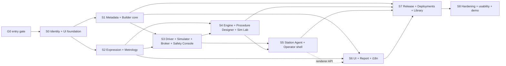

# 02 — Phase 1 plan: entry gate, slices, dependencies, exit

| | |
|---|---|
| Status | Proposal. Reconciles `IMPLEMENTATION_ROADMAP §3` (full VS-1 MVP) with Codex's narrower Phase 0B recommendation ([01 F-01](01_SPEC_REVIEW.md)). |
| Sizing | **Relative** (S < M < L < XL) with a dependency graph. No calendar durations are given because the roadmap requires re-baselining after Phase 0 and its own milestone sums do not reconcile (F-07). |
| Terminology | *Slice* = a demoable vertical cut with its own exit criteria (`P1-S0…P1-S8`). Roadmap milestones `M1.x` are mapped onto slices in §3. |

## 1. Goal, scope, non-goals

**Goal (from the roadmap, unchanged):** a non-programmer builds, simulates, publishes, installs and runs a demo calibration application end to end — entirely against the simulator — with a watermarked draft report, governed by the two-tier safety architecture and the Test→Production release workflow, and passes the twelve AC-NC scenarios.

**In scope:** identity/RBAC minimum; metadata engine; Application Builder (instrument, driver, metrology, procedure, screens, report, localization, Safety Console, Simulation Lab, review/release/deployments); expression engine; driver interpreter + simulator + broker with simulator-scope Hardware Limits Pack; workflow engine + journal; Station Agent + operator shell; release management; Application Library (deployment-local).

**Non-goals (unchanged from roadmap §3 "Out of Phase 1", plus clarifications):** real instrument transport and any real metrology content; issued reports/certificates and result approval; multi-tenant management UI; full sync; OIDC; Class B plugin infrastructure and registry; dashboards/custom-page builders; budget/TUR/CMC *editors* (viewers only); cross-organisation marketplace; theme *editor*; production-grade infrastructure (the Production deployment is a rehearsal).

### 1.1 How the assignment's ten screens land in Phase 1

| # | Screen | Phase 1 delivery | Deferred to |
|---|---|---|---|
| 1 | Main Dashboard | **Builder Home** (work queue, validation failures, releases) and **Station Home** (operator). Admin fleet dashboard is *designed* (SCR-01, 04A) but only its release/governance cards ship. | Fleet dashboard P2 |
| 2 | Calibration App Marketplace | **Application Library** (deployment-local, trust tiers, clone/import/export) | Cross-organisation marketplace P6 (F-05) |
| 3 | No-Code Application Builder | Full workspace per BUILDER §3 + MVP cut | Wizard polish |
| 4 | Visual Procedure Designer | MVP cut per DESIGNER §18 | switch, lane view, coverage, time compression |
| 5 | Instrument Manager | Builder → Instruments (models, families, identification) + Driver Designer + Operator → Instruments (discovery) | Assets register P2 |
| 6 | Test Station Manager | Builder → **Equipment & Stations** (StandardRole, StationRequirement) + Admin → **Stations (minimal)** (simulator stations, capability report, compatibility) | Reference-standard register, certificates P2 |
| 7 | Calibration Runner | Operator run console, preflight, resume | Parallel instruments, kiosk polish |
| 8 | Measurement Results | Results summary, limit-check labels, draft report | Review/approval, sealing, issued reports P2 |
| 9 | Reports & Certificate Designer | Minimal designer (BUILDER §13) producing *draft* reports; certificate templates may be authored but cannot render `issued` | Issued certificates, signature workflows P2 |
| 10 | Administrative Settings | Users & Roles (dual control), Deployment identity, Policies viewer, Trusted Issuers, Release console, Audit viewer (minimal) | Policy editing via Change Requests (basic P1), full admin P2 |

## 2. Entry gate G0 (must be green before S0 starts; per-slice ADRs before each slice)

| # | Condition | Evidence | Owner |
|---|---|---|---|
| G0-1 | Phase 0B ([PR #1](https://github.com/avihafif/calibration-os/pull/1)) merged to `main` by its owner; CI green (Python Linux+Windows, TypeScript, two-stack Compose, security vectors). Review findings in [14](14_PHASE0B_SECURITY_REVIEW.md) triaged: items R-1…R-3 before merge, R-4…R-9 before 1A, R-10…R-12 before any verifier use outside tests. | PR link, CI run | Owner / Codex |
| G0-2 | Human decisions **D-01** (Phase 1 shape), **D-02** (identity pulled into P1), **D-03** (library scope) recorded. | [11](11_DECISIONS_REQUIRED.md) signed | Product owner |
| G0-3 | ADR-0001, 0008, 0014, 0015 ratified (needed by S0). Remaining ADRs ratified before their slice (§3 column "ADRs"). Accepted ADRs are never edited — supersede. | ADR status lines | Named owners |
| G0-4 | Q-15 decided; MI-34 role holders and deputies named (no names invented here). | Register entries | Lab management |
| G0-5 | Codegen supports the JSON-Schema subset needed by S1 (`$defs/$ref`, `oneOf`, `enum`, `if/then`, `patternProperties`, `x-calos-editor` passthrough) with tests; limits documented (P0A-G04). | Codegen test report | Codex |
| G0-6 | Spike reports filed for canvas library (before S4), PDF/Hebrew rendering (before S5), Windows service host (before S5). | `docs/adr/` addenda | Architecture |
| G0-7 | Frontend dependency approvals for S0 ([06 §9](06_COMPONENT_ARCHITECTURE.md#9-dependencies-requiring-approval)). | ADR-0022 addendum or new ADR | Architecture |

## 3. Slices

> **Phase 1A ([13](13_PHASE1A_PLAN.md))** is the first visible milestone and cuts across S0 and S1: it delivers their *frontend halves* (UI foundation, `editor-core`, schema-driven inspector, Builder shell for manufacturers/families/models) against a labelled in-memory Synthetic Host. The server-backed halves (identity, persistence, signed import) are **Phase 1B** and keep the ADR gates below. 1A needs decision D-23.

Legend: **Req** = requirement IDs; **AC** = existing acceptance IDs satisfied or advanced; **P1-AC** = new IDs in [10](10_ACCEPTANCE_TESTS.md).

### P1-S0 — Identity, access and UI foundation · size L
*Roadmap: new M1.0 (F-02); prerequisite of all.*

| Track | Deliverables |
|---|---|
| Backend | Local accounts (Argon2id, optional TOTP), short-lived access JWT + rotating refresh, step-up re-authentication; permission catalog from GOVERNANCE §2.1; role bundles §2.2 (+ Hazardous Driver Author per F-11, pending D-06); role assignment with **toxic-combination validator** (`ROLE_CONFLICT`); **dual-control grant workflow**; SoD engine usable by any approval; central audit chain (hash-chained, verify endpoint); RLS on every tenant table + generated coverage test (AGENTS rule 11); simulator-station enrolment (per-station keypair, short-lived token, revoke); `/me`, `/version`, deployment identity in tokens. |
| Frontend | Packages `ui-kit`, `i18n`, generated `api-client`, `domain-types` extension; design tokens + contrast validator; app frame for the three shells (top bar, nav, deployment badge, mode badge, locale switch, user menu); Production shows no Builder nav; login + step-up dialog; Admin → Users & Roles (matrix, grant requests); Admin → Audit (list + verify); a11y (axe) and RTL/visual-regression harness; pseudo-locale; hard-coded-string lint. |
| ADRs | 0001, 0008, 0014, 0015 |
| Req | FR-SEC-01/02/03/04/05(sim), FR-GOV-01, FR-SAF-01/06, FR-ENV-02/04(partial)/10(partial), FR-AUD-01/02, FR-UI-02/05, NFR-10/11 |
| AC | AC-SAF-01/03/04, AC-ENV-02/04(partial), AC-UX-02/03/09, AC-API-01/02, P1-AC-IAM-*, P1-AC-FRM-* |
| Exit demo | Two isolated deployments each show the right badge; users with different roles see different nav; Platform Admin cannot approve anything; a privileged grant needs a distinct approver; audit chain verifies; he/en + RTL frame passes axe and screenshots. |

### P1-S1 — Metadata engine and Builder core · size XL
*Roadmap: M1.1 + start of M1.6. This is **Codex's proposed first Phase 1 slice** (Manufacturer + InstrumentModel).*

| Track | Deliverables |
|---|---|
| Backend | `calos_metadata`: kind registry, schema registry, `ConfigItem/Draft/ReviewSnapshot/Version/Dependency`, RFC 8785 canonicalisation + SHA-256 digests (extends Phase 0A), draft API (JSON Patch, `base_revision`, ETag/`If-Match`), edit lease + heartbeat, validate/submit/approve/reject/publish with Idempotency-Key, SemVer assignment, immutability (grants + triggers), pinned dependency resolution + DAG check, diff, impact (deps/dependents), audit events, `.calapp` export/import (Test) with Ed25519 signing via Phase 0B `calos_security`. Kinds: `Manufacturer`, `InstrumentFamily`, `InstrumentModel` + shared definitions (LocalizedString, Quantity, Provenance, `$input`, `$ref`). |
| Frontend | `editor-core` (document, command stack, JSON-Patch + inverse, selection, clipboard, autosave queue, lease client); schema-driven **property inspector**; Builder shell: Home (work queue), Applications (minimal list/overview), Instruments workspace (manufacturers, families, models), validation drawer, History + Where-used panels, lease banner, View-as-data, structural diff (generic + kind-aware for S1 kinds), review queue + approve/reject, publish wizard (version bump, release notes). |
| ADRs | 0016, 0019, 0004 (signing format for export) |
| Req | FR-META-01..06, FR-GOV-01/02/03, FR-NC-01/02(partial)/04, FR-UIB-03(key table), NFR-18 |
| AC | AC-NC-01, AC-NC-09 (model), AC-GOV-01/02/03/09, AC-API-03/04, P1-AC-BLD-01…08, P1-AC-GOV-* |
| Exit demo | A calibration engineer (non-programmer) creates a manufacturer and instrument model in the GUI, sees *Input required* badges instead of values, submits; a second user approves on the digest; publish v1.0.0; edit → v1.1.0; diff shows only the changed fields; tamper with stored bytes → load refused. |

### P1-S2 — Expression engine and metrology workspace · size L (parallel with S1 after S0)
*Roadmap: M1.2.*

| Track | Deliverables |
|---|---|
| Backend | `calos_expr`: parser, resolver, type/dimension checker, `Decimal` evaluator with recorded context, canonical AST, function library v1 (exact set + `pending_review` flagged), error catalog, YAML conformance vectors, property + fuzz tests, mutation-tested evaluator; `/builder/expr/check` and `/eval`; kinds `SpecTable`, `LimitsPolicy`, `Calculation`, `UnitDefinition` (view), `UncertaintyBudget`/`DecisionRule`/`CorrectionSet` (**read-only viewers** + schema). |
| Frontend | `expr-presentation` (TS subset, same vectors); **shared expression editor** (text + block mode, autocomplete, inline type/dimension, squiggles, evaluate-with-sample, explain tree); Spec Table editor (typed grid, provenance chips, Input-required, CSV import preview, per-row test vectors); Limits policy editor (explicit inclusivity, **no default**); Calculation editor with test vectors. |
| ADRs | 0017, 0010 |
| Req | FR-EXPR-*, FR-MET-03/05, MR-CFG-01/04/09, NFR-04/17 |
| AC | AC-MET-02/03/08, AC-NC-04 (authoring part), AC-VS-06 (vectors), P1-AC-MET-* |
| Review | Function library, golden vectors and any statistical/numerical function require **metrologist review** (MI-12/17/32); functions stay `pending_review` and blocked in production mode. |

### P1-S3 — Driver runtime, simulator, broker, Driver Designer, Safety Console · size XL
*Roadmap: M1.3 + driver/safety parts of M1.6/M1.6b.*

| Track | Deliverables |
|---|---|
| Backend | `calos_driver` (templates, typed formatters, parsers: `number_with_unit`, `enum_map`, `delimited_numbers`, `regex_groups`, `string_trim`; error queue; lifecycle); transport **port** + `calos_simulator` + `SimulatorTransport` + declarative `SimulationProfile` engine (seeded randomness only here); **Instrument Broker** (hazard permission → AHL ∩ Safety Profile ∩ procedure bounds → state preconditions → write; fail closed; journal `safety.violation`); simulator-scope **Hardware Limits Pack** + loader (signature, expiry, rollback protection, read-only store); VISA adapter *stub* compiled but not exercised, in a package unreachable from central (F-18); kinds `DriverDefinition`, `CommandLibrary`, `SimulationProfile`, `SafetyProfile`; lint PR-009/010/019/021/023/024. |
| Frontend | **Driver Designer** (Connections, Identification with test strings, Commands with typed parameter editor + wire-text preview + hazard ribbon, Parsers with sample tester, Error handling, Lifecycle, Libraries, Simulation, simulator-mode Test); Instrument editor identification live test; **Safety Console** (profile editor, AHL band read-only, effective-limit viewer, hazard coverage, approval-path indicator, impact analysis, hardware-limits candidate export stub). |
| ADRs | 0018 (as amended by 0023), 0013, 0005 (boundary only) |
| Req | FR-DRV-01…07, FR-SAF-01…07, FR-DISC-04, NFR-20/22 |
| AC | AC-NC-02, AC-NC-12 (authoring + approvals), AC-SAF-01…08, AC-SEC-04, AC-UX-10, AC-VS-09 (broker level), P1-AC-DRV-*, P1-AC-SAF-* |
| Review | Safety Officer reviews hazard definitions, ribbon wording, approval-path rules; no real AHL content is created. |

### P1-S4 — Workflow engine, journal, Procedure Designer, Simulation Lab · size XL
*Roadmap: M1.4 + procedure/simulation parts of M1.6.*

| Track | Deliverables |
|---|---|
| Backend | `calos_procedure` (IR schema, compiler, static analysis PR-001…PR-025 as applicable), `calos_engine` (state machine, journal in SQLite hash-chained, resume/reconcile with resume-policy semantics, limits evaluation, preflight gates, run modes + simulation marking); central **Simulation Lab workers** (engine + simulator only); kinds `Procedure`, `SubProcedure`, `ApplicationTest`; kill-at-every-boundary harness. |
| Frontend | **Procedure Designer** (canvas as view of the block tree, outline view, palette, inspector tabs, variables/parameters, expression binding pickers, static-analysis panel with quick fixes, extract-to-sub-procedure, hazard overlay, resume-simulator panel, structural diff); **Simulation Lab** (scenario picker, breakpoints, stepping, variable inspector, expression trace, wire log, fault injection, kill & resume, app tests). |
| ADRs | 0006, 0003 (accepted), 0007 |
| Req | FR-PD-01…07, FR-PROC-*, FR-EXEC-01…13, NFR-01/20 |
| AC | AC-NC-03, AC-NC-07, AC-PD-01…08, AC-VS-04…07, 10…13 (engine level), P1-AC-PD-*, P1-AC-SIM-* |

### P1-S5 — Station Agent, operator shell, Equipment & Stations · size XL
*Roadmap: M1.5.*

| Track | Deliverables |
|---|---|
| Station | Windows service (per spike), local API (`/local/v1`), config manager (CAS, verify, stage, activate), discovery (simulator scope) + identity verification, `ui-runtime` with **auto-generated operator screen**, run console, preflight, resume modal, results + draft report via trusted renderer (`calos_report`) against the **shipped default template**, diagnostics bundle, structured logs, local UI Host/Origin/token hardening. |
| Frontend | Operator shell (Home/Station status, Instruments, Start-calibration wizard, Run console, Resume, Results, Sync/Status); Builder → **Equipment & Stations** (`StandardRole`, `StationRequirement` kinds); Admin → **Stations (minimal)**. |
| ADRs | 0011, 0012 |
| Req | FR-DISC-01…04, FR-EXEC-*, FR-UI-03/06, FR-OPS-01/02, FR-REP-01…05, NFR-02/09 |
| AC | AC-VS-01…03, 10…15, 17…19, AC-UX-01/05/07, AC-SEC-06/08, P1-AC-RUN-* |

### P1-S6 — UI Builder, Report Designer, Localization · size L (parallel with S5 after S1+S2)
*Roadmap: UI/report/i18n parts of M1.6.*

| Track | Deliverables |
|---|---|
| Backend | Kinds `UiForm`, `UiPage` (operator screen), `UiNavigation` (minimal), `UiTheme` (system light/dark shipped, read-only), `ReportTemplate`, `ReportDatasetContract` (`calibration-result@1`), `TranslationBundle`; layer resolver; widget/action catalog; report renderer determinism (template + dataset + renderer digests); system-injected watermark/legend/footer. |
| Frontend | Screen Designer (generate-from-procedure + overlay, grid, binding picker, validation rules, conditional visibility, he/en + LTR/RTL preview); Report Designer (blocks, dataset explorer, preview PDF in he/en, locked system overlays); Localization workspace (key table, completeness, RTL preview). |
| ADRs | 0020, 0015 (accepted in S0) |
| Req | FR-UIB-01/03/04, FR-RPD-01/02/04, NFR-11 |
| AC | AC-NC-05, AC-NC-06, AC-VS-14…16, AC-UX-02/03/05/06, P1-AC-UIB-*, P1-AC-RPT-*, P1-AC-I18N-* |

### P1-S7 — Governance, release management, deployments, Library, packaging · size L–XL
*Roadmap: M1.6b + deployment parts of M1.6.*

| Track | Deliverables |
|---|---|
| Backend | Application packaging (`ApplicationManifest`, closure, `requires`, `intended_modes`); assignments (lab/group/station, canary/stable, activation policy), compatibility matrix, rollback; Release Candidate → Test approvals → signed Release Package; Production import → verification → production-mode validation (PR-013/014/016/023/024/025) → independent approvals → release → canary → stable; Trusted Release Issuers (dual control); Change Requests (basic); production authoring lock (`PRODUCTION_CHANGE_CONTROL`); station deployment pinning; `validation` run mode with allow-list (simulator only); deployment-local Library catalogue. |
| Frontend | Builder → Review & Releases, Deployments, Versions, Library; Admin → Release console (both deployments), Trusted Issuers, Change Requests, Drift view (digest compare), Policies viewer. |
| ADRs | 0021 (as amended by 0024), 0004, 0024 (accepted) |
| Req | FR-NC-03/04/05, FR-GOV-04/05, FR-ENV-01…10, FR-SAF-04/05 |
| AC | AC-NC-08…11, AC-ENV-01…12, AC-GOV-04/06, AC-SAF-09…12, P1-AC-REL-*, P1-AC-LIB-* |

### P1-S8 — Hardening, usability and demo · size M
*Roadmap: M1.7.* Fault-injection matrix, a11y/RTL passes on all three shells, moderated usability rounds (protocol in [10 §8](10_ACCEPTANCE_TESTS.md)), demo script, OpenTAP spike report (ADR-0002 addendum), MI register and Capability Matrix updates, defect burn-down. **Exit:** §5.

## 4. Dependency graph

**Critical path:** G0 → S0 → S1 → S3 → S4 → S5 → S7 → S8. S2 and S6 are the main parallelisable tracks. Parallel *code* work is only safe where file ownership is disjoint (§6).

## 5. Phase 1 exit criteria

1. All slice exit demos recorded; every AC listed in §3 green in CI (Linux + Windows runners where applicable).
2. VS-1 (ROADMAP §4) and AC-NC-01…12 pass as **GUI-only Playwright** runs from a clean sandbox *and* in moderated sessions with non-programmer calibration engineers (thresholds per D-10).
3. Isolation test (AC-ENV-01) passes and fails when sharing is introduced.
4. No `synthetic_demo` content, simulated Safety Profile, or unresolved `$input` can be released to Production (AC-ENV-06).
5. No open Sev-1 (metrology/safety/integrity) defects; MI register updated with Phase 1 learnings; Capability Matrix reviewed.
6. he/en and RTL pass for all Phase 1 screens (AC-UX-01/02/03); axe has no critical/serious violations (AC-UX-04).
7. Traceability matrix (`just docs-trace` once it exists) shows every FR/AC above mapped to tests.

## 6. Parallel-work rules (Codex vs design/spec lane)

| Rule | Detail |
|---|---|
| Branches | Design lane: `feature/phase-1-design` (docs only). Implementation: one branch per slice, `feature/p1-sN-<topic>`, cut from `main` after G0; PR per slice. |
| Ownership | `docs/phase1/**` is owned by the design lane; implementers raise a PR comment/issue rather than editing it, except the status table in [10](10_ACCEPTANCE_TESTS.md) and decision outcomes in [11](11_DECISIONS_REQUIRED.md). Existing specs (`docs/*.md`) change only via the owners after Phase 0B merges (01 §4). |
| Code zones | S1 owns `packages/py/calos_metadata`, `packages/ts/editor-core`; S2 owns `calos_expr`, `expr-presentation`; S3 owns `calos_driver`, `calos_simulator`, `calos_broker`; S4 owns `calos_procedure`, `calos_engine`; S5 owns `apps/station-agent`, `ui-runtime`, `calos_report`; S6 owns `designers/ui-layout`, `designers/report-page`; S7 owns release/deploy modules. Shared: `ui-kit`, `i18n`, `api-client` (S0 owns; others add via small PRs). |
| Conflicts | Do not weaken import-linter or eslint-boundaries contracts to unblock a slice (AGENTS §3); write an ADR. |
| Stop conditions | See [12 §6](12_CODEX_IMPLEMENTATION_PROMPT.md#6-stop-and-ask-triggers). |

## 7. Quality-attribute traceability

| Attribute | Mechanism in Phase 1 | Evidence |
|---|---|---|
| Modular | Package boundaries enforced by import-linter / eslint-boundaries; designers use injected host ports; central/VISA split (F-18) | AC-ARCH-01/02, P1-AC-ARCH-* |
| Metadata-driven | Every designer is schema-driven (`x-calos-editor`); specialised canvases are views over the same document model; operator screens auto-generated | P1-AC-BLD-04, AC-PD-03 |
| No-Code First | Capability Matrix updated per feature; AC-NC GUI-only harness fails on non-UI admin calls | AC-NC-01…12 |
| Secure by design | RBAC + SoD + step-up + dual control; deployment identity; strict parsers; CSP without `unsafe-eval`; no secrets in configuration | AC-SEC-*, AC-SAF-*, AC-ENV-* |
| Multi-vendor | No model/vendor strings in runtime (lint); capability vocabulary instead of model checks; neutral demo naming (F-29) | AC-VS-20, P1-AC-ARCH-03 |
| Offline-capable | Station runs and drafts reports offline; CAS staging; no central dependency in run path | AC-VS-17, NFR-02 |
| Audit-ready | Hash-chained audit/journal; digest-bound approvals; blame/history; signed exports | AC-GOV-01/02, AC-VS-07 |
| Scalable | Virtualised tables/canvases; incremental validation; cursor pagination; background jobs; load targets deferred to Q-09 | P1-AC-PERF-* (budgets set from baseline) |
| Metrologically controlled | Decimal-only; provenance chips; no defaults for inclusivity; `pending_review` functions blocked in production; "limit check" wording | AC-MET-*, P1-AC-MET-* |

## 8. Risks added by this plan (in addition to ROADMAP R-01…R-17)

| ID | Risk | Mitigation |
|---|---|---|
| R-18 | Adding M1.0 (identity) enlarges Phase 1 | Local accounts only; OIDC deferred; reuse Phase 0B JWT verifier |
| R-19 | Schema-driven inspector cannot express a designer's needs → hand-coded per-kind UIs (inner-platform inversion) | Hint vocabulary frozen in S1 ([07 §2](07_METADATA_SCHEMAS.md#2-editor-hint-vocabulary-x-calos-editor)); gaps raise catalog/hint additions, not bespoke screens |
| R-20 | RTL canvases and bidi text are under-tested | Screenshot suite per slice; native-speaker review gates (Q-15/MI-31) |
| R-21 | Library/marketplace scope creep | Fixed to deployment-local in P1 (D-03) |
| R-22 | Approver unavailability blocks acceptance tests | Test fixtures create role holders; MI-34 deputies for real use |
