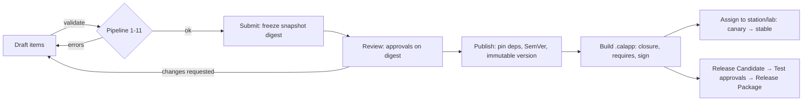

# 09 — Application packaging, publishing, plugin visibility and the Library

| | |
|---|---|
| Status | Proposal. Builds on `PLUGIN_SDK_SPEC §2`, `CONFIGURATION_GOVERNANCE §6–§10, §14`, `NO_CODE_ARCHITECTURE §4.6, §15–16`, ADR-0004/0021/0024. Resolves the "plugin packaging and publishing" request within the phase model (F-06). |
| Scope in Phase 1 | **Class A** (`.calapp`) packaging, publishing, Release Packages, compatibility, deployment-local Library. **Class B** (`.calplug`) is *visible* (requirements, origin badges, compatibility results) but not authored, reviewed or enabled — that is Phase 3 (Admin → Plugins). A cross-organisation marketplace is **designed here, not built** (D-03). |

## 1. Vocabulary

| Term | Meaning | Created where |
|---|---|---|
| **Version** | Immutable published `ConfigVersion` of one item, digest-addressed | Builder (Test) |
| **Application** | `ApplicationManifest` version that pins a closure of item versions | Builder (Test) |
| **`.calapp`** | Deterministic ZIP: `manifest.json`, `items/<kind>/<key>/<version>.json`, `media/<sha256>.<ext>` (renamed from `assets/`, F-15), `tests/…`, `signatures/manifest.sig` | Export (Test) |
| **Release Package** (`.calrel`, proposed F-31) | Deterministic ZIP containing the `.calapp` + `release_manifest.json` (digests, change class, impact analysis, validation report, application-test results, approvals) + release signature | Release export (Test) |
| **Assignment** | Mutable pointer: package version → target (lab/group/station), channel, activation policy; append-only history | Deployments |
| **Class B plugin (`.calplug`)** | Signed code package providing new catalog entries | Plugin SDK / Registry (P3) |

## 2. Publishing flow (Test deployment)

Publish wizard (Application workspace → Publish tab), each step shows what will happen and blocks on errors:

| Step | UI | Rule |
|---|---|---|
| 1 Readiness | Checklist with live counts: errors, Input required, `synthetic_demo`, `pending_review` functions, unverified commands, H2+ coverage, translations, app tests | Production readiness shown separately; Simulation/Test publish allowed with warnings |
| 2 Pipeline | Stages 1–11 with timings; findings drawer; re-run | Any error blocks (FR-GOV-03) |
| 3 Version | Computed minimum SemVer with reasoning (change class); author may raise, never lower; pre-release labels only in Test | Reusing a number impossible |
| 4 Release notes | Localized (`he`/`en`) rich text (restricted) | Locale completeness per policy |
| 5 Dependencies | Pinned-reference preview `(kind,key,version,digest)`; "upgrade available" banners | Floating→pinned resolution at publish |
| 6 Confirm | Digest, approvals present, who published; step-up | Idempotency-Key; result: version + digest |

## 3. Package formats and integrity rules

* **Deterministic build**: sorted entries, fixed timestamps, no symlinks, size limits, archive-bomb and path-traversal rejection, unknown files rejected. Content digests per RFC 8785 canonical JSON → SHA-256. Package manifest digest covers every file digest.
* **Signing**: Ed25519 detached signature (Phase 0B verifier). Signing keys are held by the deployment's signing service/KMS; **no key material is ever shown or handled in the UI**. Test packages are signed by the Test deployment's release-signing key; Production verifies only against Trusted Release Issuers (dual-controlled).
* **Closure**: all pinned item versions, application tests and media. **No secrets, personal data or run data** are included (GOVERNANCE §14).
* **Import semantics**: never overwrites; identical digest ⇒ dedupe; same `(kind,key,version)` with different digest ⇒ `VERSION_IMMUTABLE`. Unsigned/untrusted packages are **blocked in Phase 1** (explicit trust decisions are CFG·GOV later). Imported items arrive as published, `origin=import`, not drafts, and cannot be edited — fork to a draft.
* **Inspect-before-import**: `POST /config/packages/inspect` renders a report (signature, digests, schemas, compatibility, requirements, provenance counts, `intended_modes`) without writing anything.

## 4. Compatibility and requirements

The `requires` block is **computed** from the closure: catalog `type_id@major.minor` (minimum minor), `runtime_min`, schema versions, transports, plugin ids/ranges. The Deployments screen lists each enrolled station as *compatible* or *incompatible with reason* — `needs plugin`, `needs agent update`, `transport unavailable`, `schema unsupported`, `deployment mismatch`. Defense in depth: the station repeats the check at stage, activate and run start. A package requiring an absent plugin type is incompatible with a precise message and no partial install (AC-SDK-07).

## 5. Release Package workflow

Governed by GOVERNANCE §9.2 and ADR-0024; this section adds UX/validation specifics.

| Stage | Where | UI | Blocking findings |
|---|---|---|---|
| Candidate | Test | Select published package; attach evidence; readiness green | Missing evidence; failing app tests |
| Test approvals | Test | Approve on digest (QM, Metrology, Safety Officer(+QM) for safety content) | SoD, digest mismatch |
| Export | Test | Build `.calrel`; display checksums to copy for out-of-band transfer | — |
| Import & verify | Production | Upload; issuer ∈ Trusted Release Issuers; signature, digests, schema/catalog versions, compat | `REL-001/002/003` |
| Production validation | Production | Automatic production-mode pipeline | `PR-013` unresolved input · `PR-014` `synthetic_demo` · `PR-016` pending_review fn · `PR-023` AHL containment/coverage · `PR-024` simulated profile or simulator-only driver · `PR-025` modes lack production |
| Production approvals | Production | Independent approvals (importer ≠ approver); safety content re-approved by Safety Officer(+QM) | SoD |
| Release | Production | Versions with `origin=release(<test deployment id>, digest)`, **identical digests**; Production re-attests with its own key | — |
| Assign | Production | Canary → recorded sign-off → stable | Missing sign-off |

**Property to display and test:** digest equality between the Test version and the Production version, side by side, for every item in the closure (AC-NC-11, AC-ENV-05).

## 6. Library trust tiers and the future marketplace

### 6.1 Phase 1: deployment-local Library
| Tier | Definition | Visible in | Allowed actions |
|---|---|---|---|
| **Platform-shipped** | Signed by the platform release; content in `content/` (system UI, shared libraries such as the IEEE 488.2 common command library, demo package) | Test; Production only if `intended_modes` includes production (demo package does not) | View, clone (Test), reference |
| **Lab-authored** | Published in this deployment | Test; Production if released | View, clone, export, deploy |
| **Imported release** | Verified Release Package from a Trusted Issuer | Production | View, assign; no clone/edit |
| **External / unverified** | Unsigned or untrusted-signer packages | **Not available in P1** | — |

### 6.2 Future marketplace (Phase 6; requires D-03 and legal review)
Design constraints so Phase 1 does not paint into a corner:
1. **Trust is cryptographic, not social**: listings are signed; publisher identity maps to a key in a TUF-style registry with revocation; ratings/comments never affect trust state.
2. **No executable content in Class A** means a marketplace Class A listing is data — but it can still contain wrong metrology: every import lands as *Test* content, goes through full validation, and requires **local** approvals; nothing is trusted by origin.
3. **Provenance is preserved**: `derived_from`, publisher, licence, source references; vendor documentation/logos/trademarks are never redistributed (AGENTS §8, Q-08, MI-01).
4. **Class B listings** need the security-review workflow and platform countersignature (PLUGIN_SDK §9) and are never auto-enabled.
5. **Offline/air-gapped labs** import by file; the marketplace is never in the run path.
6. **Data model readiness**: `LibraryEntry{id, kind, key, version, digest, publisher, trust_tier, licence, requires, intended_modes, provenance_summary}` already exists as a view in P1 (A14) and extends to remote catalogues.

## 7. Plugin visibility in Phase 1 (read-only)

| Surface | Behaviour |
|---|---|
| Palette / catalog | Blocks provided by plugins (none exist in P1) would show an **origin badge** `plugin:<id>@<ver>`; none are installed |
| Application → Requirements | Lists `requires.plugins` (empty in P1 demo) |
| Deployments | Compatibility result `needs plugin` with remediation text |
| Admin → Settings | "Plugins registry" placeholder, disabled with "Phase 3" |
| Builder | **No** control to upload, edit, review or enable a `.calplug` anywhere in Phase 1 |

## 8. Failure modes (UX and behaviour)

| Situation | Behaviour |
|---|---|
| Pipeline passes locally but fails at publish (dependency withdrawn meanwhile) | Publish re-runs the full pipeline against pinned deps; blocked with `DEPENDENCY_UNPUBLISHED`; draft intact |
| Stale approval | `APPROVAL_DIGEST_MISMATCH`; submit again; prior approvals do not transfer |
| Tampered package | Rejected with `REL-002`; audit entry; nothing written |
| Import of existing version with different content | `VERSION_IMMUTABLE` with side-by-side digests |
| Station offline during assignment | Assignment stays pending; per-station state shows reason; no partial activation |
| Rollback to withdrawn version | Refused with explanation |
| Release exported with `synthetic_demo` | Caught at Test candidate readiness *and* again at Production validation (`PR-014`) |

## 9. Acceptance (see also [10](10_ACCEPTANCE_TESTS.md))

P1-AC-PKG-01…08, P1-AC-LIB-01…05, P1-AC-REL-01…10; AC-NC-08…11; AC-ENV-05/06; AC-SDK-07 (compatibility message only).
