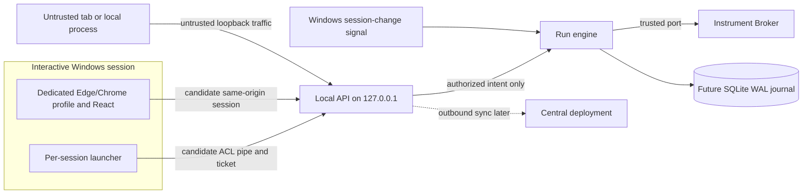

# SP-3 — Offline Station Local API security design

**Status:** Proposed technical study, revised 2026-11-04 after [independent PR #23 review](https://github.com/avihafif/calibration-os/pull/23#issuecomment-6624059759). Documentation only. The present station stub exposes only non-operational `GET /local/v1/status`. No Local API authentication, browser bootstrap, Windows service, SQLite journal, instrument control, installer, synchronization or operational endpoint is implemented or authorized here.

**Evidence labels:** **Documented** = a cited specification/API behavior; **reviewer-measured** = the independent review's scratch experiment, not a CalOS test; **unverified** = a candidate requiring prototype evidence. Proposed controls and [negative tests](SP-3_NEGATIVE_TEST_MATRIX.md) have **not run**. The architecture must preserve No-Code content as data and the accepted [two-tier safety boundary](../adr/0023-safety-profile-ownership-and-hardware-limits.md).

## 1. Decision ledger

| Source | Actual status and SP-3 implication |
|---|---|
| [AGENTS](../../AGENTS.md), [No-Code architecture](../NO_CODE_ARCHITECTURE.md), [architecture](../ARCHITECTURE.md), [security model](../SECURITY_MODEL.md) | Repository rules/specifications: central never reaches instruments; browser never reaches instruments; safety enforcement is below the API. |
| [ADR-0003](../adr/0003-station-local-first-journal.md), [ADR-0023](../adr/0023-safety-profile-ownership-and-hardware-limits.md), [ADR-0024](../adr/0024-separate-test-and-production-deployments.md) | **Accepted:** SQLite WAL run journal; immutable AHL pack plus narrow-only Safety Profile; separate Test/Production deployments and station pinning. SP-3 does not implement these controls. |
| [ADR-0009](../adr/0009-sync-protocol.md), [ADR-0011](../adr/0011-station-ui-delivery.md), [ADR-0012](../adr/0012-windows-service-and-agent-update.md), [ADR-0014](../adr/0014-authentication-and-station-enrolment.md) | **Proposed:** sync, local browser delivery, service/MSI and offline operator grants. They are not operational approvals. |
| [ADR-0011](../adr/0011-station-ui-delivery.md) port delta | The proposal says **random-but-persisted port** and per-session token. SP-3 proposes an OS-selected port on each service start. The OS can choose the same number again; `boot_id` must rotate. The port change requires owner review/revision of ADR-0011, not silent adoption. |
| [LA-DP-01](../gate-a0/15_LA-DP-01_LA-DP-02_DELEGATED_RECORD_2026-11-03.md) | Windows service plus Edge/Chrome app-mode is **planning direction only**; SP-6 must test the delivery model. |
| [API_CONTRACT §4](../API_CONTRACT.md#4-station-local-api-localv1) versus [ST-03](../review/lead-architect-2026-11-03/04_OFFLINE_STATION_ARCHITECTURE_REVIEW.md) | Draft API says `X-Local-Session`; ST-03 recommends a one-use launch code exchanged for an `HttpOnly; SameSite=Strict` cookie, with no browser hand-off detail. SP-3 adds named-pipe launch verification and evaluates SSPI and ticket hand-off. Header/cookie, bootstrap and browser delivery require a new API/security decision. |
| Security-event persistence | ADR-0003's run/config aggregate journal does not provide a home for pre-run login, denial or lock events. A separate station-level append-only, hash-chained security log is proposed; schema, ACL, retention and export are open. |
| Windows API dependency | ADR-0012 mentions `pywin32` only as a service-wrapper candidate. SP-3a should start with standard-library `ctypes`; any new dependency needs its own review. |

**Foundational limit:** Loopback, Host/Origin and a cookie do not identify a Windows caller. A named-pipe launch can establish the launcher's identity, but does not prove the browser or the CalOS operator. A bearer ticket/header can be stolen by a same-user process. None of the candidate combinations below is approved for operational actions. Local administrators remain a residual threat already recognized in [SECURITY_MODEL](../SECURITY_MODEL.md).

## 2. Topology, authority loss and supported environments



**Port proposal — unverified:** On each service start, ask the OS to bind port `0` on **only** `127.0.0.1`, retain the listener, publish the resulting origin only through authenticated launcher IPC, and generate a new unpredictable `boot_id`. Do not infer that the numeric port changes. No wildcard, LAN or `::1` listener is implied. A port is not a secret or ownership proof. If the service stops, a local process can bind its old port.

### Authority loss and safe state — required invariant, not an approved hardware policy

Windows lock, logoff, fast switch, RDP disconnect, session expiry or Local API loss removes **operator control authority**. That event must reach a run-control path **independent of browser and Local API availability**. For every active run, the engine must enter its **approved procedure-defined hold/safe state** and record the transition before any further effect. If that state, its trigger or the safe-state path has not been specified and verified under the trusted safety architecture, the run must not be allowed to start. This study chooses no instrument command, output state, timing or safety limit.

After step-up re-authentication in the same eligible Windows/operator context, a guarded abort/safe-state request must remain reachable without restarting a run. Authority restoration never silently resumes execution; any resume follows the separately approved journal/reconciliation policy. The engine and Broker enforce [AHL ∩ Safety Profile ∩ procedure bounds](../NO_CODE_ARCHITECTURE.md#831-two-tier-safety-architecture-adr-0023) regardless of API caller. A Local API crash, slow request or flood must not prevent the engine's safe-state path. Service-process crash behavior needs an independent watchdog/fail-safe design and bench evidence before operational use. **This invariant is a gate, not a claim that the present stub can do it.**

Lab policy must decide whether a lock **suspends** authority and allows same-session step-up restoration, or **ends** it. The conservative proposal is to suspend control and enter safe state until re-authenticated or ended; no duration or hardware action is chosen here. Fake-engine tests precede any bench drill.

### Supported-environment questions

- **Documented/reviewer observation:** Windows 10/11 client RDP normally reconnects or displaces an interactive session; concurrent different-user RDP sessions are a Windows Server/RDS scenario. A same SID with another LUID can also arise from UAC elevation or `runas`; equality checks can deny legitimate launches. SP-3a must measure SID, logon SID, LUID and WTS behavior for each supported flow. No second-RDP-on-client claim is assumed.
- **Shared/kiosk account:** A Windows SID says nothing about which technician is acting when the bench uses a shared or auto-logon account. Separately approved CalOS operator authentication and step-up must carry attribution. A shared CalOS login remains prohibited.
- **RDP control:** Console-only hardware control is a **recommendation**, not an adopted rule. A named lab-policy owner must decide whether any remote session may control a physical run. Until then, prototype only; no remote operational authority.
- **Dedicated browser profile:** Proposed per-user ACL-protected `user-data-dir`, no extensions/sync/sign-in/password manager/autofill, DevTools/remote debugging and crash restore disabled, origin allow-list. Edge/Chrome policies may apply machine-wide and assume a dedicated bench PC; policy scope and enforceability need SP-3c/SP-3d proof. A random origin per boot resets zoom/permissions and invalidates pinned/restored windows. Supported Windows build/channel and Edge/Chrome versions need an owner-approved matrix; do not assume current browser or NTLM policy on every lab PC.
- **Offline/restart/update:** The UI and service should remain locally reachable without central connectivity, but no operational action is authorized without an approved offline grant and time policy (ADR-0014, Q-06/Q-07). Restart invalidates tickets/sessions, rotates `boot_id`, and requires journal recovery before exposing a run. Installer/update mechanics remain ADR-0012 and SP-4/5 work.

## 3. Candidate launch, browser proof and session lifecycle

No mechanism is selected. All candidates are **unverified as a CalOS browser/service integration**.

| Candidate | Windows/browser fit and security value | Failure modes and prototype evidence |
|---|---|---|
| **A. ACL named pipe launcher → service** | Standard Windows IPC can attest a launcher user/session; independent of browser policy. | Does **not** attest the browser or the launcher binary. Same-user malware can launch. Prove ACL, token, lock and service-restart behavior. |
| **B. Browser SSPI/Negotiate on loopback** | Could give OS attributes if Edge/Chrome and policy cooperate; reviewer measured matching attributes only in an **in-process** scratch handshake. | **Optional experiment, not foundation.** HTTP Negotiate/NTLM is connection-bound, not a fresh per-request proof; browser connection pooling, 401 handshakes and SSE need explicit binding. IP-literal loopback lacks a Kerberos SPN and may use NTLM; allow-listing all loopback ports could expose NTLM to hostile listeners. Edge `AuthServerAllowlist` is not per-profile and does not dynamically refresh; a per-start port conflicts with a narrow static allow-list. Workgroup and NTLM-restricted benches may fail. Prove policies, supported versions, hostile listener, no credential leak and request-to-connection binding before considering promotion. |
| **C. One-use ticket hand-off** | Pipe-verified launch issues an in-memory, random ticket; browser redeems it once. No integrated-auth browser policy is required. | A bearer ticket can be raced or read by same-user malware. Candidate ≥128-bit entropy and 15–30 s TTL are **proposed**, not policy. Atomic redemption, failed-attempt non-consumption, cross-user command-line visibility and cleanup need measurement. |
| **D. Loopback peer attribution** | Map accepted socket to PID and WTS session as extra evidence; no browser cooperation. | TCP-table/PID lookup is race-prone; creation-time check needed. Browser network-service process may own the socket. Low-privilege service may not read another user's SID. This is **supplemental**, not browser authentication. |
| **E. Native host/WebView2 or pipe transport** | Could avoid a TCP listener and browser cookie/port attacks. | New component/stack needs a separate ADR and SP-6 study; no implementation under this PR. Keep Local API semantics transport-neutral. |

**Candidate ordering for prototypes:** A+C with D as supplemental attribution; B as a separate experiment; E as an open architectural alternative. This ordering is a study recommendation, **not** a selected authentication design.

| Hand-off channel | Exposure / compatibility | Prototype question |
|---|---|---|
| **One-use URL fragment, then immediate `history.replaceState`** | Fragment is not sent in HTTP request or Referer, but can be briefly visible in browser command line, address bar, history/crash state or to same-user malware. Browser app-mode accepts a URL. | Measure cross-user command-line visibility and history residue, ticket race and cleanup; block all other app requests until wipe. |
| **Per-user ACL temporary file or local auto-POST page** | Avoids or changes command-line exposure, but introduces file lifetime/ACL or page-origin/CSRF and cleanup questions. | Measure file/launch races and whether an auto-POST can avoid exposing the secret to another origin. |
| **SSPI without hand-off** | No ticket URL but requires browser policy and connection-bound OS proof; NTLM exposure may be worse. | Prove all B conditions, including hostile listener. |
| **Native host/pipe** | Avoids browser URL hand-off, but changes the baseline delivery model. | Separate ADR and SP-6 evidence. |

The previous blanket ban on all URL/file hand-off is withdrawn as a **proposal constraint**, not as a permission to implement one. Never put a long-lived session credential in a URL, command line, log, registry, or file. A short-lived launch ticket may be considered only after the owner chooses a channel and the negative drills pass.

### Named-pipe candidate details

An explicit pipe DACL for a *future* logon SID cannot be fixed once at service startup. Either create one first-instance pipe **per interactive session** on logon/session-change, or use a coarse Interactive-group DACL with authoritative token checks in code. Both need a named-pipe squatting test. Proposed flags: `FILE_FLAG_FIRST_PIPE_INSTANCE` and `PIPE_REJECT_REMOTE_CLIENTS` ([Microsoft CreateNamedPipe](https://learn.microsoft.com/en-us/windows/win32/api/winbase/nf-winbase-createnamedpipea)). The launcher verifies the connected server process and expected service identity (for example via `GetNamedPipeServerProcessId`, service registration and process identity), and opens with `SECURITY_SQOS_PRESENT | SECURITY_IDENTIFICATION` to deny a rogue server broad impersonation. Verification must address PID reuse and a malicious process racing service restart.

The service rejects anonymous/unverifiable peers. **Identification-level tokens require a measured decision:** Microsoft documents that they permit identity queries but not acting as the client; the review's simultaneous recommendation to open at `SECURITY_IDENTIFICATION` and deny all identification-level tokens cannot both be followed. SP-3a must prove what token data the low-privilege service can query at that level. If the chosen verification requires impersonation, fail closed rather than silently elevating the level. Any `ImpersonateNamedPipeClient` call is thread-local; it must run on a dedicated short-lived thread with `RevertToSelf` in a guaranteed cleanup path, never on a shared asyncio event-loop thread. Peer identity proves **user/session**, not that the launched executable is CalOS.

### Session-state proposal

```mermaid
stateDiagram-v2
  [*] --> NoSession
  NoSession --> PendingLaunch: verified launcher; one-use ticket
  PendingLaunch --> NoSession: expiry or valid consumption failure
  PendingLaunch --> AwaitingOperator: ticket redeemed; browser context checked
  AwaitingOperator --> Active: separately approved operator auth
  AwaitingOperator --> NoSession: denial or timeout
  Active --> Suspended: lock, disconnect, expiry, API loss
  Active --> Ended: logout, restart or update
  Suspended --> Active: same context and approved step-up; no run auto-resume
  Suspended --> Ended: policy ends session
  Ended --> NoSession: launcher starts a fresh flow
```

Until operator identity/offline grant (ADR-0014, Q-06/Q-07) and the session carrier are approved, `Active` is only a fake state in a prototype. A verified Windows launcher is not CalOS authorization. Same-user malware remains residual; constrain consequences **below the API** via Broker safety checks, step-up for run start/safety/evidence-changing actions and journal attribution to operator plus session. No operational route is enabled by this study.

**Rogue-listener rule:** On transport failure, 401 or `boot_id` change, an open UI enters a terminal **session ended — relaunch from the shortcut** state. It sends no more credentialed requests to that origin, shows no credential form there, and never auto-retries against a reused port. The launcher watches the pipe/service identity and closes or redirects its window on service loss. **Residual:** a rogue listener could answer an already in-flight request before the UI detects service loss, and a browser page cannot authenticate the listener from its port alone. The hostile-listener drill must measure credential exposure and false-state acceptance in this race; no operational design may rely solely on the terminal-state rule to close it.

## 4. Proposed Local API security contract

| Surface | Candidate invariant | Decision / proof still required |
|---|---|---|
| Bind/bootstrap | Exact `127.0.0.1` listener, OS port 0, new `boot_id`; one-use ticket only after pipe-verified launch; atomic consume. A forged redemption must **not** consume a legitimate pending ticket. | ADR-0011 port revision; ticket channel, TTL and identity evidence. |
| Session carrier | **Header-carried opaque secret held only in React memory is the leading candidate**: port-scoped by explicit use, not auto-attached cross-port, no CSRF from a different origin by construction. Reload requires relaunch; XSS can read it, so CSP remains critical. | Resolve `X-Local-Session` versus cookie and browser launch feasibility. No carrier approved. |
| Cookie alternative | Cookies are **not port isolated** ([RFC 6265 §8.5](https://www.rfc-editor.org/rfc/rfc6265#section-8.5)); SameSite ignores port and `__Host-` does not fix it. The reviewer observed a sibling loopback port receive and overwrite a `__Host-; Secure; HttpOnly; SameSite=Strict` cookie in scratch Chromium. If a cookie is retained, use host-only/HttpOnly/Strict/Secure where proved, rotate on bootstrap/login/privilege change, ignore planted/unknown values and test sibling-port leakage/tossing. | SP3-D3; Edge/Chrome behavior and residual risk. No cookie is treated as OS proof. |
| CSRF/Origin | Exact Origin on bootstrap and unsafe methods, exact Host+port on every request; no Referer fallback, CORS or side-effecting GET. Cookie designs additionally need a server-bound CSRF token in React memory on every unsafe method. Header designs still need Origin/Host checks against browser attacks. | Codes and token lifetime; browser tests. |
| Host/parser | Validate raw Host **including port** at ASGI edge before routing; reject duplicate/malformed Host, aliases, absolute-form request targets, untrusted `Forwarded`/`X-Forwarded-*`, ambiguous headers and proxy rewrites. Starlette `TrustedHostMiddleware` alone does not validate the port. | Raw-socket vectors and proxy assumptions. |
| FastAPI surface | Disable `/docs`, `/redoc`, `/openapi.json`, debug and `--reload`; custom validation-error handler returns stable code/correlation ID without the offending input. | Reviewer measured default docs/OpenAPI 200 and 422 input echo on scratch FastAPI; prove against pinned product versions. |
| Limits/DoS | Bounded pre-auth global connections, queue, header read, body and SSE streams; cheap stateless rejection and timeouts before expensive parsing. Never key pre-auth budgets only by user/session or loopback IP. Constant-time secret comparisons and indistinguishable auth failures. A failed redemption must not burn a valid ticket. | Quantitative budgets, fairness and lockout recovery require owner policy; fake active-run flood test. |
| Sessions/time | Server-side binding to deployment, boot, Windows/operator context and grant, with approved idle/absolute limits. Proposed conservative expiry uses `max(elapsed_monotonic, elapsed_wall_forward)`; backward wall jumps never extend it; suspend/resume semantics must be measured. SSE/unauthenticated traffic cannot refresh idle. | Q-06/Q-07, clock tests and Windows API choice. |
| SSE/mutations | Bound SSE count and slow consumers; validate scope and `Last-Event-ID`, close on authority loss. Mutations require approved permission, Origin, CSRF if cookie, and scoped idempotency; no optimistic safety UI. | Future action/journal/lease contracts; no endpoint exists today. |
| Public/errors | Only minimal liveness could be unauthenticated; no operator/deployment/run/diagnostic data. Return generic auth failures and a safe support code; never log raw SID, session/header/ticket/CSRF/Negotiate, PIN, body, full URL or credential-bearing CSP report. | Reconcile existing non-operational status stub; exact codes open. |
| Security audit | Proposed station-level append-only, hash-chained security log with a single writer and restricted ACL, separate from run/config aggregates. Record redacted launch, denial, lock, session and clock events; verify chain on start; never UPDATE/DELETE. | Schema, retention/export and implementation review. No security log exists today. |

**Proposed response headers, not yet enforced:** `Cache-Control: no-store` on HTML/API, `Referrer-Policy: no-referrer`, `X-Content-Type-Options: nosniff`, `Cross-Origin-Resource-Policy: same-origin`, `Cross-Origin-Opener-Policy: same-origin`, and a restrictive `Permissions-Policy` denying camera, microphone, geolocation and other unused capabilities. Candidate CSP:

```text
Content-Security-Policy: default-src 'self'; script-src 'self'; style-src 'self'; img-src 'self' data:; font-src 'self'; connect-src 'self'; object-src 'none'; frame-ancestors 'none'; base-uri 'none'; form-action 'self'; worker-src 'none'; manifest-src 'none'
```

No `unsafe-inline` or `unsafe-eval`. `frame-ancestors` must be a response header. Test the **real built app** under enforced headers in supported Edge/Chrome, en/he and no-JS fallback, including any inline style/script and `securitypolicyviolation` events. Static bundle scans and today's Vite preview do **not** prove F-05/CSP closure. `no-store` also needs back/forward-cache and logout-replay tests.

## 5. Threat model and negative-test link

| ID | Attack | Proposed mitigation / proof | Residual or gate |
|---|---|---|---|
| SP3-T-01 | Local unprivileged process forges HTTP headers. | Ticket after pipe verification, approved session carrier, authorization; raw-client denial tests. | Same-user malware/local admin residual; no OS proof from headers. |
| SP3-T-02 | Malicious tab/form or cross-origin request. | Exact Host/Origin, no CORS, CSRF if cookie, no side-effecting GET. | XSS/extension and localhost navigation. |
| SP3-T-03 | DNS rebinding to loopback. | Numeric Host+port check at ASGI edge and loopback-only bind. | Raw local client can forge Host. |
| SP3-T-04 | Sibling loopback port reads or plants a cookie. | Prefer in-memory header; if cookie retained, rotate and ignore unknown values; dedicated profile. | Cookie scope cannot isolate by port. |
| SP3-T-05 | Hostile listener reuses old port and spoofs UI. | Terminal relaunch state; launcher monitors service/pipe; no credential retry. | Same-user listener remains; drill required. |
| SP3-T-06 | Pipe squatting or rogue pipe server impersonates client. | First-instance/reject-remote, explicit DACL, verified server and identification SQOS. | Token-level and PID-race proof open. |
| SP3-T-07 | Stolen/replayed ticket, header, cookie or CSRF token. | Atomic one-use ticket; revocation, boot binding, rotation, short approved expiry. | Same-user process and XSS residual. |
| SP3-T-08 | Lock/disconnect/expiry strands an active run. | Engine-side safe-state invariant, independent of API; step-up then guarded abort, no auto-resume. | Procedure/lab safety policy and bench proof open. |
| SP3-T-09 | Shared kiosk, UAC, fast switch or RDP confuses identity. | Separate operator auth, measured SID/LUID/WTS rules, governed console/remote policy. | Shared Windows account offers no operator identity. |
| SP3-T-10 | Pre-auth flood or slow streams starve Local API. | Global pre-auth budget, timeouts, SSE caps, engine independence. | Quantitative limits and DoS drills open. |
| SP3-T-11 | Offline grant/clock rollback extends authority. | Conservative session expiry, boot invalidation; separate grant policy. | ADR-0014/Q-06/Q-07 open. |
| SP3-T-12 | XSS, extension, logs or crash dump expose secrets. | Enforced CSP, dedicated profile, redaction, canary scans. | F-05 and Windows/browser evidence open. |
| SP3-T-13 | Duplicate command or conflicting controller. | Future journal-first idempotency and lease; no optimistic action. | No engine/action path implemented. |
| SP3-T-14 | Wrong deployment or stale UI/agent after update. | ADR-0024 station pinning, version check, session invalidation. | D-25/update policy open. |

These threat IDs intentionally differ from `T-LUI-1`, which [SECURITY_MODEL](../SECURITY_MODEL.md) already uses as a **test** identifier. The [negative-test matrix](SP-3_NEGATIVE_TEST_MATRIX.md) is entirely proposed and unrun.

## 6. Decisions and non-operational roadmap

| ID | Required owner decision or proof | Status |
|---|---|---|
| SP3-D1 | Named architecture owner to ratify/revise ADR-0011/0012 after SP-6: persisted vs per-start port, service/browser delivery, supported Windows/browser channels and kiosk/RDP policy. | **Open**; LA-DP-01 is planning only. |
| SP3-D2 | Named security/Windows owners to choose A+C(+D), B or E after pipe, browser, NTLM-exposure, peer-attribution and hand-off measurements. SSPI is optional, unproven. | **Open; operational blocker.** |
| SP3-D3 | Named API/security owners to reconcile `X-Local-Session` versus cookie, CSRF, dedicated profile, ticket hand-off and secure loopback scheme. | **Open; operational blocker.** |
| SP3-D4 | Named product/security owners for ADR-0014, Q-06/Q-07: offline grant, operator credential, step-up, expiry, lock/recovery and clock policy. | **Open; operational blocker.** |
| SP3-D5 | D-25 signed environment vocabulary before station enrolment; preserve accepted ADR-0024 isolation. | **Open vocabulary; isolation accepted.** |
| SP3-D6 | Named lab/safety owner to define procedure-safe-state and remote-control policy; engine, Broker, watchdog and guarded abort must be verified before any run. | **Open; operational safety blocker.** |
| SP3-D7 | Named API/security owners for bounded pre-auth/stream/body limits, security-log schema/retention, generic error contract, CSP and installer ACL evidence. | **Open.** |
| SP3-D8 | Named dependency/architecture owners for any `pywin32` addition; SP-3a starts with stdlib `ctypes`. | **Open if dependency needed.** |

No named individual or signatory is inferred by this study.

1. **SP-3a — Windows measurement kit, separate PR:** stdlib `ctypes` in `tools/spikes/sp3/`, synthetic identities, no installed service on the shared host. Measure pipe ACL/peer identity and squatting, UAC/`runas`, WTS events, TCP-table attribution/PID reuse, sleep/hibernate clocks, cross-user command-line visibility, and optional cross-process SSPI in Edge and Chrome under explicit policies. Record OS build, browser versions, policy values and commit in `docs/spikes/SP-3_MEASUREMENTS.md`; no product code.
2. **SP-3b — fake session core, separate PR:** fake-action ASGI app outside product packages; inject OS identity, session state, clock, ticket store, CSPRNG and action port. Exercise atomic redemption, Host/Origin, CSRF, expiry, idempotency, pre-auth budgets, redacted security-log model and engine-safe-state fake. L0/L1 tests only; no persistent credential or operational endpoint.
3. **SP-3c — browser matrix, separate PR:** existing Playwright in Chromium and Edge channel on Windows. Measure header/cookie carrier, enforced CSP/headers, cross-port cookie behavior, rebinding, hostile listener, bfcache and profile policy. No network or instrument side effects.
4. **Windows VM/bench drills (later):** two accounts, client versus Server/RDS RDP, lock/fast switch, kiosk, service restart/update and safe-state fake/bench evidence. L4 results are evidence packs, **not CI-proven**.
5. **Owner decision PR, then implementation review:** reconcile ADRs and API contract only after evidence. No operational Local API, signing, grant, run, sync or installer path starts from this study.

### Primary references

[RFC 6265 §8.5 — cookie ports](https://www.rfc-editor.org/rfc/rfc6265#section-8.5); [Microsoft named-pipe security](https://learn.microsoft.com/en-us/windows/win32/ipc/named-pipe-security-and-access-rights), [CreateNamedPipe flags](https://learn.microsoft.com/en-us/windows/win32/api/winbase/nf-winbase-createnamedpipea), [pipe impersonation](https://learn.microsoft.com/en-us/windows/win32/ipc/impersonating-a-named-pipe-client), [token AuthenticationId](https://learn.microsoft.com/en-us/windows/win32/api/winnt/ns-winnt-token_statistics), [WTS events](https://learn.microsoft.com/en-us/windows/win32/termserv/wm-wtssession-change), [Edge IWA policy](https://learn.microsoft.com/en-us/deployedge/microsoft-edge-browser-policies/authserverallowlist); [MDN CSP](https://developer.mozilla.org/en-US/docs/Web/HTTP/Guides/CSP), [OWASP CSRF](https://cheatsheetseries.owasp.org/cheatsheets/Cross-Site_Request_Forgery_Prevention_Cheat_Sheet.html).
