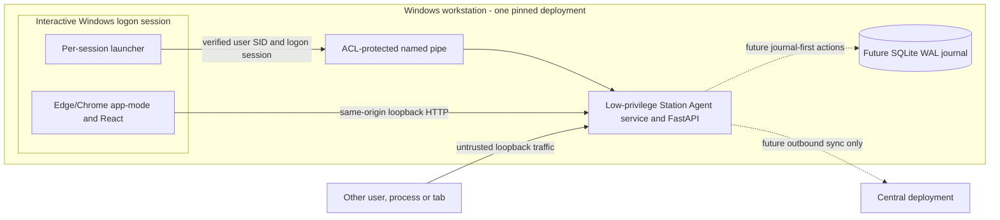
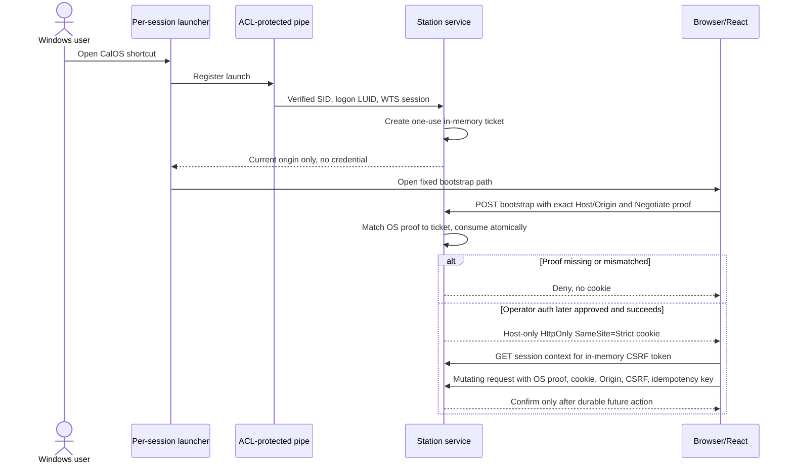

# SP-3 — Offline Station Local API security design

**Status:** Proposed technical study, 2026-11-04. Documentation only. No authentication, browser bootstrap, Windows service, SQLite journal, installer, synchronization, or operational endpoint is implemented here. The present station stub exposes only non-operational `GET /local/v1/status`. This document does not ratify an ADR or authorize credentials or trust roots.

**Scope:** A locally served React Operator UI and FastAPI Local API on an offline-capable Windows workstation. Central sync and instrument control are separate trust boundaries. This study addresses [ST-03](../review/lead-architect-2026-11-03/04_OFFLINE_STATION_ARCHITECTURE_REVIEW.md) and [AC-SEC-06](../SECURITY_MODEL.md); its prototype and tests remain future work.

## 1. Decision ledger and conflict to resolve

| Source | Status and SP-3 implication |
|---|---|
| [AGENTS](../../AGENTS.md), [No-Code architecture](../NO_CODE_ARCHITECTURE.md), [architecture](../ARCHITECTURE.md), [security model](../SECURITY_MODEL.md) | Repository rules/specifications: no central-to-instrument path; configuration is data; fail closed; attribute operator actions. |
| [ADR-0003](../adr/0003-station-local-first-journal.md) | **Accepted:** SQLite WAL with `synchronous=FULL`; the run journal is the source of truth. No persistence is added here. |
| [ADR-0024](../adr/0024-separate-test-and-production-deployments.md) | **Accepted:** a station pins one deployment; Test and Production share no agent, key, store, credential, or audit chain. D-25 must resolve the signed environment vocabulary before enrolment. |
| [ADR-0009](../adr/0009-sync-protocol.md), [ADR-0011](../adr/0011-station-ui-delivery.md), [ADR-0012](../adr/0012-windows-service-and-agent-update.md), [ADR-0014](../adr/0014-authentication-and-station-enrolment.md) | **Proposed:** sync, local web delivery, service/MSI, and offline operator grants are not approved operational mechanisms. |
| [LA-DP-01](../gate-a0/15_LA-DP-01_LA-DP-02_DELEGATED_RECORD_2026-11-03.md) | Windows service plus Edge/Chrome app-mode is adopted **for planning only**; SP-6 must test the delivery model. |
| [API_CONTRACT §4](../API_CONTRACT.md#4-station-local-api-localv1) | Draft browser auth uses `X-Local-Session`; ST-03 proposes a server-issued `HttpOnly; SameSite=Strict` cookie. **Unresolved contract conflict:** this study does not silently replace the header contract. |

**Foundational limit:** TCP loopback does not identify a Windows user, logon session, or browser. A cookie alone cannot bind later requests to an OS session. Exact `Host`/`Origin` checks block browser attacks but a local process can forge those headers. Operational Local API actions must remain disabled unless an OS-authenticated bootstrap **and continuing request proof**, or a separately approved native host, are demonstrated. Same-user malware and local administrators remain residual threats.

## 2. Proposed topology and per-boot port



On **every service start**, bind `127.0.0.1` with OS-selected port `0`, retain the listener, and publish the resulting origin only through an authenticated, per-session launcher IPC. Never bind `0.0.0.0`, `::`, a LAN address, or a stable port. The port is **not a secret**. The named pipe needs an explicit logon-SID DACL and verified client token; Windows' default named-pipe ACL can grant Everyone read access ([Microsoft](https://learn.microsoft.com/en-us/windows/win32/ipc/named-pipe-security-and-access-rights)). The service runs in Session 0 and must not create an interactive window there ([Microsoft](https://learn.microsoft.com/en-us/windows/desktop/Services/interactive-services)).

The UI and API share exactly `http://127.0.0.1:<current-port>`; no CORS, remote content, service worker, direct instrument access, browser storage, or runtime cloud dependency is needed. Deployment identity and UI/agent compatibility are checked independently of the local session.

## 3. Conditional browser session lifecycle

This is a **candidate protocol** awaiting Windows/Edge/Chrome proof. The one-time *launch ticket* stays in service memory; it is never placed in URL, browser history, command line, page source, registry, file, or log. Browser OS proof is proposed through same-origin Windows Integrated Authentication (SSPI/Negotiate). Whether supported browsers reliably return a token with the expected user SID, logon LUID and WTS session ID on loopback must be verified. Edge's [AuthServerAllowlist](https://learn.microsoft.com/en-us/deployedge/microsoft-edge-browser-policies/authserverallowlist) affects this behavior; a wildcard allow-list is unacceptable.



1. **Launch:** verify pipe peer user SID, logon SID/AuthenticationId (LUID), WTS session ID, unlocked state, and station boot ID. Reject cross-user, cross-session, anonymous, remote-pipe, stale or locked requests. A ticket has approved short expiry and atomic single use. Windows documents [pipe impersonation](https://learn.microsoft.com/en-us/windows/win32/ipc/impersonating-a-named-pipe-client) and token [AuthenticationId](https://learn.microsoft.com/en-us/windows/win32/api/winnt/ns-winnt-token_statistics).
2. **Browser proof:** only the fixed numeric loopback origin can perform the Negotiate challenge. Match the browser's Windows proof to the pending ticket. A malicious tab cannot register a ticket; a raw local process can forge HTTP headers, so headers are never identity proof. If browser policy, private mode, proxy or RDP prevents a trustworthy proof, deny bootstrap. Windows authentication itself is [CSRF-sensitive](https://learn.microsoft.com/en-us/aspnet/web-api/overview/security/integrated-windows-authentication).
3. **CalOS operator:** Windows identity is device/session binding, **not** CalOS authorization. A separately approved online identity or offline grant plus local credential must supply operator, roles and scope. ADR-0014 and Q-06/Q-07 remain open; until resolved, no operational login or action is authorized. Shared CalOS logins are prohibited.
4. **Issue:** rotate to a new opaque server-side session after authentication. Bind station/deployment, Windows SID/LUID/WTS session, operator, browser session, agent boot ID and permission/grant evidence. Do not put roles in a client-editable cookie. Use OS cryptographic randomness only when implemented, never a fixture key.
5. **Every protected request:** verify exact Host, Origin where required, cookie, boot/idle/absolute expiry, WTS unlocked state, continuing OS proof matching the bound identity, deployment and action permission. The exact per-request SSPI proof mechanism is an SP-3 prototype gate; cookie-only fallback is not authorized.
6. **End:** logout revokes server session and clears cookie. Lock, logoff, fast switch, RDP disconnect, service restart/update or identity mismatch revokes control access. Unlock/reconnect requires new launch and operator authentication. The service receives [WTS session-change events](https://learn.microsoft.com/en-us/windows/win32/termserv/wm-wtssession-change); sensitive actions also recheck state in case a notification was missed.

Within a boot, use monotonic time for session idle/absolute age; restart invalidates all sessions and tickets. This does **not** establish trusted expiry for offline grants after reboot or clock rollback. Q-06/Q-07 and revocation-latency policy remain gates.

```mermaid
stateDiagram-v2
  [*] --> NoSession
  NoSession --> PendingLaunch: verified Windows launcher
  PendingLaunch --> NoSession: expiry / mismatch / replay
  PendingLaunch --> AwaitingOperator: matched browser OS proof
  AwaitingOperator --> Active: approved operator authentication
  AwaitingOperator --> NoSession: denial / timeout
  Active --> Locked: Windows lock / RDP disconnect / fast switch
  Active --> Ended: logout / idle or absolute expiry / service restart
  Locked --> Ended: revoke; unlock does not resume
  Ended --> NoSession: new launch required
```



## 4. Proposed Local API security contract

| Surface | Proposed invariant | Unresolved proof/decision |
|---|---|---|
| Listener/bootstrap | Exact IPv4 loopback and per-start port; `POST /local/v1/session/bootstrap` requires pending OS-bound ticket, same-origin browser proof and atomic consume. Generic deny on failure. | SSPI/browser proof, URL/version contract, IPv6/proxy behavior. |
| Cookie | Host-only, `Path=/`, `HttpOnly`, `SameSite=Strict`, no `Domain`; bounded idle/absolute age, rotate on login/privilege change. Prefer `Secure` with `__Host-` prefix **only if** supported browsers prove it on the chosen loopback scheme; never silently drop `Secure`. | Browser matrix for `http://127.0.0.1` versus separately approved HTTPS/native host; TTL policy. [Cookie reference](https://developer.mozilla.org/en-US/docs/Web/HTTP/Reference/Headers/Set-Cookie). |
| CSRF | Authenticated `GET /local/v1/session` returns a server-bound CSRF token to React **memory**; every unsafe request sends `X-CalOS-CSRF`. Rotate with session. No readable token cookie or URL parameter. | Error codes/token lifetime. [OWASP guidance](https://cheatsheetseries.owasp.org/cheatsheets/Cross-Site_Request_Forgery_Prevention_Cheat_Sheet.html). |
| Host/Origin | Require one canonical `Host: 127.0.0.1:<bound-port>`; reject alias, alternate IP spelling, malformed/duplicate Host, null/mismatched Origin or wrong scheme/port. Require exact Origin on bootstrap and all unsafe methods; no Referer fallback. Protected GET/SSE still need Host, cookie and OS proof. | Parser/proxy and browser tests; `TrustedHostMiddleware` alone is not sufficient for exact port enforcement. |
| CORS/fetch | No CORS middleware or allow-origin headers. Reject cross-origin preflight; Fetch Metadata adds defense, not identity. No side-effecting GET. | Edge/Chrome tests. |
| Inputs/limits | Strict content type and schema, bounded headers/body/path/query/depth, separate bounded upload stream; reject ambiguous parsing and executable content. | Endpoint-specific budgets approved before operational work. |
| Public/status | Only minimal liveness may be public. Operator, deployment, run, evidence, diagnostics and session details require auth. `Cache-Control: no-store`, `Referrer-Policy: no-referrer`, `X-Content-Type-Options: nosniff` on appropriate responses. | Reconcile current public stub `/status` with later contract. |
| SSE | Same-origin cookie, Host and OS proof at connect and periodically; close on lock, logout, expiry/restart. Validate `Last-Event-ID` against committed journal scope; never use URL tokens. | Replay window, reconnect and visibility policy. |
| Mutations/replay | Permission + grant + Origin + CSRF + idempotency key. Same key and request digest returns the same committed result; same key with different body conflicts. Durable journal-backed key before any physical effect. No optimistic safety UI. | ADR-0009/action contract and fault tests. |
| Rate limits | Separate budgets for bootstrap, credential attempts, read/SSE and actions, keyed by verified session/user/station rather than shared loopback IP. Audit lockouts without bench-wide denial from one user. | Thresholds/backoff/recovery are open policy decisions. |
| Errors/logging | Stable problem code and correlation ID; generic auth errors. Never log/echo cookie, CSRF, Negotiate header, grant, request body, full URL, raw SID or secret. Append-only security audit separate from diagnostics. | Audit schema/redaction tests. |

**Proposed audit taxonomy:** launch accepted/denied, browser proof mismatch, operator authentication success/denial, session issued/revoked/expired, Windows lock/disconnect, Host/Origin/CSRF rejection, authorization denial, rate limit, controller conflict, idempotent replay/conflict, clock anomaly, and deployment mismatch. Each record carries event code, UTC and monotonic/boot context, station/deployment, opaque actor/session references when known, correlation ID and outcome; never raw credentials, headers, token, user SID, request body or full URL. Aggregate unauthenticated floods without hiding a security incident. Diagnostic bundles redact the same fields and are separately access-controlled. Audit retention and export remain governance decisions.

### Enforced Content Security Policy — candidate header

```text
Content-Security-Policy: default-src 'self'; script-src 'self'; style-src 'self'; img-src 'self' data:; font-src 'self'; connect-src 'self'; object-src 'none'; frame-ancestors 'none'; base-uri 'none'; form-action 'self'
```

No `unsafe-inline`, `unsafe-eval`, CDN, remote font, service worker or cross-origin WebSocket. Same-origin SSE fits `connect-src 'self'`. `frame-ancestors` must be an HTTP response header. Test the built app under this **enforced** policy in supported Edge/Chrome, en/he and no-JS fallback; fail on browser violations. Today's Vite preview/static bundle checks do **not** prove CSP enforcement ([MDN](https://developer.mozilla.org/en-US/docs/Web/HTTP/Guides/CSP)). Do not log unredacted CSP report URLs.

## 5. Shared workstation, offline and update behavior

- **Browsers/tabs:** cookies are shared among tabs of one browser profile, so they are not per-tab identity. Independently authenticated profiles get distinct server sessions. Concurrent readers may be allowed later; one future per-run controller lease/resource lock prevents two operators from controlling the same run. Conflicts never use last-writer-wins.
- **Windows users/RDP:** bind user SID **and** logon LUID/WTS session; the same account in another logon session is distinct. Lock, switch or RDP disconnect denies control. Browser profile ACLs help but do not defeat same-user malware. Cross-user cookie replay needs continuing OS proof; cookie binding alone is insufficient.
- **Offline:** local UI/service remain reachable without central connectivity, but operational access requires a valid approved local grant and staleness/time policy. Missing grant or uncertain clock means deny. Show explicit offline/unknown status; never infer permission from `navigator.onLine`.
- **Restart:** new port and boot ID, old cookie/CSRF/ticket invalid. UI relaunches and re-authenticates. Future journal recovery verifies chain integrity before exposing run state; duplicate HTTP requests never cause a second effect.
- **Installer/update:** a proposed signed per-machine MSI installs low-privilege service and per-user launcher, explicit pipe/data ACLs and app-mode shortcut. No credentials in MSI arguments, shortcut, registry, environment or logs. Updates verify signed metadata, avoid active runs, ship compatible UI/API, backup before migration, health-check and roll back without restoring old sessions. ADR-0012, SP-4/5, trust expiry and N/N-1 policy remain open.

## 6. Threats and mitigations

| ID | Attack | Proposed control / negative proof | Residual or gate |
|---|---|---|---|
| T-LUI-01 | Another local unprivileged user/process guesses port or forges headers. | OS proof bound to SID/LUID, cookie, CSRF, permission; test second-account raw HTTP. | Same-user malware/local admin remains. |
| T-LUI-02 | Malicious tab or cross-origin form submits an action. | SameSite Strict, Origin, CSRF, no CORS, no side-effecting GET; test form/preflight. | Trusted-origin XSS/extension still dangerous. |
| T-LUI-03 | Attacker domain DNS-rebinds to loopback. | Exact numeric Host+port, exact Origin, loopback bind and host-only cookie; test alternate Host forms. | Raw local client can spoof headers; OS proof required. |
| T-LUI-04 | Stolen cookie replay after logout, lock or restart. | Server revocation, boot and OS-session binding, no-store, approved expiry; test each. | Same-user process may steal browser profile/memory. |
| T-LUI-05 | Shared PC, fast switch, RDP, simultaneous browsers. | SID+LUID+WTS check, session-change revoke, per-action check, controller lease. | Windows/SSPI behavior unproven. |
| T-LUI-06 | Credential guessing or bootstrap flood. | Separate rate budgets, lockout, bounded queues and audit. | Q-07 and thresholds open. |
| T-LUI-07 | Offline grant replay after clock rollback/reboot/disconnect. | Monotonic session age, boot invalidation, later trusted-time watermark and signed grant verification. | Q-06/Q-07/revocation latency open. |
| T-LUI-08 | Retry/reorder after timeout or restart duplicates an action. | Request-digest idempotency plus durable journal result, conflict on changed payload. | Future action/journal contract required. |
| T-LUI-09 | XSS/CSP failure or diagnostics expose token. | Enforced CSP, escaping, HttpOnly, redaction and canary tests. | F-05 remains open today. |
| T-LUI-10 | Wrong deployment or stale UI/agent after update. | Station pinning, version compatibility, session invalidation. | D-25, ADR-0012 and update trust open. |

The [negative-test matrix](SP-3_NEGATIVE_TEST_MATRIX.md) makes these controls reviewable; **no test in that matrix is claimed to pass**.

## 7. Decisions and implementation prerequisites

| ID | Decision or evidence | Status |
|---|---|---|
| SP3-D1 | Ratify/revise ADR-0011/0012 after SP-6; define supported browsers, Windows versions, kiosk/RDP policy. | Open; LA-DP-01 is planning direction. |
| SP3-D2 | Prove browser SSPI on loopback returns matching SID/LUID/WTS for bootstrap and protected requests. If not, choose a native-host/IPC design by ADR. | **Unproven operational blocker.** No URL-secret fallback. |
| SP3-D3 | Resolve `X-Local-Session` versus cookie, `Secure` on loopback, CSRF, browser profile and session contracts. | Open API/security decision. |
| SP3-D4 | Offline grant, staleness, time rollback, credential lockout/recovery: ADR-0014, Q-06/Q-07. | Open product/security decision. |
| SP3-D5 | D-25 environment vocabulary before signed station enrolment; preserve ADR-0024 separation. | Open vocabulary; isolation Accepted. |
| SP3-D6 | Session/rate/body limits, audit retention/redaction, lock behavior, replay and idempotency contract (ADR-0009). | Open policy and API review. |
| SP3-D7 | Enforced CSP, Host/Origin/CSRF, Windows/RDP/Edge/Chrome tests and F-05 closure; installer/update ACL tests. | No implementation evidence today. |

**Next sequence:** independent security/Windows review of this proposal and API_CONTRACT conflict; a **non-operational** SP-3 prototype with fake endpoints and no stored credentials proving D2/D3; explicit ADR/Q/D decisions; then a separate reviewed implementation PR using the negative matrix. Journal-backed actions, offline sync, installer and any operational control remain separate gated work. No real instrument, calibration, signing, production auth or trust provisioning is authorized here.

### Primary technical references

[Microsoft named-pipe security](https://learn.microsoft.com/en-us/windows/win32/ipc/named-pipe-security-and-access-rights), [pipe impersonation](https://learn.microsoft.com/en-us/windows/win32/ipc/impersonating-a-named-pipe-client), [token AuthenticationId](https://learn.microsoft.com/en-us/windows/win32/api/winnt/ns-winnt-token_statistics), [Session 0 services](https://learn.microsoft.com/en-us/windows/desktop/Services/interactive-services), [WTS events](https://learn.microsoft.com/en-us/windows/win32/termserv/wm-wtssession-change), [Edge IWA policy](https://learn.microsoft.com/en-us/deployedge/microsoft-edge-browser-policies/authserverallowlist), [Windows-auth CSRF caveat](https://learn.microsoft.com/en-us/aspnet/web-api/overview/security/integrated-windows-authentication); [MDN cookies](https://developer.mozilla.org/en-US/docs/Web/HTTP/Reference/Headers/Set-Cookie), [Origin](https://developer.mozilla.org/en-US/docs/Web/HTTP/Reference/Headers/Origin), [CSP](https://developer.mozilla.org/en-US/docs/Web/HTTP/Guides/CSP); [OWASP CSRF guidance](https://cheatsheetseries.owasp.org/cheatsheets/Cross-Site_Request_Forgery_Prevention_Cheat_Sheet.html).
